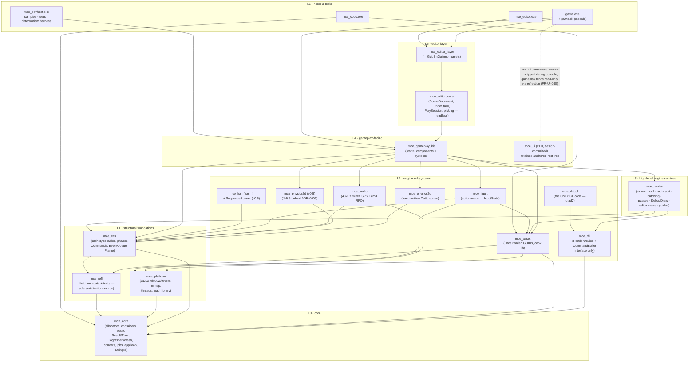
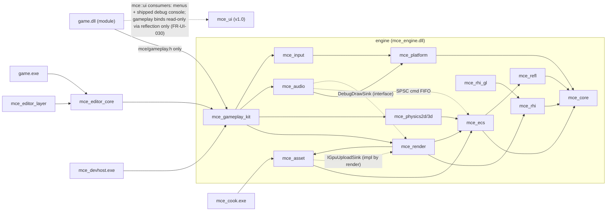
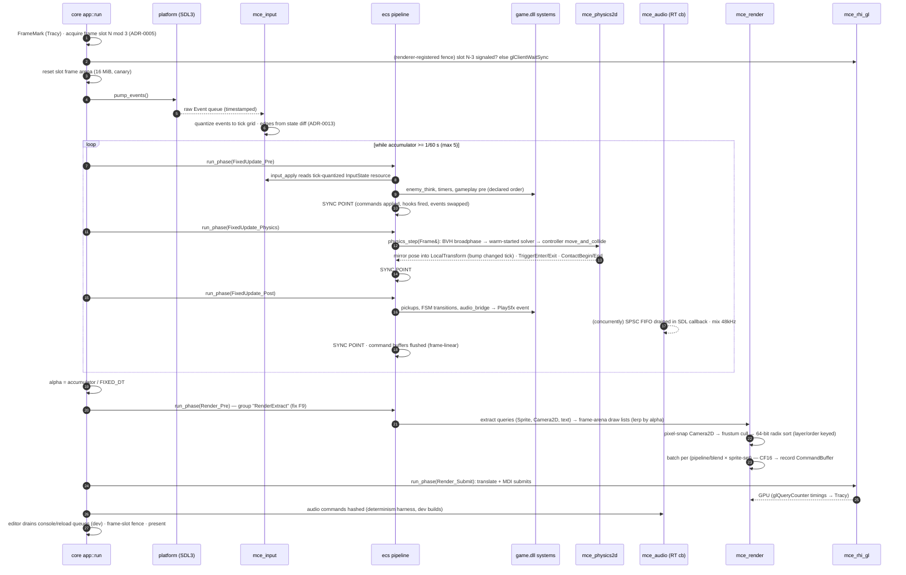
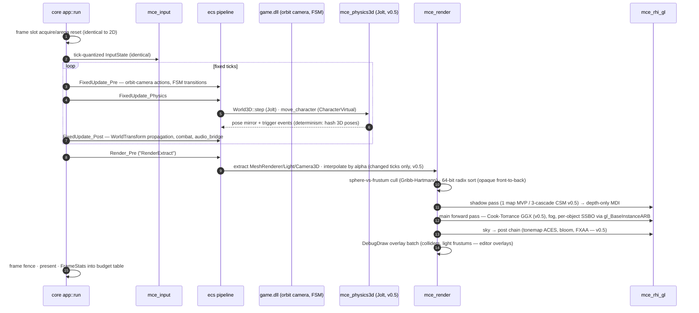
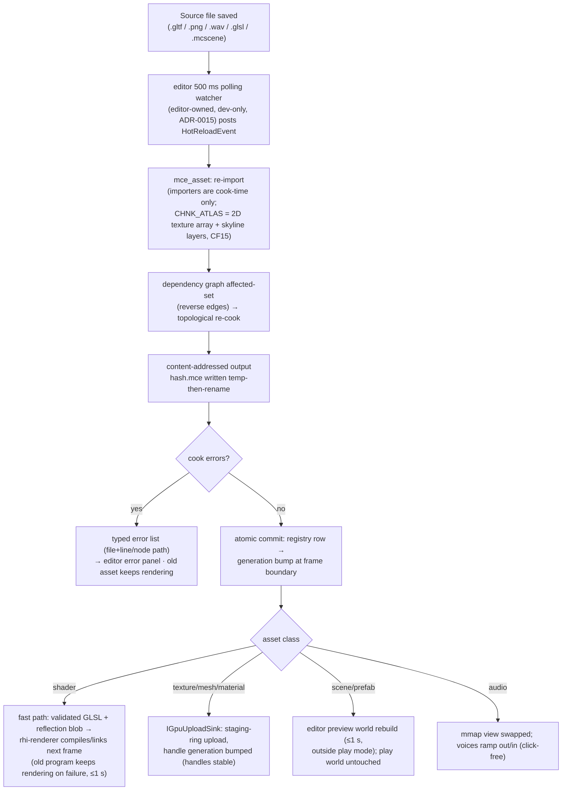
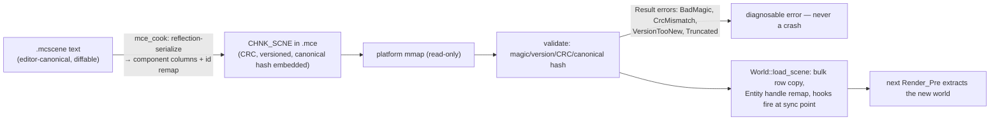

# Mesh Control Engine — Unified System Architecture

**Project:** Mesh Control Engine (MCE) · **Document class:** Architecture — integration (chief document)
**Date:** 2026-10-06 · **Revision 3 (post-integration)** · **Status:** AUTHORITATIVE for cross-subsystem contracts. The eight subsystem docs under `docs/architecture/` remain authoritative for *internal* design; where an internal detail contradicts this document, this document wins and the change is recorded in §5 (Contracts & reconciliation). Every fix below is binding on the subsystem docs.
**Inputs:** `docs/REQUIREMENTS.md` (authoritative), `docs/architecture/{core,rhi-renderer,ecs-gameplay,physics,assets,editor-tools,audio-input-ui,scripting}.md`.
**This revision:** all eight subsystem docs are finalized and state "applies the binding errata from ARCHITECTURE §5.1". The twelve contract fixes of Revision 2 (**F1–F12**) are **verified applied** across every subsystem doc. Reading the finalized docs end-to-end surfaced nine further cross-document mismatches — recorded here as **CF13–CF21** (§5.1) — plus a citation register that disambiguates the two `F#` namespaces now in circulation (fix-register vs findings-register).

---

## 1. Architecture overview

### 1.1 The layered diagram



### 1.2 The layering rules (narrative)

The engine is a **strictly downward-closed DAG of CMake targets**. A module may include only modules below it; the target graph is the rule (`target_link_libraries` is the only include-path mechanism; include directories are per-target, never global), and CI include-greps are the second lock. Five walls carry requirement teeth, plus one test-only wall added by CF13/ADR-0016:

1. **The GL wall** — every `gl*` symbol lives in `mce_rhi_gl` sources only (~2–3k lines). Everything above speaks the abstract `mce_rhi` interface: pipelines, transient resources, recorded `CommandBuffer`, barrier no-ops. CI grep: `gl[A-Z]` outside `src/engine/rhi_gl/` fails the build. This is what keeps a D3D12/Vulkan backend a *translation* (N14), not a rewrite.
2. **The SDL wall** — `SDL_Event` appears only in `mce_platform` (FR-INP-010 grep). The single sanctioned leak is `Window::native_handle()` returning `SDL_Window*` to `mce_rhi_gl` (context creation) and the editor — allowlisted in the CI grep.
3. **The ImGui wall** — ImGui symbols never appear in anything linked by a shipped game. `mce_editor_layer` is the only ImGui consumer; CI symbol-scans the shipped `game.exe`/`mce_engine.dll` (FR-UI-048). There is no `#ifdef MCE_EDITOR` anywhere in runtime code — the wall is a *link error*, not a preprocessor branch.
4. **The JPH wall** (v0.5) — `JPH::` symbols appear only inside `mce_physics3d`, exactly like the GL wall (CI grep). Components are core-math plain structs; physics leaks types in neither direction (physics.md D7).
5. **The gameplay module wall** — game code includes exactly one umbrella, `mce/gameplay.h` (the FR-DX-010 12-type budget), and links only the `mce_module_api` interface target. It cannot see `SDL_Event`, GL, JSON, or ImGui — compiler-enforced, not convention.
6. **The Box2D wall** (test-time, CF13/ADR-0016) — `b2*`/Box2D symbols are legal **only** in `test_physics2d`. Box2D v3 is a *test-time oracle* — the physics twin of the DirectXMath math oracle — never linked into runtime, editor, cook, or shipped targets (CI grep).

Two of the apparent back-edges in the diagram are sanctioned **inverted interfaces** (the interface is defined low, implemented high, so the include direction still points down): `IGpuUploadSink` (defined in `mce_asset`, implemented by `mce_render` — fix F6) and `IDebugDrawSink` (defined in `mce_ecs`, filled by physics, implemented by the renderer — fix F5). The third seam of the same class is the `FrameSlotFence` protocol (core-defined, renderer-registered, headless stub always-signaled).

Above the walls sit three composition principles (P6 — one path, thin seams):

- **One loop.** `mce::app::run()` (core, *Fix Your Timestep* — Gaffer On Games) is the only loop in the engine. The editor runs it; `game.exe` runs it; the headless determinism harness runs it with a no-op fence and zero GL symbols loaded (FR-RUN-025). No subsystem spins its own thread loop except the SDL audio callback and the single IO worker.
- **One scene truth.** The editor's `SceneDocument` is canonical; cooking produces immutable columnar `.mce` scene chunks; the runtime *instantiates* them and never mutates the canonical scene (FR-ENT-060). Play-in-editor, run-in-player, and the shipped game all reach a running world through the same `load_scene` path.
- **One frame-memory discipline.** Everything per-frame comes from the frame-linear allocator in the frame-slot ring; everything cross-frame is a persistent arena, a pool, or a generational handle. "When is it safe to overwrite last frame's memory" has one answer for the whole engine: after the fence for slot *N−MCE_FRAMES_IN_FLIGHT* signals (§6).

**What is deliberately absent at MVP:** no frame graph (fixed hand-authored pass list per view with pooled transients — rhi-renderer D3), no scheduler (explicit phase pipeline only; auto-parallel is an M3+ flag-gated experiment gated by the determinism CI test), no scripting VM, no observers/relationship pairs, no second render path ("old/new systems" is the solo-engine death pattern — P6).

---

## 2. Module map

### 2.1 Module table

| Module | Directory | Layer | Depends on | One-line responsibility |
|---|---|---|---|---|
| `mce_core` | `src/engine/core` | L0 | (STL subset, spdlog, Tracy) | Allocators, containers, math, `Result`/`Error`, logging/asserts/crash, convars, jobs, the app loop, frame slots |
| `mce_platform` | `src/engine/platform` | L1 | core | SDL3 window/event pump, filesystem + mmap, threads/TLS, `load_library`, the `SDL_Event` quarantine |
| `mce_refl` | `src/engine/refl` | L1 | core | Generic field/trait metadata registry; the *sole* source of component field metadata (fix F4) |
| `mce_ecs` | `src/engine/ecs` | L1 | core, refl | Archetype tables, generational entities, phases + sync points, `Commands`, `EventQueue<T>`, `Frame`, `World::state_hash` |
| `mce_rhi` | `src/engine/rhi` | L2 | core | RenderDevice + recorded CommandBuffer interface (no GL) |
| `mce_rhi_gl` | `src/engine/rhi_gl` | L2 | rhi, platform (window handle) | The only GL 4.5 code: DSA, persistent-mapped rings, MDI, fences |
| `mce_asset` | `src/engine/asset` | L2 | core, refl, platform | `.mce` container reader, GUID registry, cook library, hot-reload commit machinery, `IGpuUploadSink` (fix F6) |
| `mce_physics2d` | `src/engine/physics2d` | L2 | core, ecs | Hand-written Catto-style 2D world: solver, character controller, queries, events |
| `mce_physics3d` (v0.5) | `src/engine/physics3d` | L2 | core, ecs | `World3D` facade over embedded Jolt 5 (ADR-0003 gate before first include) |
| `mce_audio` | `src/engine/audio` | L2 | core, platform, ecs | 48 kHz float32 mixer on the SDL3 callback; SPSC command FIFO; voices/buses; streaming music |
| `mce_input` | `src/engine/input` | L2 | core, platform, asset, ecs | Action maps (cooked chunk) → tick-quantized `InputState` snapshots; record/replay streams |
| `mce_render` | `src/engine/render` | L3 | core, ecs, asset, rhi, rhi_gl | Extract/cull/sort/batch, 2D+3D passes, DebugDraw, editor views, picking, golden capture |
| `mce_gameplay_kit` | `src/engine/kit` | L4 | L0–L3 | FR-ENT-080 starter components/systems; the 12-type gameplay surface consumers actually touch |
| `mce_ui` (v1.0) | `src/engine/ui` | L4 | L0–L3 | Retained anchored-rect runtime UI rendered through the 2D MDI batch (FR-UI-020; design doc is an **M4 deliverable** — CF21) |
| `mce_engine` (dll) | `src/module` | L5 | all of L0–L4 | The umbrella shared library: exports `mce::` gameplay API, carries `MCE_ENGINE_ID`, hosts the game-module loader (fix F8) |
| `mce_editor_core` | `src/editor/core` | L5 | mce_engine | Headless editor logic: `SceneDocument` + `SceneCommand` funnel, `UndoStack`, `SelectionSet`, picking, `PlaySession` — CI-testable with no ImGui |
| `mce_editor_layer` | `src/editor/layer` | L5 | mce_editor_core, ImGui | The only ImGui consumer: panels, viewport widget, gizmos, console; implements `DrawCtx` |
| `game.dll` | `games/<game>/module` | L6 | `mce_module_api` (import lib of mce_engine) | The game module: `mce_game_module()` returning `ModuleInfo{install(World&)}` |
| `game.exe` | `games/<game>/host` | L6 | mce_engine | Thin shipped host: boots, loads `game.dll` (copy-and-load), runs the app loop |
| `mce_editor.exe` | `src/editor/app` | L6 | mce_editor_layer, mce_engine | Docking editor application |
| `mce_cook.exe` | `tools/cook` | L6 | mce_asset, core | CLI cook: scan → graph → topological cook → content-addressed outputs, CI exit codes |
| `mce_devhost.exe` | `tests/devhost` | L6 | L0–L4 | Sample ladder host, determinism harness, crash-test, golden runner |

### 2.2 Dependency graph (data-flow annotated)



Notes on the edges that people get wrong:

- **assets → ecs, not the reverse.** Scene chunks are component columns laid out per the ECS registration contract; `mce_asset` includes `mce_ecs`/`mce_refl` to type them. The renderer consumes asset *blobs* — include direction `mce_render → mce_asset` only. The one apparent back-edge (GPU upload on hot reload) is the inverted interface `IGpuUploadSink`, defined in `mce_asset`, implemented by `mce_render` (fix F6).
- **physics → ecs, never → render.** Physics fills an `IDebugDrawSink` interface (defined in `mce_ecs` next to the other shared interfaces, fix F5); the renderer implements it; the composition point registers the implementation as a World resource.
- **audio/input → ecs only for lifecycle and resources.** Both register ordinary systems/phases; neither includes render, physics, or assets beyond cooked-chunk views.

---

## 3. One frame in the life of the engine

The loop below is `mce::app::run()` (core) driving the ECS phase pipeline (ecs-gameplay §2.4). Both diagrams show the same 16.67 ms frame at 60 Hz with one sim tick; catch-up steps (0–5) repeat the fixed-tick block. Catch-up is clamped at 5; `time_scale` scales accumulator inflow only (determinism-preserving, FR-RUN-050).

### 3.1 A frame in a 2D scene (Ember Step, Artifact A)



### 3.2 A frame in a 3D scene (Ashen Court diorama, Artifact B)

Differences from the 2D frame; everything else is identical (one path, P6):



Camera and light interpretation is the renderer's job (Cameras are kit components; the renderer owns *interpretation*); the primary camera is the `ActiveCamera` **world resource**, not a component. On the dev machine every stage above is a Tracy zone and the per-stage FrameStats feed the milestone budget tables (NFR-F-01/02, FR-DBG-010).

---

## 4. End-to-end flows

### 4.1 Asset import → cook → hot reload



Load-bearing details: cooked outputs are **content-addressed**, which makes the incremental cook a set-union and makes Windows rename-over-open-mmap a non-problem (assets.md D2); hot reload commits are all-or-nothing and single-threaded; the shipped runtime contains no watcher, no importer, no JSON (FR-AST-010 symbol scan). Failure is typed per class (magenta checker, empty mesh, 1 s silence, fallback material) — never a crash, never a white void (FR-DX-050). The shader MVP slice is a single default variant per family (finding F9); variant enumeration + stored SPIR-V reflection blob arrive at v0.5.

### 4.2 Editor play mode enter / exit (v0.5 play-in-editor; MVP is run-in-player)

```mermaid
sequenceDiagram
    autonumber
    participant UI as editor_layer (ImGui)
    participant EC as editor_core
    participant Doc as SceneDocument (canonical)
    participant Loader as mce_engine module loader
    participant W as PlayWorld (ECS)
    participant Ren as renderer

    UI->>EC: PlaySession::enter()
    EC->>Doc: serialize current SceneDocument state
    EC->>EC: cook scene → temp .mce (same cook lib as mce_cook)
    EC->>Loader: load_game_module(game.dll) — copy-and-load,<br/>engine_id gate, diagnosable errors
    EC->>W: load_scene(chunk) — the runtime's single load path
    W->>W: Startup phase (deterministic, hash recorded = tick 0)
    EC->>Ren: swap EditorView source: preview world → play world
    Note over UI,W: budget ≤ 1 s (NFR-M-03); edits during play go to<br/>PlayWorld only and are discarded on stop (FR-EDT-060)
    UI->>EC: pause / single-step / slow-mo (time_scale convar)
    UI->>EC: PlaySession::stop()
    EC->>W: teardown: hooks fire, voices leak-assert, GPU objects reaped after fence
    EC->>Loader: FreeLibrary (game_loaded.dll copy released)
    EC->>Ren: swap back to preview world (never mutated during play)
    Note over EC,W: Play→Stop→Play twice ⇒ identical first-tick hash<br/>(reuses FR-RUN-040 harness)
```

At MVP the same flow stops after step 6 and runs it in a child `game.exe` over a temp-cooked pack (Appendix A4). The play world can never receive editor-registered systems — no such API exists (editor-tools.md D6).

### 4.3 Scene load (the single path)



The same `load_scene` call serves boot, scene-stack transitions (FR-RUN-030), play-in-editor, and prefab template instantiation (v0.5) — one path (P6). Scene save→cook→load→hash equals the editor reference hash (FR-ENT-060). Canonical scene extension is **`.mcscene`** everywhere, including autosave files (`<scene>.mcscene.autosave` — CF18).

---

## 5. Interface contracts & reconciliation

### 5.1 Contract reconciliation

**Two namespaces are in circulation across the docs, and this revision fixes them so every citation resolves.** The fix-register rows ("fix F#") are cross-subsystem contract changes issued by this document; the findings-register rows ("finding F#") are the per-document review register that re-tiered scope (cited by REQUIREMENTS and the subsystem docs). The word — *fix* vs *finding* — is the disambiguator; both registers are listed here in full.

**Citation protocol (binding on every document in the set):**
1. `fix F#` cites the **fix register** in this section (F1–F12, CF13+).
2. `finding F#` cites the **canonical findings register** in this section.
3. A bare `finding N` (no F, no prefix) cites the **citing document's own review register** — each subsystem doc carries one; it is doc-local by definition and never crosses documents.
4. `ROADMAP finding F##` cites **ROADMAP's own finding/slip register** — the F## namespace there is ROADMAP-local, not this section's.
5. Citing a finding that lives in *another* document requires that document's prefix (`ROADMAP finding F28`, `physics finding F5`). A bare `finding F#` that does not resolve to the register above is a defect in the citing document.

**Fix register — status after the 2026-10-06 integration pass (all eight subsystem docs state "applies the binding errata from ARCHITECTURE §5.1"):**

| # | Conflict found | Fix (authoritative) |
|---|---|---|
| F1 | **Frame-slot ring depth:** `core.md` fixes a ×3 frame-slot ring (`N mod 3`, fence for N−3); `rhi-renderer.md` sketches `framesInFlight = 2` ("3 if Tracy shows stalls"). | One engine-wide constant `MCE_FRAMES_IN_FLIGHT = 3`, defined in `mce_core`, consumed by core's frame arenas *and* the RHI staging rings/fences. Lowering to 2 is a measured convar change requiring a one-page ADR and both docs updated. Renderer sketch superseded. **Applied** — core.md §5, rhi-renderer.md §2. |
| F2 | `TickContext` carries `input::ActionSnapshot` (core.md §2.1) while every consumer doc says `mce::input::InputState`. | Canonical name is **`mce::input::InputState`**; `using ActionSnapshot = InputState;` alias retained in core so the core doc stays valid. **Applied** — core.md §2.1, audio-input-ui.md §0. |
| F3 | Two per-tick context types: core's `TickContext` vs the `Frame&` every system actually receives. | **`Frame` (mce_ecs) is the per-tick context of record** for all systems. Core's `TickContext` shrinks to the app-shell payload (dt, tick_index, alpha, `InputState` ref) from which the World builds `Frame`. **Applied** — core.md, ecs-gameplay.md, physics.md §2.4. |
| F4 | Reflection has no home: core.md's layer table omits it; ecs-gameplay both "provides" `MCE_COMPONENT` and "requires" reflection; assets requires "the reflection trait system". | New **`mce_refl`** module at L1 (generic field/trait registry, `MCE_COMPONENT` macros, property paths). ecs builds on it; asset (serialization), editor (inspector), audio (rebinding), ui (binding) consume it. One metadata source. **Applied** — core.md, assets.md §9.2, audio-input-ui.md §5.1. |
| F5 | **Debug-draw seam contradiction:** physics defines and fills its own sink and never includes renderer headers; rhi-renderer said physics "draws through DebugDraw during extract" (physics → renderer include). | `mce::debug::IDebugDrawSink` defined in **`mce_ecs`**; physics fills it during extract; `mce_render`'s DebugDraw *implements* it; composition point registers it as a World resource; an engine-owned sink-pump system in `Render_Pre` drains it into the debug line batch. **Applied** — ecs-gameplay.md, physics.md §5.1, rhi-renderer.md. |
| F6 | **Assets↔renderer upload direction:** assets required "staging-ring upload and GPU object creation" from the renderer while forbidding assets → renderer includes — a latent circular dependency. | Dependency inversion: `mce::asset::IGpuUploadSink` (abstract, in `mce_asset`): `upload_mesh/upload_texture/update_material/destroy_gpu_objects`. `mce_render` implements it, registers at `Renderer::init`. Include direction remains `mce_render → mce_asset`. **Applied** — assets.md §7.1/§9.2, rhi-renderer.md §2. |
| F7 | Editor naming: core.md had one `mce_editor` (L5); editor-tools split three targets. | Three targets, fixed: **`mce_editor_core`** (headless; CI-tested, no ImGui), **`mce_editor_layer`** (only ImGui/ImGuizmo consumer), **`mce_editor`** (the exe). **Applied** — editor-tools.md §2.1. |
| F8 | Runtime naming: core said `mce_runtime` (host exe); scripting said `mce_engine.dll`; editor-tools said "editor links mce_runtime". An exe cannot be linked. | **`mce_engine.dll`** is the umbrella shared library aggregating L0–L4; `game.exe` and `mce_editor.exe` link its import lib; `game.dll` links it too (one CRT, one engine instance). "mce_runtime" survives only as the *collective name* for the ImGui-free engine library set — the CI symbol scan runs against `mce_engine.dll`. **Applied** — editor-tools.md §3.5, scripting.md §3.1, audio-input-ui.md §6.3. |
| F9 | Phase naming: rhi-renderer required "a `RenderExtract` phase slot"; ecs-gameplay fixed the phase enum with no registerable per-render gameplay phase. | The enum stays fixed. **`Render_Pre` hosts exactly the renderer-registered extract chain as the declared system group named "RenderExtract"** — a group name inside `Render_Pre`, not a new phase; gameplay still cannot register into any render phase. **Applied** — ecs-gameplay.md phases, rhi-renderer.md pass lists. |
| F10 | Editor event fan-in: editor-tools posts events from ≥2 threads but core's container list only had an SPSC `RingBuffer`. | Core gains **`MpScQueue<T>`** (bounded Vykov MPMC used as MPSC; intrusive unbounded variant). Consumers: editor event pump, log fan-out, asset commit queue. **Applied** — core.md containers, assets.md §8.1, editor-tools.md §4.1. |
| F11 | Core.md layer table missing `mce_input`, `mce_physics3d`, `mce_ui`, and the `mce_engine` umbrella. | Layer table in this document (§2.1) is authoritative. **Applied** — core.md §1.3. |
| F12 | Hot-reload watcher ownership ambiguity: assets started at "watcher → re-import"; editor-tools said the editor runs the watcher. | **Watcher is editor-owned** (500 ms mtime poll on the IO worker, ADR-0015; shipped runtime has none, so FR-RUN-010 stays true). `mce_asset` owns everything after the event: re-import, re-cook, atomic commit, generation bump. **Applied** — assets.md §7.5, editor-tools.md §4.1. |

**New fixes made this revision (CF13–CF21)** — each resolves a cross-document mismatch found while reading the eight finalized subsystem docs end-to-end:

| # | Mismatch found | Resolution (binding) |
|---|---|---|
| CF13 | physics.md D9 adopts **Box2D v3 as a test-time behavior oracle** (linked into `test_physics2d` only), while the old tech-stack line said "Box2D never linked" in a way that read as *never linked at all*. | Tech stack (§7) restated: Box2D v3 is a **test-time-only dependency class** (same class as glslangValidator/DirectXMath oracles): legal only in `test_physics2d`, never in runtime/editor/cook/shipped targets. Oracle scene diffs (drop/slide/restitution/pyramid-lite/platform-ride, documented tolerances) run locally and in the nightly lane; per-PR determinism stays on the in-house solver + hand-computed cases. |
| CF14 | **ADR index collision:** physics.md cites "ADR-0004" for the Box2D oracle (and names `docs/adr/0004-box2d-test-oracle.md`) while ADR-0004 is already "archetype tables over sparse sets" (cited by ecs-gameplay.md and core.md). | Archetype tables keep ADR-0004; the Box2D test oracle is appended as **ADR-0016** (`docs/adr/0016-box2d-test-oracle.md`). Erratum: physics.md's four "ADR-0004" citations read as ADR-0016. No other ADR numbers move (Jolt = ADR-0003, editor targets = ADR-0008, watcher = ADR-0015). |
| CF15 | Atlas chunk wording: assets.md §2/§5.2 describe `CHNK_ATLAS` as "MaxRects packing → page texture"; rhi-renderer.md commits the 2D **texture-array** atlas with per-page **Skyline** layer assignment and a vertex-carried layer byte (and already flags the MaxRects wording as stale). | `CHNK_ATLAS` = 2D texture array + skyline layer assignment, deterministic source order (sorted by GUID then name); sprite quads carry the array layer in the vertex (SpriteVertex bits [7:0]). assets.md §2/§5.2 wording is superseded by rhi-renderer.md §2.3. |
| CF16 | Old ADR-0006 said "one MDI submit per atlas page (2D)"; the refined FR-R2D-010 contract (rhi-renderer.md) batches by pipeline/blend state across the whole sprite set. | ADR-0006 restated: one MDI submit per **(pipeline/blend state × sprite-set)**; the atlas page is a texture binding, not a batch boundary. 10k-sprite budget unchanged (p99 < 4 ms GPU). |
| CF17 | Project-root naming drift: editor-tools.md says `EditorDesc.project_path` = "folder with `<project>.mceproj` + `content/`" (watcher polls `content/`); assets.md §4.4 (normative layout) has no `.mceproj` and names the source tree `assets/`. | Canonical project root = `<project>.mceproj` + `assets/` (source tree, mounted `source://`) + `cooked/` (git-ignored, disposable) + `games/<game>/{module,host}` + shipped `assets.mce`. editor-tools' `content/` references → `assets/`; assets.md §4.4 gains the `<project>.mceproj` marker line (stamped by the M8 new-project generator). |
| CF18 | Scene file extension drift: assets.md commits `.mcscene`; editor-tools.md autosave writes `scene.mcescene.autosave`. | Canonical extension is **`.mcscene`** everywhere; the autosave file is `<scene>.mcscene.autosave` (atomic temp-write + rename; recovery prompt on launch per FR-EDT-100). editor-tools.md §3.4 erratum. |
| CF19 | Physics facade naming drift: scripting.md §2.7 sketches `PhysicsWorld2D`, `ControllerParams`, `ControllerResult{grounded_now, impact_speed}`; audio-input-ui.md cites a `TriggerEntered` event. physics.md's committed facade is `World2D/World3D`, `MoveResult2D{flags, groundNormal, platformVelocity, hitCeiling}`, and `TriggerEnter`/`TriggerExit`. | Canonical names: `mce::physics::World2D`/`World3D`, `MoveResult2D`/`MoveResult3D`, `TriggerEnter`/`TriggerExit`, `ContactBegin2D/End2D` (physics.md §2.2/§2.3). The scripting.md §2.7 player sketch predates the facade rename and is illustrative only; controller gravity/params live in world config + `CharacterController2D`, not a per-call params struct. Erratum: audio-input-ui.md's two `TriggerEntered` citations read `TriggerEnter` (2026-10-06); physics.md §2.1 is the single component/event-name register. |
| CF20 | Scene-component naming drift: assets.md §6 example serializes a `BoxCollider2D` component; physics.md's committed set is `RigidBody2D` + `Collider2D{ColliderShape = Box2 \| Circle2 \| Convex2}` (renamed to avoid colliding with the Box2D oracle's vocabulary, physics D9). | `.mcscene` examples and cook validation use `Collider2D` with the shape-variant fields; physics-local shape structs are `Box2`/`Circle2`/`Convex2` (thin wrappers over core math). assets.md §6 example is superseded as illustration. |
| CF21 | `mce_ui` design-doc scheduling drift: audio-input-ui.md §8 says the design is "finalized during M8", but REQUIREMENTS FR-UI-020 pins "design doc at M4; build at v1.0" (audio-input-ui.md §1.3 already follows that). | FR-UI-020 stands: the **mce_ui design doc is an M4 deliverable** (audio-input-ui.md §2.5's design commitment is its seed); the **build is M8/v1.0** (A9: MVP/v0.5 games ship scene-state menus + text sprites). audio-input-ui.md §8 erratum; ROADMAP M4 carries the design doc, M8 the build + RmlUi fallback trigger. |

**Findings register (canonical — "finding F#" citations across REQUIREMENTS and the subsystem docs resolve here):**

| Finding | Content (as applied) |
|---|---|
| finding F2 | Sample-accurate audio `play_at` scheduling deferred from MVP to v0.5; MVP ships 60 Hz command granularity (audio-input-ui.md §8, ROADMAP M3/M6). |
| finding F3 | MVP tier rebalanced to ROADMAP M0–M4 + M3.5 stretch (REQUIREMENTS §6). |
| finding F4/F5 | Editor re-baseline: reflection inspector + save/load at M2; entity CRUD/gizmos/pickers at M3; M0 ships shell + viewport + console over a stub world (editor-tools.md §1.3/§8). |
| finding F6 | MVP asset/entity reference pickers = GUID field + type-filtered dropdown from the registry scan (editor-tools.md §2.6). |
| finding F7 | UC-D may slip to a named v1.1; v1.0 closes at the M8 gate (REQUIREMENTS §6, ROADMAP M9 fallback). |
| finding F8 | Cook tool tiers at M2 with cook-determinism CI from its first PR (assets.md §10). |
| finding F9 | MVP shader cook = single default variant per family; variant enumeration + stored SPIR-V reflection blob deferred to v0.5 (assets.md §5.2). |
| finding F11 | MSVC template/ABI rule for the DLL boundary: no function-local statics in engine templates; explicit `dllexport` instantiations for every FR-DX-010 budget type; ComponentId-identity CI test from M3 (scripting.md §3.1). |
| finding F13 | One-shot audio latency gate split: CI-gated engine segment (enqueue-to-mix ≤ 25 ms on the fake device) + informational device loopback with `audio.device_latency_ms` (audio-input-ui.md §6.2.7). |
| finding F15 | `Renderer::captureNextFrame(mce::StringView)` keeps MCE types out of the RHI's public seam (rhi-renderer.md). |
| finding F16 | NFR-M-05b shipped-build soak runs on a clean VM with no sanitizer instrumentation, matching ROADMAP M4 (REQUIREMENTS). |
| finding F17 | The module template + new-project generator ships at M8 and is the only sanctioned way to start a game project (scripting.md §1.1/§8, ROADMAP M8). |

(Findings F1, F10, F12, F14 are retired from the findings namespace to keep the two registers collision-free; where those numbers appear in older drafts they are covered by fix-register rows or by the owning document's own errata.)

Additionally clarified (not conflicts): the `Requires: editor-tools: view size/DPI, camera state…` line in `rhi-renderer.md` and the mirror-image line in `assets.md` are **data-flow descriptions, not include directions** — renderer and assets expose APIs that the editor *calls*; neither includes editor headers. The determinism harness composition is fixed here: `World::state_hash` (ecs) is the entry point; physics (poses), audio (command stream), renderer (draw-order key hash, separate test), and input (post-quantization `InputState` stream = artifact of record) register per-subsystem hashers into it, composed by the `mce_devhost` harness (FR-RUN-040/070).

### 5.2 Reconciled cross-subsystem interface contract table

Owner = the module that defines and evolves the API. Consumers list who may call it. Direction is include-direction unless marked *(data)* = event/data flow, *(impl)* = interface implemented elsewhere via dependency inversion.

| API | Owner | Consumers | Notes |
|---|---|---|---|
| `mem::IAllocator`, `mem::frame()/heap()`, `Pool<T>`, `LifoArena`, `ArenaScope` | core | all L1+ | no hidden allocation; hot paths frame-arena only (NFR-F-03) |
| `Handle<Tag>` / `HandleTable<T>` | core | assets, audio, physics, ecs (pattern), editor | the only legal cross-frame engine reference type |
| `Array/SmallVector/FixedArray/HashMap/FlatMap/RingBuffer/MpScQueue/BitSet/StringId/FixedString` | core | all | `std::unordered_map`/`std::vector` banned in engine targets (CI grep) |
| `math::vec2/3/4, mat4, quat, aabb2/3, Color` + ops | core | all | RH/Y-up/meters/column-major; DirectXMath oracle tests |
| `Result<T,Error>`, `Errc`, `MCE_TRY`, `MCE_ASSERT/VERIFY` | core | all | two failure categories only (FR-DX-050) |
| `MCE_LOG_*`, breadcrumb ring, crash handler + minidump, build ID | core | all | hot-path logging banned; shipped sinks = file only |
| convar/confunc registry (`MCE_CVAR/MCE_CONFUNC`) | core | all; editor console + shipped debug console (FR-UI-045) | static registrar pattern |
| `app::Application`, `app::run()`, `StateStack<T>`, `TickContext`, frame-slot fence protocol | core | game.exe, mce_editor.exe, mce_devhost | the only loop; headless = no-op fence |
| `platform::Window/native_handle/framebuffer_size`, `pump_events/Event` | platform | rhi_gl (handle only), editor_layer, input | SDL wall |
| `platform::filesystem` (`read_file/write_file/map_file_readonly`, mounts `content:// source:// save://` — `content://` maps to the project's `assets/` tree per CF17) | platform | assets, audio (stream pages), ecs (saves via assets) | |
| `platform::spawn_thread, load_library, now_us/now_seconds` | platform | audio (thread), editor (watch), scripting (DLL load), Tracy/RenderDoc hooks | |
| `refl::TypeRecord/FieldRecord`, traits, property paths, `MCE_COMPONENT` | refl | ecs, assets (serialization), editor (inspector/undo), audio (rebinding), ui (binding) | sole metadata source (F4) |
| `World`, `Entity`, `Commands`, `EventQueue<T>`/`EventWriter`, `Frame`, `Phase` enum, `MCE_SYSTEM`, queries | ecs | kit, physics, audio, input, scripting, render (extract), editor_core | gameplay never sees SDL/GL/JSON/ImGui (CI) |
| lifecycle hooks `on_add/on_remove/on_set` at sync points | ecs | physics (body lifecycle), audio (voice cleanup), render (material residency) | applied in fixed order at sync points |
| `World::state_hash(seed)`, `World::metrics` | ecs | devhost harness (hash), editor panels (metrics) | FR-RUN-040 / fragmentation watch |
| `SceneStack`/`SceneState` (World-scoped), `load_scene` | ecs (instantiation) | game hosts, editor PlaySession | core owns generic `StateStack<T>`; ECS provides the scene-typed wrapper |
| `RenderDevice`, `CommandBuffer`, buffer/texture/pipeline/sampler handles, `beginFrame/endFrame(slot)` | rhi | render only (plus nothing else) | GL-callable code confined to rhi_gl |
| staging rings (vertex/uniform/indirect/object-SSBO), MDI, `gl_BaseInstanceARB` object data | rhi_gl | render | `MCE_FRAMES_IN_FLIGHT = 3` per F1 |
| shader compile + hot-reload swap (≤1 s), binding-bank convention | rhi_gl (impl), render (policy) | assets (validated source + reflection blob handed over) | old program keeps rendering |
| `DebugDraw` (lines, wire shapes, frusta, screen text) | render | editor_layer, physics *via* `IDebugDrawSink` (F5), kit (dev overlays) | zero-draw-cost when idle |
| `RenderExtract` system group inside `Render_Pre` | render (registers), ecs (owns phase) | — | F9 |
| `EditorView` targets (offscreen DPI-correct), `pick2D/pick3D`, golden capture, GPU timing | render | editor_layer | editor is the renderer's client; render never includes editor |
| `AssetSystem` facade (`mount/load_sync/retain/release/commit_reload`), `AssetHandle<T>`/`AssetRef<T>` | asset | kit components, render (blob→GPU), audio (CHNK_SFX/AUDP), input (CHNK_INPUT), editor_core | sync-only at MVP; async SPSC commit queue at v0.5 |
| `.mce` container reader (header/TOC/CRC), GUID registry + `.mceasset` sidecars | asset | runtime mmap load, cook tool, editor browser | one reader, three mounts |
| cook library (scan, dep graph, topological cook, content-addressed outputs, error list) | asset | mce_cook.exe, editor cook button, CI | deterministic outputs (FR-AST-030) |
| `IGpuUploadSink` | asset (defines) / render (implements) *(impl)* | asset hot-reload commit | F6 |
| `AssetReloaded/AssetUnloading` events, cook `ErrorList` | asset *(data)* | render, editor_core, devhost | frame-boundary commit |
| `World2D` facade (`step/move_and_collide/teleport/queries`), `MoveResult2D`, `DebugDrawSink` fill, `hash_state` | physics2d | kit systems, module systems, editor picking refinement, devhost harness | transform authority: physics owns bodied pose during play (D2); CF19 names |
| `World3D` facade (Jolt): `move_character`, `camera_sweep` (v0.5) | physics3d | kit, module systems, editor camera-collision gate | ADR-0003 before first JPH include |
| `TriggerEnter/Exit`, `ContactBegin2D/End2D` (+ 3D twins) | physics *(data)* | kit, module systems, audio bridge | pair-diff emission; per-tick caps + convar (CF19 names) |
| `input::InputState` (per-tick snapshot resource), action maps, `record_tick/replay_tick` | input | ecs resource consumers, TickContext (F2), devhost replay harness | tick-quantized; replay stream = determinism artifact |
| `AudioDevice` (`play/play_at(v0.5)/stop/set_handle_gain/set_bus_gain/set_listener/attach_dsp(v0.5)/stats`), voice pool, SPSC command FIFO | audio | kit `AudioSource` bridge system, editor mixer panel | RT callback: zero alloc/lock (Doumler); sample-accurate `play_at` at v0.5 (finding F2) |
| `audio_bridge` system, `AudioSource/AudioListener` components | audio (system), kit (components) | ecs `FixedUpdate_Post` | only ECS→audio translator |
| `mce::ui` retained tree (v1.0) | ui | game modules, shipped debug console | rendered through the 2D MDI batch; gameplay never imports mce_ui (FR-UI-030); design doc at M4, build at M8 (CF21) |
| `mce_game_module()` → `ModuleInfo`, `load_game_module/unload_game_module`, `mce/gameplay.h`, `mce/fsm.h` | scripting | game.dll (author), game.exe + editor PlaySession (host side) | copy-and-load; `MCE_ENGINE_ID` gate |
| `SequenceRunner`/`TimelinePlayer` runtimes, registration records (systems/phases/events/FSM tables) | scripting | editor pipeline/FSM/sequence views | ordinary `FixedUpdate_Post` systems; lite subset at M3 |
| `SceneDocument::apply`, `SceneCommand`, `UndoStack`, `SelectionSet`, `PlaySession`, headless picking | editor_core | editor_layer only | all four mutation effects through one funnel |
| `DrawCtx` widget seam | editor_layer (implements), editor_core (consumes) | — | editor_core tests with zero ImGui |

---

## 6. Threading & memory model (whole engine)

### 6.1 Thread roster (complete — five steady-state threads, ever)

| Thread | Owner | Runs | Rules |
|---|---|---|---|
| **Main** | core | sim + render + editor + ECS, all of it through v1.0 | owns GL context, ECS worlds, document/undo, command recording; the only thread that mutates the registry, asset tables, or scene structure |
| **Audio (SDL callback)** | audio | continuous mix | RT rules (Doumler): no locks, no allocations, no syscalls, no ECS; in = SPSC POD command FIFO + 2 atomic snapshots (bus gains, listener); out = mixed 48 kHz float32 |
| **IO worker** | platform | one thread | completion-queue driven: cook steps (M2), music page prefetch, editor file-watch polling; no GL, no ECS access |
| **Job workers ×N−1** | core jobs | M3+ only, flag-gated | fork-join counters; serial inline implementation until M3 so call sites are written once |
| **Cook worker** | assets (via job system) | during cook | one thread at MVP; posts progress/errors to the main thread over `MpScQueue` (F10) |

Cross-thread communication is exclusively: SPSC `RingBuffer` (audio commands, log ring), `MpScQueue` (editor/cook events), atomics (audio snapshots, stream `filled_upto`), and frame fences. No mutex is ever held across a subsystem boundary; the audio hot path has none. Module code (`game.dll`) never leaves the main thread — which is what keeps the M3+ auto-parallel experiment a zero-change option for gameplay code.

### 6.2 Memory map

| Region | Owner | Size / policy |
|---|---|---|
| CRT heap (`mem::heap()`) | core | setup-time only: registries, init-time container growth, editor session state, cook file tables; engine hot paths assert-never |
| Frame-slot arenas ×`MCE_FRAMES_IN_FLIGHT` (=3, F1) | core (CPU half) / rhi_gl (fence) | 16 MiB/slot bump allocators, thread-local, canary + debug fill; hold sim command buffers, extract lists, sort keys, batch scratch, ImGui frame data, job contexts; reset after the slot's `glFenceSync` signals |
| RHI staging rings per slot | rhi_gl | vertex 4 MiB / uniform 1 MiB / indirect 256 KiB / object SSBO 4 MiB, persistent-mapped, `glClientWaitSync` on slot reuse; overflow = Tracy warning + temporary extra buffer, never silent corruption |
| Persistent arenas | owning subsystem | level arena (scene lifetime), audio arena (clips, voice pool), asset arena (mmap-backed, `mce_asset`) |
| Physics world pool | physics | 8 MiB default world pool (bodies ≈ 200 B, contacts ≈ 64 B, BVH nodes 48 B); Jolt temp allocator 4 MiB carve-out (v0.5) |
| Cook scratch | assets | LIFO `LifoArena` per cook job (tools-side, not runtime) |
| Replay/rewind ring | devhost (dev builds) | ≤ 64 MiB at sample scale (NFR-M-04) |
| VRAM | renderer | per-milestone budget table; BCn textures at v0.5 (FR-AST-050) |

The single discipline: **core owns the CPU half of the frame slots; the renderer owns the GPU half and signals release** through the `FrameSlotFence` seam. Headless mode substitutes an always-signaled fence and the determinism harness runs the identical loop with zero GL symbols (FR-RUN-025, GL-leak grep).

---

## 7. Technology stack (final)

| Concern | Choice | Version / pin policy | From-scratch? |
|---|---|---|---|
| Language | C++20 | MSVC v143 (VS 2022), `/std:c++20`, `/EHs-c-`, `_HAS_EXCEPTIONS=0`, no RTTI in runtime | — |
| Build | CMake + Ninja | ≥ 3.28 (binding), presets only (`msvc-debug`, `msvc-release`, `msvc-determinism`, `msvc-asan`) | — |
| Package mgmt | vcpkg manifest, pinned baseline | `vcpkg.json` in repo; baseline bumped only by ADR | — |
| Window/input/platform | SDL3 | latest stable at M0, pinned (core R1 fallback: vendor under `third_party/`) | wrapped |
| Graphics API | OpenGL 4.5 Core (DSA, persistent-mapped rings, MDI) | driver on dev machine; loader = **glad2** | loader is boilerplate |
| RHI | `mce_rhi` + `mce_rhi_gl` | — | **hand-written** |
| Renderer | `mce_render` (forward, MDI batching, radix sort) | — | **hand-written** |
| ECS | `mce_ecs` (archetype tables) | — | **hand-written** (flecs-3/EnTT/Bevy studied, never linked) |
| Math | `mce::math` scalar-first | DirectXMath as *test oracle only* | **hand-written** |
| 2D physics | `mce_physics2d` (sequential impulse, Catto) | hand-computed cases + **Box2D v3 as test-time oracle (CF13, ADR-0016)** | **hand-written** |
| 2D physics oracle | Box2D v3 — **test-time only**, linked into `test_physics2d` exclusively | vcpkg-pinned; CI greps `b2*` symbols everywhere else | dependency (test lane) |
| 3D physics | Jolt 5 (v0.5, ADR-0003) | Jolt 5.x pinned, vendored or vcpkg | embedded (pre-approved exception) |
| Audio | `mce_audio` mixer on SDL3 callback | RBJ cookbook / Freeverb as paper oracles | **hand-written** |
| Reflection | `mce_refl` | — | **hand-written** |
| Asset pipeline | `mce_asset` + `mce_cook` | cook-side: nlohmann/json, meshoptimizer, stb_image, stb_truetype, glslangValidator, ispc_texcomp (v0.5), DirectXTex (BCn test oracle), **msdf-atlas-gen (v0.5 — FR-R2D-060's MSDF font path; cook-time-only, glslangValidator-class test/cook-time ADR)** | **hand-written** (importers are boilerplate) |
| Editor UI | Dear ImGui docking branch + ImGuizmo | 1.9x docking pinned; multi-viewport off | editor-only |
| Logging | spdlog (+ fmt) | `SPDLOG_NO_EXCEPTIONS` | boilerplate |
| Profiling | Tracy client | v0.11+; compiled out of shipped except FrameMark | tool |
| GPU debugging | RenderDoc | external tool, capture = merge gate (FR-DBG-020) | external |
| Tests | doctest; ASan per PR; clang-cl UBSan weekly; golden images dev-machine-only (< 0.5% perceptual, never a CI gate) | doctest single-header | — |
| Crash dumps | dbghelp `MiniDumpWriteDump` + archived PDBs | Windows SDK | — |
| CI | GitHub Actions `windows-latest`, clang-tidy | green pipeline = merge requirement (FR-SHP-040) | external |

External-dependency rule: `mce_core` links only spdlog + Tracy, ever; anything new anywhere needs an ADR. Cook-time-only deps (json, meshoptimizer, stb, ispc_texcomp) are never linked into `mce_engine.dll` (FR-AST-010 symbol scan). Box2D is a *test-lane* dep with the same class of rule (ADR-0016): linked only into `test_physics2d`.

---

## 8. Repository / directory layout

```
mesh_control_engine/
├── CMakeLists.txt                  # presets: msvc-debug, msvc-release, msvc-determinism (named release alias, F29), msvc-asan
├── CMakePresets.json
├── vcpkg.json                      # pinned baseline; cook-time deps quarantined
├── .clang-format  .clang-tidy
├── cmake/                          # toolchain helpers, MCE_ENGINE_ID generation, unity/PCH helpers
├── docs/
│   ├── REQUIREMENTS.md  ARCHITECTURE.md  ROADMAP.md
│   ├── adr/                        # 0001-rhi-seam … 0015-editor-watch-poll.md, 0016-box2d-test-oracle.md
│   ├── architecture/               # the 8 subsystem docs (this file's inputs)
│   ├── engine/                     # per-subsystem one-pagers written from memory (FR-DX-060)
│   ├── research/  drafts/  tech/
├── src/
│   ├── engine/                     # → linked into mce_engine.dll (the ImGui-free set = "mce_runtime")
│   │   ├── core/        platform/     refl/        ecs/
│   │   ├── rhi/         rhi_gl/       asset/       render/
│   │   ├── physics2d/   physics3d/    audio/       input/
│   │   └── kit/         ui/
│   ├── module/                     # mce_engine umbrella dll, mce/gameplay.h, mce_module_api target, loader
│   ├── editor/
│   │   ├── core/                   # mce_editor_core (headless, CI-tested)
│   │   ├── layer/                  # mce_editor_layer (only ImGui consumer)
│   │   └── app/                    # mce_editor.exe main()
│   └── tools/cook/                 # mce_cook.exe
├── games/
│   ├── template/                   # game.dll + game.exe skeleton (the module idiom, FR-DX-070; ships at M8 — finding F17)
│   ├── ember_step/                 # UC-A: full 2D platformer content + module
│   ├── ashen_court/                # UC-B 3D arena content + module
│   └── uc_d/                       # v1.0 proof game (editor-first)
│   # each project is shaped per assets.md §4.4 (CF17):
│   #   <game>.mceproj · assets/ (source tree + .mceasset sidecars, VCS'd)
│   #   · cooked/ (git-ignored, disposable) · module/ · host/ · assets.mce (shipped pack)
├── samples/                        # 01_triangle · 02_boids · 03_platformer · 04_cubes · 05_showcase
├── tests/                          # doctest units + devhost (determinism harness, golden runner, --crash-test)
│   └── test_physics2d/             # the ONLY target allowed to link Box2D (ADR-0016)
├── third_party/                    # vendor fallback only (SDL3 if vcpkg port breaks; Jolt at v0.5)
└── scripts/ci/                     # include-grep walls, symbol scans, cook-determinism, golden (dev-only)
```

---

## 9. Key ADRs (index — each gets `docs/adr/NNNN-*.md`)

Each entry: **Decision** · alternatives considered · why.

**ADR-0001 — Two-layer RHI seam (`mce_rhi` + `mce_rhi_gl`), GL confined by CI grep.**
Decision: all GL in one ~2–3k-line backend behind a modern-explicit interface (pipeline objects, recorded CommandBuffer, transient resources, barrier no-ops). Alternatives: direct GL everywhere (Hazel-style), full frame-graph abstraction. Why: keeps D3D12/Vulkan a translation exercise (N14), makes the seam CI-enforceable, and the recorded-command shape keeps a future threaded recorder API-compatible.

**ADR-0002 — No frame graph at MVP; fixed hand-authored pass list with pooled transients.**
Decision: per-view explicit pass list (shadow → main → sky → post → debug). Alternatives: frame graph (papering over resource lifetimes I am supposed to learn), immediate-mode GL. Explicit passes are debuggable in RenderDoc, deterministic for golden images, and the transient-pool API survives a later graph.

**ADR-0003 — Embed Jolt 5 for 3D physics; hand-write all 2D physics.**
Decision: `mce_physics3d` wraps embedded Jolt 5 behind a facade; `mce_physics2d` is fully hand-written (Catto GDC material as the paper oracle, never linked at runtime). Alternatives: hand-written SAT/GJK 3D (a year of edge cases Ashen Court doesn't need — N3); Box2D linked at runtime (defeats P2 — 2D is on the from-scratch binding; the *test-time* oracle use is governed separately by ADR-0016). JPH types never leave `mce_physics3d` (CI grep, same as the GL wall).

**ADR-0004 — Archetype tables over sparse sets.**
Decision: columnar archetype tables; sparse-set thinking kept for the entity-location index and hierarchy indexes. Alternatives: EnTT-style sparse sets (fast single-component iteration, poor reflection-driven batch serialization), flecs ships-its-own storage. Tables make deterministic iteration, bulk serialization, and inspector reads fall out of one storage shape. *(This ADR keeps its original number; the Box2D oracle — which physics.md had also cited as "ADR-0004" — is ADR-0016 per CF14.)*

**ADR-0005 — One frame-slot constant; fence-owned memory across the RHI seam.**
Decision: `MCE_FRAMES_IN_FLIGHT = 3` (fix F1) governs core arenas *and* RHI rings; core owns CPU half, renderer signals via `FrameSlotFence`. Alternatives: per-subsystem ring depths; a render thread. One ring discipline, one mental model; a render thread is excluded by GL context affinity anyway.

**ADR-0006 — MDI + per-object SSBO + `gl_BaseInstanceARB`; fixed binding banks instead of reflection-driven bindings.**
Decision: one MDI submit per **(pipeline/blend state × sprite-set)** (2D — restated per CF16; the atlas page is a texture binding, not a batch boundary) / per (mesh, pipeline, material) group (3D); per-object data in a persistent SSBO indexed by `gl_BaseInstanceARB` (ARB_shader_draw_parameters, documented UBO-range fallback); binding banks 0–5 UBO/SSBO, 6–13 samplers. Alternatives: per-draw uniforms, reflection-driven binding assignment, SPIR-V + ARB_gl_spirv. MDI is the only path to 10k sprites in one call; fixed banks map 1:1 to descriptor sets on a future backend; SPIR-V runtime path is a redundant second path.

**ADR-0007 — Determinism defined narrowly, enforced by CI from M1.**
Decision: same binary + same `.mce` inputs + same input stream ⇒ identical hashes over 10k ticks, one machine, Debug and Release; **`/fp:precise` in every configuration — `/fp:fast` is banned engine-wide (finding F29); the former "determinism preset" survives only as a named alias of the standard release preset**; cross-machine rendering equality forever out of scope. Alternatives: full bit-identical rendering (driver-variance false-alarm machine, N16); keeping `/fp:fast` outside physics (any non-physics float code feeding a hash — interpolation lerp, hierarchy propagation, particles — legally diverges under MSVC fast-math, breaking FR-RUN-040 on arbitrary PRs). The narrow contract is nearly free and pays for replay, bug-bisecting, and the play-mode idempotency test.

**ADR-0008 — Editor process model: two executables, one library wall; play-in-editor in-process.**
Decision: `mce_editor.exe` links `mce_engine.dll` + ImGui; `game.exe` never can (link error, not `#ifdef`); play-in-editor (v0.5) loads the game module in-process through the same loader `game.exe` uses. Alternatives: editor-as-plugin in the game process, out-of-process play. One loader and one code path make Play→Stop→Play idempotency a property, not a test you hope passes.

**ADR-0009 — Reflection is a standalone L1 module (`mce_refl`); it is the only metadata source.**
Decision: generic field/trait registry with `MCE_COMPONENT` macros; inspector, scene serialization, undo diffs, rebinding persistence, and UI binding all consume it (fix F4). Alternatives: per-subsystem ad-hoc metadata (the O3DE inspector-first warning), code-generating IDL (Unreal-UHT cautionary). One metadata source is what makes "adding a component requires zero editor code" (FR-DX-020) structural.

**ADR-0010 — Native C++20 game module DLL; no scripting VM; copy-and-load.**
Decision: `game.dll` exports `mce_game_module()`; loader copies to `game_loaded.dll` before mapping; `MCE_ENGINE_ID` gates version mismatch. Alternatives: C-ABI function table (Handmade Hero — rejected: MCE's gameplay API is template-coupled, a C boundary forces a parallel registration protocol), Lua VM (N2 — a second runtime to debug before the ECS is proven). One compiler, one machine, one consumer makes the C++ ABI safe; the split exists for compile isolation and reload-at-Play. MSVC template/ABI rules are binding (finding F11): no function-local statics in engine templates, explicit `dllexport` instantiations for every FR-DX-010 budget type, ComponentId-identity CI test from M3.

**ADR-0011 — Content-addressed cooked outputs + GUID sidecars.**
Decision: cooked `.mce` files are named by content hash, written temp-then-rename; every source gets a checked-in `.mceasset` GUID sidecar. Alternatives: path-based assets (renames break references), timestamps in outputs (breaks FR-AST-030 determinism). Content-addressing makes hot reload safe on Windows (no rename-over-open-mmap), incremental cook a set-union, and determinism structural.

**ADR-0012 — Audio crosses threads via one bounded SPSC POD command FIFO; audio determinism = command-stream hash.**
Decision: no atomics in the per-voice hot path, ramped parameters, sample-accurate absolute-timestamp scheduling on the mixer clock (from v0.5 — finding F2; MVP is 60 Hz command granularity); headless mode runs the identical command stream with no device. Alternatives: shared-state audio thread, mutexed voice lists (clicks and priority-inversion by construction). Hashing commands rather than output keeps FR-RUN-040 meaningful without cross-driver audio capture.

**ADR-0013 — Input sampled per tick from event timestamps; replay records post-quantization `InputState` streams.**
Decision: input is a pure function of event timestamps against the fixed tick grid (rational boundaries `(N·1e6)/60` µs); mouse deltas excluded from the determinism contract (render-rate dependent, stated honestly). Alternatives: event-to-frame assignment (fails FR-INP-030's odd-render-rate test by construction). Edges derived by state comparison make 30/90/240 fps render loops sim-identical.

**ADR-0014 — `mce_ui` designed and committed now; ImGui never ships.**
Decision: retained anchored-rect widget tree (uGUI model), action-driven focus, read-only reflection binding, rendered through the shared 2D MDI batch — **design doc delivered at M4, built at M8/v1.0** (CF21, FR-UI-020); RmlUi is the named fallback. Alternatives: ImGui-in-runtime (FR-UI-048 violation), immediate-mode runtime UI (no focus navigation, no data binding). Committing the design now is what prevents gameplay code from coupling to ImGui before the wall exists.

**ADR-0015 — Editor file-watch is a 500 ms poll owned by the editor; assets own everything after the event.**
Decision: polling (not `ReadDirectoryChangesW`) on the IO worker, posting `HotReloadEvent`s to `mce_asset`'s re-import/re-cook/commit machinery (fix F12). Alternatives: `ReadDirectoryChangesW` (event storms, editor-only lifetime anyway), assets owning the watcher (puts a dev-only concern in the runtime library). Simple, deterministic, and invisible to shipped builds.

**ADR-0016 — Box2D v3 is a test-time oracle, never a runtime dependency** *(new — CF13/CF14)*.
Decision: Box2D v3 links **only** into `test_physics2d`; identical deterministic scenes stepped in both engines, compared within documented tolerances — the physics twin of the DirectXMath math oracle; nightly lane keeps link time off the per-PR critical path; CI greps `b2*` symbols outside `test_physics2d`. Alternatives: hope + hand-computed cases alone (kept, but insufficient against Catto's 14 years of tuning); linking Box2D at runtime (defeats the from-scratch gate, LRN-6); nightly-only without per-case tolerances (unverifiable tolerances rot). Supersedes the old "Box2D never linked" tech-stack wording, which conflated "never at runtime" with "never anywhere".

---

## 10. Tier traceability (summary)

- **MVP** = core + platform + math oracle + RHI/GL + ECS core + refl/scene serialization + assets v1 (glTF static, cook CLI) + 2D renderer + 2D physics v1 + input + audio v1 + editor shell + **Artifact A** (+ Artifact B diorama as the 3D gate) — M0–M4 (+ M3.5 stretch) in `ROADMAP.md`.
- **v0.5** = PBR/Forward+/CSM/sky/post, glTF multi-node animation (single-node TRS clip playback already at MVP per FR-R3D-010), Jolt embed + 3D controller, physics joints/sleeping, hierarchy + change detection + prefabs, undo/redo + asset browser + play-in-editor, hot-reload matrix, buses/48 voices, **full Ember Step + Artifact B v0.5** — M5a + M5b + M6 + M7.
- **v1.0** = `mce_ui`, packaging/one-command ship, IBL, editor maturity (prefab UI, thumbnails, timeline), project template + new-project generator, **Ashen Court complete + UC-D proof game** — M8+ (UC-D may slip to a named v1.1 — finding F7).

Every tier maps to the cut ladder in REQUIREMENTS §6.3; rungs 1–7 name which ARCHITECTURE components degrade first (v1.0 niceties → editor polish → 3D tier ladder → audio buses → meshopt cook step → physics joints → Artifact-A-only).

### 10.1 Milestone ID ↔ subsystem-doc tier map (binding — the mapping authority over subsystem-doc milestone numbering)

Subsystem documents use **tier names, with the ROADMAP milestone ID in parentheses**; the numeric M-tags inside the REQUIREMENTS FR tables are indicative only. **ROADMAP owns sequencing — this table mirrors it, it never leads.** Whenever a subsystem doc's milestone numbering and this table disagree, this table wins.

| Subsystem doc | MVP tier | v0.5 tier | v1.0 tier |
|---|---|---|---|
| `physics.md` | `World2D` rung-6 shape: dynamic-vs-static + kinematic swept controller, sensors, queries (**ROADMAP M3** — FR-PHY-035/040 close here, not at M3.5); **Box2D-oracle diff suite nightly from M3/M3.5 (ADR-0016, CF13)**; solver hardening + 20-case suite (**M3.5**, may slip to v0.5; carries no Must FRs) | **Jolt 5 + `World3D` (ADR-0003) — M5b**; joints, sleeping, 2,000-body budget — M6; character/camera sweeps — M5b–M7 | no new physics work |
| `ecs-gameplay.md` | archetype tables, phases, `Commands`/`EventQueue`, `state_hash` + determinism harness (**M1**); scene chunk load/save + starter-kit components via the editor (**M2**); gameplay kit systems, FSM helper wiring (**M3**) | change detection, `ChildOf` hierarchy, particles/save hooks — **M6**; play-world construction — **M5b** | timeline assets — **M8** |
| `scripting.md` | module boundary + `mce_game_module` loader, FSM helper, **SequenceRunner-lite + `mce/gameplay.h` umbrella + ComponentId-identity CI test** (**ROADMAP M3**) | action-list SequenceRunner, TimelinePlayer groundwork — **M5b–M6** | timeline + scripted-beat depth — **M8** |
| `editor-tools.md` | shell + console (M0) → reflection inspector + hierarchy + scene create/save (M2) → CRUD/gizmo/asset pickers/play-in-player (**M3**) | undo/redo, asset browser, rotate/scale gizmos, tilemap panel — **M6**; play-in-editor — **M5b** | prefab override UI, thumbnails, timeline view, multi-scene — **M8** |
| `audio-input-ui.md` | input L1+L2 + audio v1 (8 voices, 60 Hz command granularity) — **ROADMAP M3** | buses/DSP/spatialization/48 voices/sample-accurate scheduling — **M6** | `mce::ui` build — **M8** (design doc already delivered at **M4** — CF21) |
| `rhi-renderer.md` | 2D path + forward 3D + golden images — **ROADMAP M2–M4** | PBR/Forward+/CSM/post/sky — **M5a**; hot-reload-adjacent render hooks — **M5b** | IBL — **M8** |
| `assets.md` | `.mce` + cook CLI + importers + shader-validate slice — **ROADMAP M2** | hot-reload matrix, BC textures, shader variants/reflection blob — **M5b–M6** | thumbnails plumbing — **M8** |
| `core.md` | core + platform + loop — **ROADMAP M0–M1** | jobs runtime enablement, TLSF — **M5a** | shipped console plumbing — **M8** |
