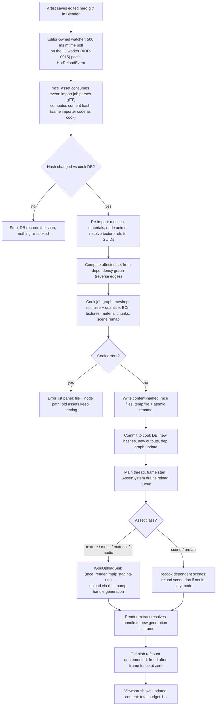

# Architecture: Assets & the Cook Pipeline (`mce_asset`)

**Subsystem:** assets · **Doc class:** Architecture design · **Date:** 2026-10-06
**Authority:** `docs/REQUIREMENTS.md` (FR-AST-010..120, plus FR-R3D-010, FR-ENT-060/070, FR-EDT-080/110, FR-DX-040/050, NFR-B-04/05, NFR-M-01/02). Cross-subsystem contracts defer to `docs/ARCHITECTURE.md` (fixes F4, F6, F10, F12 applied at this revision). Where this doc and REQUIREMENTS disagree, REQUIREMENTS wins.
**Scope of this doc:** asset types & formats, import/compile/cache pipeline, GUID registry, dependency graph, sync/async loading, hot reload end-to-end, reference counting & unload, scene serialization format, default project layout. Not in scope: how the renderer consumes GPU objects (see `rhi-renderer.md`), how the editor presents assets (`editor-tools.md`).
**Document map (for cross-doc citation):** responsibilities §1 · asset types & chunk formats §2 · `.mce` container §3 · GUID registry & project layout §4 · import/cook/cache pipeline §5 · scene serialization §6 · **public interface §7.1** (loading §7.3, refcount/unload §7.4, hot-reload flow diagram §7.5, editor integration §7.6) · threading & lifecycle §8 · upstream/downstream dependencies §9 · test strategy §10 · risks §11.

**Related research:** `docs/research/existing-engines.md` §2.1 (Unity import cache), §2.6 (id Tech format discipline), §4 decision #5; `docs/research/platform-engineering.md` §2 (allocators for cook), §3 (job system learned in cook first), §7 (container/determinism tests).

---

## 0. Design summary (the five decisions)

1. **Two trees, one boundary.** Humans author interchange sources (`glTF 2.0`, PNG/JPG, WAV, TTF) plus a small set of MCE-native text assets (`.mcmat` materials, `.mcscene` scenes, `.mcprefab` prefabs, `.mcinput` action maps). Everything the runtime touches is cooked to versioned chunked `.mce` containers, memory-mapped at load. The runtime contains no JSON/PNG/WAV decoder (FR-AST-010, CI symbol-scanned).
2. **Content-addressed cooked outputs.** Cooked `.mce` files are named by their content hash and written temp-then-rename. This makes hot reload safe on Windows (no file locking against the mmap), makes incremental cook a set-union, and makes cook determinism (FR-AST-030) structural: no timestamps, no driver state, no output naming that depends on anything but bytes. (Cited as "assets.md D2" by `ARCHITECTURE.md` §4.1.)
3. **Stable identity by sidecar.** Every source file gets a `<file>.mceasset` sidecar holding its GUID and importer settings (the Unity `.meta` model). GUIDs are created once and never regenerated on move/rename (FR-AST-040).
4. **One cook graph, one cache.** `mce_cook` scans the project, builds the source registry + dependency graph, and cooks only what changed, in topological order, on the job system. The cook DB is a plain binary journal. Full cook < 60 s, incremental < 5 s (NFR-B-04).
5. **Handles and generations everywhere.** Runtime asset references are `AssetHandle<T>` generational indices into per-type registry tables; components store `AssetRef<T>` (GUID) which the loader resolves to handles with a fixup table at scene load. Reload bumps the generation; stale handles fail visibly (magenta placeholder, one log line — FR-DX-050), never crash.

MVP tier gets the full design below; v0.5/v1.0 additions (BCn, hot reload, the incremental-cook *gate* — the cook DB and journal format are M2 and always populated per §5.3, only the < 5 s gate closes at v0.5 — prefabs, thumbnails) are marked and sketched.

---

## 1. Responsibilities & non-responsibilities

### 1.1 Responsibilities

| # | Responsibility | FR trace |
|---|---|---|
| R1 | Define the closed set of asset types, their interchange sources, and their cooked chunk formats. | FR-AST-010 |
| R2 | Own the `.mce` container format: header, TOC, chunk versioning, CRC, 16-byte alignment; provide the single reader used by runtime and editor, and the writer used by cook. | FR-AST-020 |
| R3 | Own the GUID registry: sidecar files, GUID lifetime across moves/renames, path→GUID→cooked-blob resolution. | FR-AST-040 |
| R4 | Own the importers (glTF static + animation later, PNG/JPG, WAV, TTF) — parse interchange, extract data + external references. Cook-time only. | FR-R3D-010, FR-AST-100 |
| R5 | Own the cook pipeline: `mce_cook` CLI, per-type cook stages, cook cache (content hashes), dependency graph, topological ordering, determinism. | FR-AST-030/070/080 |
| R6 | Own runtime loading: mount pack/directory, mmap, validate, register blobs, resolve references, sync + async load paths. | FR-AST-020, FR-ENT-120 |
| R7 | Own reference counting, deferred unload, and generational handle validity for all asset types. | FR-DX-050 |
| R8 | Own hot reload end-to-end *after the watcher event*: re-import → re-cook → atomic commit → handle generation bump → visible failure modes. (The 500 ms poll itself is editor-owned — ADR-0015, ARCHITECTURE fix F12; shipped runtimes contain none of this machinery.) | FR-AST-090, FR-DX-040 |
| R9 | Define the scene serialization format (editor canonical text doc) and the scene → runtime-chunk cook transform (component columns + id remap). | FR-ENT-060 |

### 1.2 Non-responsibilities (someone else's, or nobody's)

- **GPU resource creation** — the asset system produces cooked bytes; `rhi-renderer` owns texture/mesh/buffer object creation, the staging ring, and residency. The asset system only signals "new blob ready for generation N" and "blob of generation N-1 unreferenced".
- **Component storage and scene *semantics*** — `ecs-gameplay` owns archetypes, columns, and component registration. The scene cook *consumes* ECS component metadata (via reflection) but does not interpret gameplay.
- **Audio playback** — `audio-input-ui` reads cooked audio chunks (mmap'd, zero-copy) through the mixer; the asset system never mixes.
- **Physics behavior** — colliders are *data* on components cooked inside scene chunks; `physics` interprets them.
- **Editor UX** — the asset browser, thumbnails (v1.0), error-list panel, and drag-drop live in `editor-tools`; they are clients of this subsystem's API.
- **Save/persistence of gameplay state** — save games (FR-RUN-065) are owned jointly by `core` (SaveWriter/SaveReader, atomic write, `save://` mount — see `core` §2.x "Save/persistence") and `ecs-gameplay` ([Save]-flagged reflection dump, §4.7 there); they may reference assets by GUID but the asset system owns neither format nor storage.
- **DCC tool integration, runtime import, network streaming, encryption** — Won't per FR-AST-120 and binding asset policy.
- **Shader *compilation* semantics** — glslangValidator validation + variant enumeration happen at cook (R5), but GL program objects are created by `rhi-renderer`; the asset system carries the validated source + reflection blob.

### 1.3 The one-sentence model

> **The asset system is a deterministic compiler from a human-readable source tree to a content-addressed binary tree, plus a registry that makes the outputs look like infinite-lived, reloadable objects to the rest of the engine.**

---

## 2. Asset types, formats, and cooked chunks

Interchange formats are closed: glTF 2.0 (`.gltf`/`.glb`), PNG/JPG, WAV. MCE-native text assets (`.mcmat`, `.mcscene`, `.mcprefab`, `.mcinput`) are *authored* formats, not interchange — they are the editor's own serialization and also never reach the runtime unparsed. TTF is a cook-time-only source for font atlases.

| Asset type | Source (editor/interchange) | Cooked chunk type | Notes | Tier |
|---|---|---|---|---|
| Static mesh | `.gltf`/`.glb` mesh primitive | `CHNK_MESH` | meshopt vertex-cache/fetch optimized, quantized streams | MVP |
| Material | `.mcmat` (MCE-native), or extracted from glTF PBR | `CHNK_MAT` | metallic-roughness params + texture refs by GUID | MVP |
| Texture | `.png`/`.jpg` | `CHNK_TEX` | raw RGBA8 in MVP; BC1/BC5/BC7 at v0.5 | MVP |
| Shader/technique | `.glsl` (GLSL 4.5 core, hand-written) | `CHNK_SHD` | validated source + variant manifest + reflection blob | MVP |
| Audio clip | `.wav` | `CHNK_SFX` | 48 kHz float32; IMA-ADPCM variant for size (v0.5 sketch) | MVP |
| Music/stream | `.wav` (long) | `CHNK_SFX` + `CHNK_AUDP` | streamed via ~100 ms ring from mmap | MVP |
| Font | `.ttf` | `CHNK_FONT` | stb_truetype-baked glyph atlas + metrics, at cook | MVP |
| Sprite atlas | `.mcscene`-adjacent `.mcatlas` def + PNGs | `CHNK_ATLAS` | Skyline bin packing, deterministic order (ARCHITECTURE CF15) | MVP |
| Scene | `.mcscene` (editor canonical) | `CHNK_SCENE` | component columns + id remap (§6) | MVP |
| Prefab | `.mcprefab` | `CHNK_PREFAB` | entity sub-tree template; nested flattened at cook | v0.5 |
| Timeline | `.mctimeline` | `CHNK_TIMELINE` | track/clip data (FR-ENT-110) | built (M-CINEMA 1; `kit/timeline.h`) |
| Behavior tree | `.mcbt` | `CHNK_BT` | pre-order nodes, typed blackboard keys (ADR-0045) | built (M-AI 1-2; `kit/ai.h`) |
| 2D skeleton | `.mcskel2d` | `CHNK_SKEL2D` | bones (rest pose, parents first) + slots (textured quads in draw order) + animations (minor 1: per-bone rotate / translate / scale timelines with linear, stepped or bezier keys, events) + names | built (M-ANIM2D 1, 2; `kit/skeleton2d.h`) |
| Input action map | `.mcinput` | `CHNK_INPUT` | named actions, bindings, curves (FR-INP-020) | MVP |
| Animation clips | glTF node-transform tracks | `CHNK_ANIM` | sampled or keyframed node tracks (MVP: single-node TRS; per-node tracks sampled at runtime by the ECS `AnimationPlayer` — see `ecs-gameplay` §3.8) | MVP (diorama prop) |
| Particle preset | `.mcpart` (MCE-native) | `CHNK_PART` | emitter parameters + sprite GUID + spawn curves (FR-R2D-050) | v0.5 |
| String table | `assets/loc/<locale>.csv` (`key,text`, `key#one` plural forms; sidecar importer `strings`) | `CHNK_STR` | one locale's sorted key → UTF-8 text rows (`mce/loc/string_table.h`); the cook warns about keys a locale lacks against the base (`en`) table | M-MOBILE 11a |

**Rules for cooked chunks** (binding + FR-AST-020):

- Payload is 16-byte aligned; every chunk carries its own schema version, independent of container version. Reader must accept same-major-version-forward chunk versions or reject with a diagnosable `Result` (version-ahead = error with code + path + expected/actual version).
- No chunk may embed absolute paths, hostnames, timestamps, or any cook-environment residue — this is what makes FR-AST-030 (byte-identical re-cook) checkable rather than aspirational.
- All intra-chunk references to other assets are 16-byte GUIDs, never paths or indices into a global table.

---

## 3. The `.mce` container format

One format serves three mount shapes: a single per-asset file (dev cook output), a directory of such files (dev mount), and one packed file (shipping, the `assets.mce` of FR-SHP-010). The reader is the same code for all three.

```cpp
// mce/asset/container.h — the only header the runtime sees
namespace mce::asset {

inline constexpr uint32_t CONTAINER_MAGIC   = 0x3145434D; // "MCE1" LE
inline constexpr uint16_t CONTAINER_VERSION = 1;

enum class ChunkType : uint16_t {          // closed set, appended only
    Mesh = 1, Material, Texture, Shader, Sfx, AudioPacket, Font,
    Atlas, Scene, Prefab, Timeline, InputMap, Manifest,
    ParticlePreset, StringTable,           // v0.5 (FR-R2D-050, N12 groundwork)
};

struct ContainerHeader {                    // 64 bytes exactly
    uint32_t magic;            // == CONTAINER_MAGIC
    uint16_t version_major;    // breaking changes bump major -> reject, diagnosable
    uint16_t version_minor;    // additive changes bump minor -> accept
    uint32_t chunk_count;
    uint64_t toc_offset;       // byte offset to TocEntry[chunk_count]
    uint64_t payload_offset;   // first chunk payload; 16B-aligned
    uint64_t total_size;       // for mmap bounds checking
    uint32_t header_crc;       // CRC-32 (IEEE) of bytes [0, 60)
    uint32_t payload_crc;      // CRC-32 of all chunk payload bytes (skippable via flag for streaming)
    uint32_t flags;            // bit0: payload_crc_validated_at_write
    uint8_t  reserved[28];     // must be zero; reader rejects nonzero (forward-compat discipline)
};
static_assert(sizeof(ContainerHeader) == 64);

struct TocEntry {              // 40 bytes
    ChunkType type;
    uint16_t chunk_version;    // per-type schema version
    uint16_t flags;            // bit0: streaming (read sequentially, don't preload)
    uint32_t user_flags;       // type-specific (e.g. texture: format enum)
    uint64_t guid_hi;          // owning asset GUID (or 0 for anonymous chunks)
    uint64_t guid_lo;
    uint64_t offset;           // absolute, from container start
    uint64_t size;             // raw payload size (compression is per-format, not generic)
};
static_assert(sizeof(TocEntry) == 40);
}
```

Decisions, committed:

- **No generic compression in MVP.** Textures are BCn (v0.5), audio is ADPCM where needed, meshes are quantized. LZ4'd chunks would be the first v1.0-era candidate if pack size ever matters; the format reserves `flags` bits for it. Rationale: mmap + zero-copy + simple reader beat a few MB of pack size for a solo project (id Tech's WAD-era philosophy: simple, documented, versioned container — Sanglard, *Game Engine Black Books*).
- **CRC at two levels**: header CRC always validated; payload CRC validated at load for non-streaming chunks, with a mount-level option to trust the pack (boot-time cost control for the < 1 s Artifact B budget, NFR-M-02 — a CRC over ~200 MB is ~100 ms, so dev mode validates, shipped runtime validates the pack once at boot and trusts chunks thereafter).
- **Validation order is part of the contract**: magic → version → bounds (toc/offset/size inside `total_size` and inside the mmap) → CRC. Every failure is a distinct `AssetError` code with path + expected/actual. Fuzz + negative tests are mandatory (§9).
- **Alignment**: chunk payloads start at 16-byte-aligned offsets; the writer pads and records it in the TOC gap. Audio streaming and future GPU-tight layouts rely on this.

### 3.1 Pack file & content-addressed dev output

- **Dev (editor + devhost runtime):** cook writes `cooked/<aa>/<GUID-as-hex>/<content-hash>.mce` — one container per asset, named by its content hash. A generated `cooked/manifest.mce` (`CHNK_Manifest`) maps GUID → {logical path, current content hash, chunk offsets}. The runtime mounts `cooked/` via the manifest.
- **Ship (FR-SHP-010):** `mce_cook --pack` concatenates all chunks of all live assets into a single `assets.mce` container (chunk-level concatenation, TOC rewritten; GUID table preserved). The runtime mounts one file; mmap offsets come straight from the TOC.
- **Windows hot-reload safety (load-bearing decision):** because cooked files are content-named, a reload writes a *new* file and updates the manifest; the old file is deleted only after the runtime unmaps it (refcount + generation, §7.4). This sidesteps the classic Windows failure where a rename-over-open-mmap fails with `ACCESS_DENIED`. Temp file + `MoveFileEx(MOVEFILE_REPLACE_EXISTING)` only for the manifest, which the runtime reads atomically (read whole small file into a scratch buffer, parse, swap pointer).

---

## 4. GUID registry

### 4.1 Identity model

- An asset's identity is a **128-bit GUID** (UUIDv4, generated at first import via `CryptGenRandom`-equivalent; rendered as canonical hyphenated hex). GUIDs are stable across moves, renames, and re-imports (FR-AST-040). Cook does not need deterministic GUID generation — it needs GUID *stability*, which the sidecar provides.
- A source file's path is a *hint*, not identity. Resolution order at cook and editor load: sidecar GUID → registry path map → (if missing) repair prompt.

### 4.2 Sidecar files

Every source asset has `<source-file>.mceasset` beside it, checked into version control with the source (Unity's `.meta` pattern — the sidecar travels with the file, which is what makes a move in a version-controlled tree GUID-stable):

```jsonc
// hero.gltf.mceasset  (editor-side only; NEVER cooked into runtime blobs)
{
  "guid": "0f1e2d3c-4b5a-6978-8796-a5b4c3d2e1f0",
  "importer": "gltf-static",          // selects the cook stage; changing it re-cooks
  "importer_version": 3,              // importer upgrade => automatic re-cook
  "settings": {
    "normal_map_slot": "tangent",     // per-type knobs, reflected
    "weld_vertices": true
  }
}
```

Rules:

- Sidecars are created by the editor on import (or by `mce_cook --init` for CI-only projects); a source without a sidecar is a **cook error** ("unregistered asset", fixed by `mce_cook --adopt` or the MCP `cook_run` with `adopt`) rather than a silent new GUID — silent GUID churn is how reference graphs rot.
- MCE-native text assets (`.mcmat`, `.mcscene`, ...) carry their GUID **inline** in a `"guid"` top-level field instead of a sidecar — they are already MCE-controlled files, and a second file per scene is noise. One exception, two lines of code, fewer files.
- Renaming *inside the editor* = move source + sidecar together + update registry. An external (non-editor) rename is detected at the next scan as an orphan (GUID with no file) plus an unregistered file with identical content hash → auto-repair + info log, not an error.

### 4.3 Registry data structures

```cpp
// Cook-side + editor-side registry (in-memory projection of sidecars + cook DB)
struct AssetRecord {
    Guid       guid;
    std::string_view source_path;      // relative to project root, normalized, forward slashes
    uint64_t   source_hash;            // xxhash64 of source bytes (content, not mtime)
    uint64_t   settings_hash;          // hash of sidecar settings + importer_version
    AssetClass klass;                  // Texture, Mesh, Material, Shader, Audio, Font, Scene, ...
    std::span<const Guid> dependencies;// extracted by the importer at import time
};

class AssetRegistry {
public:
    // Scan: enumerate source tree, load sidecars, verify one-GUID-one-file uniqueness.
    // Duplicate GUID or missing sidecar -> diagnosable error list (FR-AST-040).
    Result<Vector<AssetRecord>, AssetError> scan(const ProjectRoot& root, Arena& scratch);

    // The two queries everything else is built on:
    const AssetRecord* by_guid(Guid g) const;              // O(1) open-addressed map
    Result<Guid, AssetError> guid_for_path(std::string_view rel_path) const;
    // Rename/move with GUID stability; also rewrites references in dependent MCE-native
    // assets (.mcscene/.mcprefab/.mcmat text sources) so refs stay resolvable (FR-EDT-110).
    Result<void, AssetError> move(Guid g, std::string_view new_rel_path);
};
```

Runtime-side, GUIDs are interned into a 64-bit key (registry index assigned at cook, stored in the manifest — runtime never parses strings):

```cpp
using AssetKey = uint32_t;   // stable index assigned by cook, baked into the manifest chunk

struct RuntimeEntry {         // per-type table row (SoA columns)
    uint32_t generation;      // bumped on every reload
    const void* blob;         // pointer into the mmap (stable until unload)
    uint32_t refcount;
};
```

### 4.4 Default project layout (the new-project template)

One committed tree shape serves every sample, both anchor games, and UC-D (which is built exclusively through editor workflows on this template — FR-DX-070, ROADMAP M8). It is the research doc's committed shape (§9 there), restated normatively here; the `v1.0` new-project generator stamps exactly this skeleton:

```
project/
  <project>.mceproj             # project identity: name, engine-version pin, plugin list (ARCHITECTURE CF17); sibling of assets/
  assets/                       # in git — human-authored truth; mounted as source://
    models/hero.gltf            + hero.gltf.mceasset   (GUID + importer settings)
    textures/hero_alb.png       + hero_alb.png.mceasset
    materials/hero.mcmat        (.mcmat — GUID inline)
    scenes/level_01.mcscene     (GUID inline, "version": N)
    prefabs/Enemy.mcprefab      (v0.5)
    audio/jump.wav + music.wav  fonts/consolas.ttf
    atlas/ui.mcatlas            input/controls.mcinput
    shaders/sprite.frag.glsl    (binding-bank-conformant, cook-validated)
  cooked/                       # git-ignored, disposable (Unreal-DDC contract, §5.3)
    .mcedb                      cook DB: append-only journal + snapshot
    manifest.mce                GUID → {logical path, content hash, AssetKey}
    <aa>/<guid>/<hash>.mce      content-addressed per-asset containers (§3.1)
  games/<game>/
    module/                     # game.dll (scripting subsystem's module idiom)
    host/                       # game.exe thin host
  assets.mce                    # ship output: `mce_cook --pack` (FR-SHP-010 zip shape)
```

Rules that make this layout load-bearing rather than convention:

- **`assets/` is the only tree a human edits; `cooked/` is only ever written by `CookService`.** Deleting `cooked/` entirely must always recover with a full cook and byte-identical outputs — the determinism CI test doubles as the "the cache is disposable" proof (Unreal-DDC contract; research §4.1).
- **Paths inside the engine are mount-relative, never absolute**: `source://models/hero.gltf` (editor/cook side), `content://...` (runtime mount, either the dev `cooked/` manifest or a shipped pack — the same `platform::filesystem` mounts ARCHITECTURE §5.2 fixes). This is what lets the same code run in editor, devhost, and shipped game with three different roots.
- **The editor performs renames as registry operations** (§4.3 `AssetRegistry::move`), so a rename inside `assets/` keeps every reference resolving (FR-EDT-110); an external rename is auto-repaired by content hash (§4.2).
- **Per-game content trees** live under the game directory; the sample ladder (`samples/01_triangle` …) uses the same layout at smaller scale. There is no engine-global asset directory — a project is self-contained by construction, which is what makes `--pack` and the ship zip trivial (FR-SHP-030).

---

## 5. Import / compile / cache pipeline

### 5.1 The cook graph

`mce_cook <project> [--pack] [--force]` is a library (`mce::asset::cook`) with a thin CLI. One pass:

1. **Scan** — registry scan (§4.3), hash all sources (size+mtime short-circuit, content-hash fallback; hashes are the only thing the cache trusts — mtimes are an optimization, never a decision input, so determinism survives clock changes and CI checkouts).
2. **Graph build** — importers run on changed sources and *declare* external references (a glTF names textures by relative URI → resolved to GUIDs; a `.mcscene` embeds GUID strings; a `.mcmat` embeds texture GUIDs). Result: a directed graph `source → dependencies`. Cycles among MCE-native text assets are a cook error naming the cycle (glTF/PNG/WAV cannot form cycles — they reference only opaque assets). Missing references: cook error with **file + location** — for text assets, line/column; for glTF, file + JSON pointer path (e.g. `/materials/3/pbrMetallicRoughness/baseColorTexture`) which satisfies FR-AST-040's "names file + line" in the only way a binary-ish format honestly can.
3. **Topological order** — Kahn's algorithm over the graph; nodes in a cycle or referencing missing assets are reported *as a batch*, never one per cook run (a cook that forces 20 re-runs to find 20 errors is a broken cook).
4. **Stage execution** — per-asset cook stages run on the job system (platform-engineering §3.4: this is where the job graph is *learned*, M2), each stage pure: `bytes in + settings → bytes out`, arena-allocated, no global state. Outputs written to `cooked/` as content-addressed `.mce` (§3.1).
5. **Manifest + DB commit** — regenerate `manifest.mce` (sorted by GUID; sort order is part of the format so pack assembly is deterministic), append the pass to the cook DB.

### 5.2 Per-type cook stages

| Type | Algorithm (concrete) | Notes |
|---|---|---|
| **Mesh** (FR-R3D-010) | hand-written glTF parser (nlohmann/json at cook only) → per primitive: de-index duplicate streams → `meshopt_generateVertexCacheMultiplier`-era pipeline: `meshopt_optimizeVertexCache`, `meshopt_optimizeVertexFetchRemap` → quantize: positions to snorm16 relative to mesh bounds, normals/tangents to snorm8 octahedral, UVs to unorm16 (or f16 if precision demands) → `CHNK_MESH` with bounds, sub-mesh ranges, material GUID | Cook of the 10k-tri reference < 5 s; load = mmap, zero decode (NFR-M-02). Skinned streams (joints/weights) are v0.5, reserved as extra attribute slots in the same chunk format |
| **Texture** | stb_image decode → linearize per sRGB flag → mips via box filter (or Kaiser at v0.5) → **v0.5:** BC1 (color opaque)/BC7 (color alpha)/BC5 (normals) via ispc_texcomp (deterministic, job-parallel); MVP ships RGBA8 | sRGB flag carried as chunk metadata; renderer must not double-correct (classic bug — assert at cook) |
| **Material** | `.mcmat` validate + texture GUIDs resolved → `CHNK_MAT` with fixed-width param block (baseColor, metallic, roughness, emissive, flags) | glTF import *extracts* materials into `.mcmat` files on first import (Unity-style), so glTF is interchange only and the editor has a native material asset to edit |
| **Shader** | GLSL 4.5 source → `glslangValidator -V` per stage, **MVP slice (finding F9): single default variant only — validate, check binding-bank conformance against the §3.3 fixed table via glslangValidator's reflection dump (printed, not stored), and emit `CHNK_SHD` = {source text (never *parsed* at runtime — recompiled by `rhi-renderer` via `glShaderSource`), cache key}**; **v0.5 (slip note):** variant enumeration (defines from the `.glsl` variant header comment block) + SPIR-V reflection blob (uniform block offsets, samplers, vertex input locations) added to the chunk, with a stored variant table | Why not cook program binaries: `glGetProgramBinary` blobs are driver/version-specific and would break cook determinism (FR-AST-030) and cold-boot on other drivers. Cook *validates*; the driver links at load; hot reload re-links in ms — which is exactly the DX-H1 win this stack was chosen for. Variant precompilation is deferred (ROADMAP M6 slip note) because MVP materials use exactly the uber-sprite + forward-3D families |
| **Audio** (FR-AST-100) | WAV decode (own 200-line PCM/IEEE-float reader — cook-time only) → resample to 48 kHz (windowed-sinc, fixed 32-tap kernel; < 0.5% THD on a sweep test) → peak-normalize to −1 dBFS → `CHNK_SFX` float32 interleaved; long-form gets `CHNK_AUDP` (packetized 100 ms pages for streaming) → v0.5: IMA-ADPCM variant for size, chosen per-asset in the sidecar | Loop points validated at cook (loop end > start, both in samples) so gapless music is a data guarantee, not a mixer hope (FR-AST-100) |
| **Font** | stb_truetype bake at cook: chosen codepoints (ASCII + project-supplied ranges) → glyph atlas (skyline packing) + metrics + kerning table → `CHNK_FONT`; with `"sdf": true` the atlas is a single-channel signed distance field (`FontFlags::Sdf`, the sprite shader thresholds it). v0.5 upgrade path: MSDF via **msdf-atlas-gen** (cook-time dep, vcpkg) for crisp multi-scale rendering — same `CHNK_FONT`, extra payload variant | "Atlas built at cook, not runtime" is the acceptance test (FR-R2D-060) |
| **Atlas** | `.mcatlas` lists source PNGs + per-sprite regions → hand-written **Skyline** bin pack (deterministic: sources sorted by GUID then name) → `CHNK_ATLAS` = 2D texture-array payload (one layer per page, per ARCHITECTURE CF15) + sprite rect table | Sprite animation (FR-R2D-030) references atlas frame indices |
| **Scene** | `.mcscene` → per component type, build columnar arrays; remap entity indices → runtime ids; remap asset refs → AssetKeys; validate against registered component metadata → `CHNK_SCENE` (§6 for format) | Scene hash round-trip test (FR-ENT-060) |
| **Prefab** (v0.5) | `.mcprefab` → same as scene, single root; nested prefab refs **flattened at cook** (binding: no runtime inheritance) → `CHNK_PREFAB` | Editing a prefab re-cooks the prefab chunk; dependent scenes re-cook via reverse-dep edges (FR-ENT-070) |
| **Input** | `.mcinput` → validated bindings (no dangling action names) → `CHNK_INPUT` | FR-INP-020; rebinding persistence is save-data, not asset data |

### 5.3 Cook cache & DB

`cooked/.mcedb` — an append-only binary journal + periodic snapshot (no SQL dependency; a cook DB is a keyed log, not a service):

```
record := { guid, source_hash, settings_hash, importer_id, importer_version,
            tool_versions{meshopt, glslang, ispc, mce}, output_hash[], dep_guids[] }
```

An asset needs re-cook iff any of: source hash, settings hash, importer version, tool version, or any dependency's *output* hash changed. Tool-version keys are what make "we changed the quantization code, re-cook everything" one flag flip instead of an archaeology project. The DB is recomputed from scratch if corrupt (cook is pure; the DB is an optimization — FR-AST-080's incremental < 5 s target has no correctness dependence on it).

**Determinism (FR-AST-030)** rests on four properties, each testable: (1) pure stages, no wall-clock/env in outputs; (2) parallel stages write disjoint output files — parallelism affects wall time, never bytes; (3) manifest and pack assembly sort by GUID; (4) tool versions pinned (vcpkg baseline) and recorded. CI: cook, hash, cook, hash, equal — every milestone.

---

## 6. Scene serialization (editor canonical) — format

The `.mcscene` document is the **only** serialized truth for scenes (binding: editor owns canonical scene; A11: inspector edits hit the editor's live preview world, the document is written on save). It is text (JSON via nlohmann, editor/cook-side only) so it diffs in git and survives a crash as a readable file (FR-EDT-100 autosave writes this same format). Every field name and type comes from the reflection system — no ad-hoc field lists anywhere in this pipeline (binding).

```jsonc
// scenes/level_01.mcscene
{
  "format": "mce-scene",
  "version": 3,
  "guid": "7c9e6679-7425-40de-944b-e07fc1f90ae7",
  "name": "level_01",
  "settings": { "gravity": [0.0, -9.81, 0.0], "ambient": [0.04, 0.04, 0.05] },

  "entities": [
    { "id": 1, "name": "Player",   // "id": the editor's persistent entity id (optional; the cook ignores it)
      "components": {
        "LocalTransform": { "position": [0.0, 2.0, 0.0], "rotation": [0.0, 0.0, 0.0, 1.0], "scale": 1.0 },
        "Sprite":         { "atlas": "guid:9f2c...", "frame": 0, "sort_layer": 0, "tint": [1,1,1,1] },
        "RigidBody2D":    { "type": "dynamic", "gravity_scale": 1.0 },  // field name matches the CF20 component register
        "Collider2D":     { "shape": { "Box2": { "half_extents": [0.35, 0.6] } }, "material": "guid:1a2b...", "is_sensor": false, "one_way": false }
      }
    },
    { "name": "Checkpoint", "prefab": "guid:44d0...", "overrides": {
        "LocalTransform.position": [12.0, 0.0, 0.0] } }
  ]
}
```

Design points:

- **Entity-row oriented, component-nested** — this is the human-diffable shape (Godot `.tscn`'s lesson about authoring formats); the *runtime* chunk is the columnar transform of exactly this data (FR-ENT-060: "component columns + id remap"). Cook sorts entities deterministically (source order is preserved as a stable key: entities carry an order-preserving index; editor save writes in hierarchy order).
- **References are typed**: asset refs as `"guid:..."` strings with a required type tag on the field (reflection knows the field's `AssetRef<T>` type — a texture GUID in a mesh field is a cook error, not a silent mismatch); entity refs as `"$<index>"` resolved at cook; prefab instances as `{"prefab": guid, "overrides": {...}}` where overrides are reflection field paths (v0.5; MVP copy-pastes prefab contents into the scene).
- **Versioning**: `"version"` gates migration. Migration functions live in one table `scene_migrators[old_version → new_version]`, run at *editor load* (so the user's file is upgraded interactively) — cook never migrates, it only accepts the current version and errors on older ones with "open and re-save in the editor first" (one code path, P6).
- **Hash discipline**: the cook's scene chunk embeds `xxhash64(canonical serialization of the source document)`; FR-ENT-060's save→cook→load→hash equality test compares this against the editor-side reference hash. Canonicalization (sorted keys, fixed float formatting `%a`-style shortest-round-trip) lives in one place: the scene save function.

---

## 7. Runtime loading, refcounting, unload, hot reload

### 7.1 Public interface

The asset system is a **server** in the Godot sense (existing-engines §2.3): thin create/destroy-by-handle API, data owned internally. Gameplay and the editor see the same surface; the editor additionally gets registry/cook services.

```cpp
namespace mce::asset {

// ---- Handles: the only cross-frame reference to asset state (binding) ----
template<class T> struct AssetHandle {      // T = Texture, Mesh, Material, Audio, Font, ...
    uint32_t index; uint32_t generation;
    bool valid() const { return generation != 0; }
};

// Component-facing reference: survives serialization, resolves at scene load.
template<class T> struct AssetRef {
    Guid guid;                              // what save data stores
    AssetHandle<T> handle;                  // what the sim reads (resolved by fixup, §7.3)
};

// ---- Runtime facade (what a scene loader / gameplay touches) ----
class AssetSystem {
public:
    // Mount: dev = cooked/ dir via manifest; ship = single pack. Validates header+TOC.
    Result<void, AssetError> mount(std::span<const std::string_view> roots);

    // Sync load: mmap + validate + register + (GPU upload submitted through the registered
    // IGpuUploadSink — see below; "renderer facade" in earlier drafts meant exactly this sink).
    // Blocking; used at boot and for small sets. p99 for a 10k-tri mesh: mmap ~0 ms,
    // register ~us — the budget lives in GPU upload, which is the renderer's problem.
    Result<AssetHandle<Texture>, AssetError> load_sync(TextureKey key);

    // Async (v0.5, FR-ENT-120): request → status poll → completion event on AssetQueue.
    void load_async(AssetKey key, CompletionCB cb);   // cb fires on the main thread, frame start
    [[nodiscard]] LoadStatus status(AssetKey key) const;

    // Refcounting: scenes/levels acquire; release schedules deferred unload.
    void retain(const AnyHandle& h);
    void release(const AnyHandle& h);   // decrements; unload happens at frame end, after fence

    // Hot reload (editor only): called by the reload queue drain, §7.5.
    // Resolves to the NEW generation; old blob stays alive while old generations are held.
    void commit_reload(Guid guid, const CookedBlob& blob);

    // Failure degradation (FR-DX-050): every type has a placeholder —
    // magenta checker texture, empty mesh, 1-second silence, fallback material.
    AssetHandle<Texture> placeholder_texture() const;

    // Events (double-buffered, FR-ENT-030 discipline): AssetReloaded{guid, old_gen, new_gen},
    // AssetReady{key, gen} (post-upload, ready for extract), AssetUnloading{guid, gen} (posted
    // before GPU destruction so the renderer can drop cached references), AssetUnloadFailed{guid,
    // refcount}, AssetLoadFailed{key, error} — editor console listens.
    EventBus& events();
};

// ---- The one call-shaped seam, inverted (ARCHITECTURE fix F6) ----
// The asset system produces bytes; GPU object creation is the renderer's job. To avoid
// mce_asset -> mce_render includes (which would be a circular dependency, since the renderer
// already depends on assets), the sink interface lives HERE and mce_render implements it,
// registering the implementation at boot. Raw GL never crosses this boundary either: the
// implementation translates blob views into rhi:: calls.
class IGpuUploadSink {
public:
    virtual ~IGpuUploadSink() = default;
    virtual Result<void, AssetError> upload_mesh(AssetKey, std::span<const Byte> mesh_blob) = 0;
    virtual Result<void, AssetError> upload_texture(AssetKey, std::span<const Byte> tex_blob,
                                                    uint32_t format_flags) = 0;
    virtual Result<void, AssetError> update_material(AssetKey, std::span<const Byte> mat_blob) = 0;
    virtual void destroy_gpu_objects(std::span<const RetiredAsset> retired) = 0; // post-fence reap
};
// Registered by mce_render at init (Renderer::init already receives the AssetSystem& —
// rhi-renderer.md §2); mce_asset stores it as a naked interface pointer and calls it only
// from the main thread at commit/reap points (§8.1). Include direction stays
// mce_render -> mce_asset; there is no assets->render edge, only this runtime-polymorphic one.

// ---- Cook/editor-side services ----
class CookService {                          // backs mce_cook AND the editor cook button
    Result<CookReport, AssetError> cook(const ProjectRoot&, const CookOptions&); // full+incremental
    Result<CookReport, AssetError> cook_assets(std::span<const Guid>);           // targeted (hot reload)
    // CookReport: per-asset {status, ms, output_hash} + a structured error list:
    // {file, location(node path or line), stage, message} — rendered by editor-tools EDT-070.
};

class ImporterRegistry {
    void register_importer(std::unique_ptr<IImporter>);   // open for engine types, closed for users
};
}
```

Error model: every fallible call returns `Result<T, AssetError>`; `AssetError` = `{code, guid_or_path, location, stage, detail}` — the same struct the editor error list renders clickable (FR-DX-050). Programmer errors (unregistered type, misuse of the API from the wrong thread) are `MCE_ASSERT`, not Results.

### 7.2 Internal data structures

- **Per-type registry tables** (Texture/Mesh/Material/...): open-addressed `AssetKey → {generation, blob_ptr, refcount}` plus a parallel free list; `AssetHandle<T>::resolve()` is one indexed load + generation compare (Bitsquid ID-lookup-table pattern; generational indices are the binding, and this is their home for assets).
- **Blob registry**: `AssetKey → {mmap_region, chunk_view}`. One `MemoryMappedFile` per mounted root (a single pack file in ship; in dev, a small set of per-asset files — Windows mmap handles are pooled, mapped lazily on first touch of a file).
- **Key → chunk offset** comes from the manifest chunk, loaded at mount into a flat sorted array (cache-friendly binary search; ~10k assets at MCE scale — no fancy index needed, NFR-T-04's design ceiling is 10k *entities*, asset counts are lower by an order of magnitude).
- **Refcount rows are 32-bit** with a saturated "pinned" sentinel for editor-held assets; overflow is an assert (a game with 4 billion refs to one texture has worse problems).

### 7.3 Scene load path (sync, MVP)

1. mmap scene chunk, validate (§3 contract).
2. Pass 1: scan chunk's asset-reference table → `load_sync` each (already-resident keys are O(1) refcount bumps — the boot scene's 60% texture overlap with the last scene costs nothing).
3. Pass 2: instantiate into the ECS as **command-buffer** entity creation with component columns copied straight from the chunk (zero per-entity heap traffic; chunk → columns are the same layout `ecs-gameplay` agreed on — this contract is what makes "scene-to-scene transition < 1 s" (NFR-M-01) arithmetic rather than heroics).
4. Pass 3: fixup — every `AssetRef<T>` field's GUID → `AssetHandle` (generations stamped), every entity ref `"$n"` → runtime id, recorded in the scene instance's fixup table so unload can reverse it.
5. Render extract next frame builds GPU objects from mesh/texture blobs via the staging ring; first frame shows everything (the < 1.0 s Artifact B budget is measured at this boundary, NFR-M-02).

### 7.4 Reference counting & unload

- Ownership: **loaded scenes own their assets** (scene instance holds one retain per referenced asset); the editor holds pins on assets referenced by the open scene document; audio mixer holds a pin on streaming music for the life of the stream. Everything else is explicit `retain/release` by systems.
- `release` never frees synchronously: the row's refcount hits 0 → the asset enters the **deferred unload queue** → at frame end, *after the render fence for that frame slot* (the same ring discipline as the staging buffers, platform-engineering §2.3), the blob is unmapped and the GPU objects destroyed through `IGpuUploadSink::destroy_gpu_objects` (post-fence reap, §7.1). Generational handles make any straggler stale-handle safe instead of use-after-free.
- Unload failures (refcount resurrected between queue and reap — e.g., a prefab instantiated during the same frame) are an event + log, not a crash; the asset simply stays resident. Worrying about transient residency at MCE scale is optimizing nothing (NFR-M-04's budget tables will say so if not).
- Editor nuance: **play-mode pins**. Enter play → runtime world acquires its own refs; stop → released. A texture deleted from disk while pinned shows the magenta placeholder on next reload attempt; the old blob serves until the scene stops referencing it (FR-AST-090's "handles stable" criterion).

### 7.5 Hot reload end-to-end — "artist edits a .gltf → it appears updated in the running editor"

Watch → import → cook → commit → swap, with every failure mode visible:



The load-bearing mechanics, per stage:

- **Watch**: an **editor-owned 500 ms mtime poll on the IO worker** over `assets/` (ADR-0015, fix F12 — not `ReadDirectoryChangesW`, whose event storms and editor-only lifetime buy nothing over a cheap poll; SDL3 has no file watcher anyway). Changed paths coalesce into one import pass. Editor-only — shipped games never spawn it (MCE cannot see the source tree; FR-RUN-010).
- **Import**: the *same importer code* as full cook, on the job system. This is the "one path per concern" rule applied to import: no separate "editor import" that drifts from cook.
- **Affected set**: reverse edges of the dep graph. Editing a texture re-cooks the texture; editing a mesh re-cooks mesh + every material using it + scenes whose entities reference the mesh; editing a prefab re-cooks prefab + scenes instantiating it. Scenes referencing an *unchanged* prefab are untouched — the graph, not heuristics, decides (FR-AST-080's "only assets whose source hash changed", plus dependents).
- **Commit**: all-or-nothing per asset — new content-addressed file written and fsynced *before* the cook DB/manifest update, so a mid-reload crash leaves the last good cook as truth (no half-loaded states; FR-EDT-100's crash-safety posture extended to content).
- **Swap**: `commit_reload` bumps the table row's generation and points it at the new blob. Handles already in components carry the *old* generation; the render extract resolves through the table, so the swap is one frame-delta wide, and gameplay code does nothing. `AssetReloaded` events let the editor refresh inspector thumbnails.
- **Shader fast path** (FR-AST-060/DX-H1, MVP): `.glsl` changes skip the full queue — validate with glslangValidator immediately (file+line errors to console), hand source to `rhi-renderer` for compile+link on the render thread at the next frame boundary; failure keeps the old program rendering (the acceptance test: syntax error → line-numbered console message, scene keeps rendering). Budget: save-to-pixels ≤ 1 s; expected ~50–150 ms.
- **Budgets** (FR-AST-090, FR-DX-040): texture/material/mesh/scene ≤ 1 s each; the reload queue drains at most one commit per frame per asset to keep frame spikes off the p99.

### 7.6 Editor integration surface (what `editor-tools` consumes)

The editor is this subsystem's heaviest client but contributes nothing runtime-side (direction is one-way; §9.2). The services `mce_editor_core`/`mce_editor_layer` call (cited from editor-tools.md as "assets.md §7.6"):

- **Cook**: `CookService::cook` backs the toolbar cook button and the run-in-player pre-cook (editor-tools M3); `CookReport`'s structured error list (`{file, location, stage, message}`) is the data the error-list panel renders with jump-to-asset (FR-EDT-070). Cook runs on the cook worker; progress + errors arrive on the main thread over a `MpScQueue` (§8.1, ARCHITECTURE F10).
- **Reload intake**: the editor's watcher (editor-owned, ADR-0015) posts `HotReloadEvent`s; everything after the event — re-import, re-cook, atomic commit, generation bump — is owned here (ARCHITECTURE fix F12). The editor never re-cooks and never imports.
- **Registry access for UI**: `AssetRegistry::scan` (browser rows + import status), `by_guid`/`guid_for_path` (the MVP inspector's type-filtered dropdown picker, FR-EDT-020 finding F6), `move` (rename-with-GUID-stability, FR-EDT-110), and the dependency graph projection (find-references, FR-AST-110 — the graph data already exists as reverse edges; this is an editor-tools view at v1.0).
- **Events out**: `AssetReloaded` (refresh inspector/thumbnails), `AssetLoadFailed` (console + error panel), `AssetUnloading` (drop cached thumbnails).
- **What the editor never does**: parse interchange sources, touch `cooked/` bytes, or construct GPU objects — the editor's viewport renders through `rhi-renderer`'s EditorView, whose sources are asset blobs resolved through the same `AssetHandle` table everything else uses.

---

## 8. Threading & lifecycle

### 8.1 Threads and what they touch

| Thread | Owns | Asset-system rules |
|---|---|---|
| Main (editor or runtime) | registry tables, handle validity, refcounts, commit queue | The *only* thread that mutates registry state (create row, bump generation, reap). Commits happen at frame start, reaps at frame end post-fence. |
| Job workers (core job system) | import/cook stages | Pure stages, arena-allocated scratch (double-ended stack per file, platform-engineering §2), no registry access. Results land in the commit queue — a core `MpScQueue` draining to the main thread (ARCHITECTURE fix F10; cook worker + reload jobs both post here). |
| Loader thread (v0.5 async; single) | mmap + validate + register-pending for async requests | Builds ready-to-commit entries; never touches live tables (avoids a whole lock class for one thread). |
| Watcher (editor) | 500 ms mtime poll on the IO worker (ADR-0015) | Only enqueues paths; all hashing/cooking happens on jobs. |
| Audio RT thread | none of ours | Reads mmap'd audio bytes directly (const, stable for the stream's life — pins hold the blob). No asset API calls in the callback (FR-AUD-010 discipline). |

Concurrency contract: the runtime path needs **no locks on the asset read path** — handle resolution is a table read the main thread alone mutates, and the sim/render read handles from the main thread only (MCE is single-threaded above the RHI until M2+, platform-engineering §3.2). Async/v0.5 adds a single SPSC commit queue (loader → main), the same primitive as the audio FIFO; the cook/reload → main path uses the core `MpScQueue` (F10) because several worker threads converge. Cross-thread primitives are core-owned and closed-listed — nothing in this subsystem invents its own synchronization.

### 8.2 Lifecycle

- **Editor boot** (NFR-M-01, usable < 5 s): registry scan with mtime short-circuit (sub-second for the sample project) → cook incremental in background (editor usable immediately; browser rows show "cooking…" state until manifest commit) → mount. The *editor* mounts the dev cooked tree; it never parses a glTF interactively.
- **Runtime boot** (FR-RUN-010): open pack → validate header/TOC → load manifest → load boot scene (§7.3). No watcher, no cook DB, no importer code linked (CI symbol scan is the enforcement).
- **Cook tool run**: pure batch process; crash handler attached (FR-DBG-030); exit code = error count (CI contract, FR-AST-070).
- **Editor shutdown / scene close**: release pins → reap → save cook DB → unmap. Kill-9 safe by construction: the cook DB is an append-log, sidecars are written per-edit, scenes autosave — nothing requires a graceful exit to stay consistent.

---

## 9. Dependencies on other subsystems

Subsystems per the architecture list: `core`, `rhi-renderer`, `ecs-gameplay`, `physics`, `assets`, `editor-tools`, `audio-input-ui`, `scripting`.

### 9.1 What assets provides (downstream)

| Consumer | What it gets |
|---|---|
| `rhi-renderer` | Cooked mesh/texture/material/shader blobs (const mmap views); shader hot-reload handoff (validated source + reflection blob); asset-unload GPU destruction requests; the `IGpuUploadSink` interface the renderer implements (§7.1, F6) |
| `ecs-gameplay` | The scene cook contract: component column layouts + id remap consumed by scene loading; `AssetRef<T>` field type for components; runtime scene chunk loader |
| `physics` | Collider shape data as cooked component columns (shapes authored in editor, cooked in scene chunks — physics never reads sources) |
| `audio-input-ui` | Audio chunks (`CHNK_SFX`/`CHNK_AUDP`) as pinned mmap views the mixer streams from; input action map chunks |
| `editor-tools` | Everything: registry, cook service + structured error list, dep graph (find-references, browser status, FR-AST-110), reload events, GUID stability on rename |
| `scripting` (v1.0+ sketch) | Nothing at MVP. If the deferred scripting VM ever lands, it consumes assets through the same handle API — no importer or format changes (script assets would be a new importer + chunk, by ADR) |
| `core` | The cook tool is core's first job-system customer (platform-engineering §3.4); asset system supplies cook-step Tracy zones (FR-DBG-010) |

### 9.2 What assets requires (upstream)

| From | Why |
|---|---|
| `core` | Allocators (frame/stack/cook arenas), `Result<T,E>`/`AssetError`, generational `Handle<T>` machinery, containers, job system (cook + import jobs), logging, Tracy, xxhash64/CRC-32, file IO primitives |
| `mce_refl` (L1 reflection module, ARCHITECTURE fix F4) | The *only* source of component field metadata for the scene cook/serializer (binding: no ad-hoc field lists); sidecar `settings` schemas are reflected types |
| `ecs-gameplay` | Registered component list + column layout contract (the scene chunk format is a function of ECS schema — a new component must require zero asset-system changes, FR-DX-020) |
| `rhi-renderer` | **Dependency inversion (ARCHITECTURE fix F6):** assets *defines* `IGpuUploadSink` (§7.1); the renderer *implements* it and registers at `Renderer::init`. Through it assets gets staging-ring upload and GPU object creation for hot-reload commits, and GPU object destruction on unload (§7.4). Assets produces bytes; the renderer turns them into GPU state — via the registered sink, never via an include |
| `editor-tools` | Nothing at runtime (direction is one-way: editor consumes assets). Editor-side only: the cook button/error panel call *into* this subsystem |
| Third-party (cook-time only, vcpkg-pinned) | nlohmann/json, meshoptimizer, stb_image/stb_truetype, glslangValidator, ispc_texcomp (v0.5) — never linked into `mce_runtime` (FR-AST-010). *(Dependency mechanism superseded by ADR-0017: CMake FetchContent with pinned tags in `cmake/Dependencies.cmake`; there is no `vcpkg.json`.)* |

**Layering rule** (existing-engines §4 decision #1, enforced by CMake target direction + include-direction CI check): `core → ecs-gameplay → assets → {rhi-renderer, audio, editor}`. Assets depends on `ecs-gameplay` (registered component list + reflection metadata), never the reverse — `mce_ecs` must not include `mce_asset` (the canonical ARCHITECTURE §2.2 rule; it is why `load_scene` takes cooked chunk payloads, not `AssetId`s). Assets never *includes* renderer headers; of the coupling points above, the scene chunk layout is data-shaped, and the upload handoff is the single sanctioned call-shaped seam — **inverted** through the `IGpuUploadSink` interface defined here and implemented by `mce_render` (ARCHITECTURE fix F6), so the include direction remains `mce_render → mce_asset` and no circular dependency exists.

---

## 10. Test strategy

| Area | Test | Gate | FR |
|---|---|---|---|
| Container reader | Negative + fuzz suite: bad magic, truncated file, TOC offset out of bounds, CRC mismatch, version-ahead, nonzero reserved bytes → each asserts a *distinct* `AssetError` code, never a crash. Fuzz: deterministic byte-mutation corpus (1k mutations of real containers) run under ASan | Per PR (doctest) | FR-AST-020 |
| Cook determinism | Cook sample project twice → byte-identical hashes (full + `--pack`); run in CI Debug and Release | Every PR from ROADMAP M2 (cook tool milestone, finding F8 retier) | FR-AST-030 |
| GUID stability | Copy project → rename asset externally → registry scan → references resolve; delete referenced asset → cook error names file + glTF node path | Per PR | FR-AST-040 |
| Dependency graph | Cycle injection (two scenes referencing each other via prefab) → batched error; deep chain (scene → prefab → material → texture) → topological cook order verified by log | Per PR | FR-AST-040/080 |
| Incremental cook | Touch one `.gltf` → cook log shows exactly {that asset + dependents}; untouched set reuses DB entries | Per PR (v0.5+ — the journal DB format and always-populated DB are M2 per §5.3/§0-4; only the FR-AST-080 < 5 s gate closes at v0.5) | FR-AST-080 |
| Scene round-trip | Save → cook → load → hash == editor reference hash (also: 10k-entity synthetic scene) | Per PR | FR-ENT-060 |
| Reflection-driven scene schema | Add a new reflected component in a test project → cook + inspector handle it with zero asset/serializer code changes (the FR-DX-020/020 acceptance lives here) | Per PR | FR-DX-020 |
| Refcount/unload | Load scene → release → reap after fence; stale handle after reload resolves to placeholder + one log, never aliases (generational test) | Per PR | FR-DX-050 |
| Hot reload (dev machine, stopwatch) | Shader save→pixels ≤ 1 s; texture/mesh/scene reload ≤ 1 s; failed texture shows magenta with stable handles | Milestone gate | FR-AST-090, FR-DX-040 |
| Cook CLI contract | Exit codes 0 (ok) / 1 (cook errors, structured list) / 2 (usage) exercised in CI; error list renders in editor panel with jump-to-asset | Per PR | FR-AST-070, FR-EDT-070 |
| Golden images | Cook-time render of fixed scenes vs perceptual-threshold reference (block-mean luminance < 0.5%), dev-machine-only | Milestone (never CI gate, A8) | FR-DBG-020 |
| Startup budgets | Artifact B double-click → first frame < 1.0 s; scene-to-scene < 1 s; editor boot < 5 s — Tracy-marked | Milestone | NFR-M-01/02 |

The `.mce` reader negative suite and the determinism test are the two the whole design leans on: the first makes mmap-of-untrusted-bytes safe, the second makes content-addressing trustworthy. Both are MVP-tier, non-negotiable.

---

## 11. Risks & mitigations

| # | Risk | Severity | Mitigation (committed) |
|---|---|---|---|
| 1 | **Cook determinism leaks** (timestamp, hash-order, or driver-state residue in a chunk) silently breaks FR-AST-030 and the hash test starts flagging random assets | High | Determinism CI test from the cook tool's first PR (ROADMAP M2, not "later"); the four-property checklist (§5.2); tool-version keys in the DB so a false fail is immediately attributable to a tool change, not archaeology |
| 2 | **glTF importer scope creep** (skinning, extensions, weird DCC exports). The importer is the single most schedule-fragile piece of the asset layer (R3D-060 already demoted once) | High | Importer scope is *locked by FR-R3D-010*: static meshes, PBR params, node transforms (+anim at v0.5); unknown extensions → cook warning, never failure. Unsupported-feature matrix in importer README; KHR extensions rejected with the extension name in the error. If a DCC's glTF export is broken, fix the export settings — not the importer |
| 3 | **Windows mmap vs hot-reload file replacement** — rename-over-open-mapped-file fails, classic silent corruption source | Medium | Content-addressed outputs (§3.1): new file, manifest swap, deferred unmap. The rename-over-open path never occurs by construction; verified by the reload stress test |
| 4 | **GUID rot**: sidecars diverge from files (external edits, git merges), duplicate GUIDs from copy-pasting assets | Medium | Unregistered-source and duplicate-GUID cook errors (batched); content-hash-based auto-repair for external moves; browser "adopt" action in editor-tools; uniqueness checked at every scan |
| 5 | **Hot reload destabilizes the editor** (partial commits, GPU object leaks, refcount races) — this is the most stateful code in the engine | Medium-High | Single-threaded commit discipline (§8.1), all-or-nothing commits, generational handles make stale reads safe, reload hammer test (mutate 50 assets in 5 s under ASan) at v0.5; reload machinery is editor-only so shipped runtime never carries it |
| 6 | **mmap + `MapViewOfFile` handle pressure / fragmentation** on long editor sessions with many reloads | Medium | Handle pool with LRU unmap of unreferenced regions; leak check in the reload hammer test (ASan + handle-count assert) |
| 7 | **Async loading complexity** tempting "stream everything" designs before the sync path is proven | Medium | Async is v0.5 and *designs for* scene streaming only (FR-ENT-120 Could); MVP is sync-only, which mmap makes fast enough (NFR-M-02 measured, not assumed) |
| 8 | **Scene format versioning rot** (editor saves v3, cook expects v3, someone bumps one not the other) | Medium | Single version constant shared by editor save + cook via one header; cook rejects older with the "open and re-save" message; migrator table lives beside the save code (§6) |
| 9 | **Cook time grows** (BCn + meshopt + font bakes) past the 60 s budget as content grows | Medium | Incremental DB is the primary defense; job-parallel stages second; last resort is pack-splitting (Could) — never accepted-slow, the budget is binding |
| 10 | **The reflection system is a single point of failure** for scene serialization, inspector, and cook | Medium | Accepted deliberately (one mechanism — binding); the round-trip + schema tests (§10) are the safety net; reflection gets its own architecture doc where this risk belongs |

---

## 12. Tier summary

- **MVP (full design above):** container + reader/writer + negative tests; GUID registry + sidecars; glTF static import; mesh (meshopt + quantize), texture (RGBA8), material extraction, audio cook, font bake, atlas (Skyline pack, CF15), input chunks, shader validate + binding-bank conformance check (§5.2 — the SPIR-V reflection blob is v0.5); scene `.mcscene` format + columnar cook + sync load; deterministic cook CLI with CI contract; refcounted registry with placeholders; editor registry/cook integration (error list, save→cook→launch).
- **v0.5 (sketched, designed to be additive):** BC1/5/7 at cook; shader variant enumeration + SPIR-V reflection blob; async load path + scene streaming groundwork; incremental cook (DB is already in the format — the MVP DB is simply always populated); prefab cook + instantiate; hot reload for texture/mesh/material/scene/prefab (the machinery above, wider); IMA-ADPCM audio variant; `CHNK_PART` particle presets + `CHNK_STR` string tables; MSDF font option via msdf-atlas-gen.
- **v1.0 (sketch only):** thumbnails (cooked 128×128 PNG-into-chunk per asset — same content-addressing), dep-graph visualization + find-references (the graph data already exists; this is an editor-tools view), timelines, pack-splitting if size ever matters.
- **Deferred debt, named (not silently dropped):** runtime UI asset types (FR-UI), localization data assets (N12), streaming install (N7). The chunk-type enum is append-only precisely so these are additions, not rewrites.
