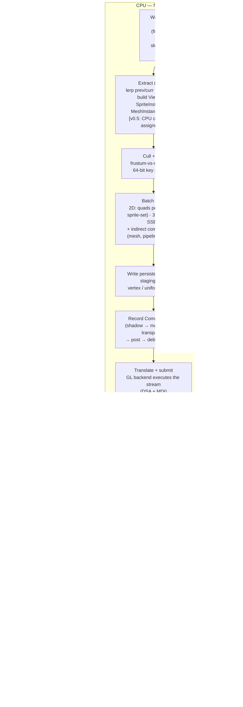

# MCE Architecture — RHI & Renderer (2D/3D)

**Subsystem:** `rhi-renderer` (logical name; physically split into `mce_rhi`, `mce_rhi_gl`, `mce_render`)
**Document class:** Architecture · **Date:** 2026-10-06
**Authoritative inputs:** `docs/REQUIREMENTS.md` (esp. §3.3 FR-R2D, §3.4 FR-R3D, FR-AST-060, FR-DBG-010/020, §4 budgets, §6.3 cut ladder), binding guidelines from the technology decision (GL 4.5 Core / DSA / persistent-mapped staging / MDI / RHI seam discipline), `docs/research/existing-engines.md` (L2 RHI-seam lesson), `docs/research/platform-engineering.md` (frame slots, profiling, GL debugging, module targets).
**Tier convention:** MVP tier items get full design; v0.5 and v1.0 items get sketches marked **[v0.5]** / **[v1.0]**.

---

## 1. Responsibilities & non-responsibilities

### 1.1 Responsibilities

**Layer 1 — RHI (`mce_rhi` interface + `mce_rhi_gl` backend):**

- Resource creation/destruction by generational handle: buffers, textures, samplers, pipeline state objects, transient render targets.
- A recorded command stream (`CommandBuffer`) covering: render passes, pipeline binds, uniform/texture binds, vertex/index data staging, draws (indexed + indirect), debug scoping, barriers (no-ops on GL, real on a future backend).
- Frame-in-flight ring management: persistent-mapped staging buffers, `glFenceSync`/`glClientWaitSync` per slot, frame-allocator reset coordination with core.
- Shader program compilation from GLSL source (cook-validated), pipeline cache keyed by (shader variant, fixed state), shader hot-reload swap-in.
- GL context lifecycle via SDL3 (create, vsync, resize-present, teardown), GL debug output (`GL_KHR_debug`) and object labels.

**Layer 2 — Renderer (`mce_render`):**

- Frame orchestration: extract → cull → sort → batch → record → translate/submit, inside the 16.6 ms budget (NFR-F-01/02).
- The camera model: `Camera2D`/`Camera3D` interpretation, primary-camera selection, view-projection construction, interpolation-alpha application.
- The 2D path: sprite batcher (one MultiDrawElementsIndirect submit per **(blend/pipeline state × sprite-set)** — the cooked 2D-array atlas carries the page as a vertex-carried layer index, per the FR-R2D-010 refinement in rendering-2d D4), cook-baked tilemap chunks drawn through the same batch, text rendering through the same batch, particle rendering through the same batch, 2D lighting **[v0.5]**, 2D post effects **[v0.5]**.
- The 3D path: forward pass (MVP: diffuse+specular, 1 directional light + 1 shadow map, fog) → PBR Cook-Torrance **[v0.5]** → Forward+ clustered lighting **[v0.5]** → cascaded shadows **[v0.5]** → sky **[v0.5]** → post chain **[v0.5]** → IBL **[v1.0]**.
- Frustum culling and 64-bit-key draw sorting (deterministic draw order).
- Shadow rendering (single map at MVP, cascades as sketch).
- The debug draw API (lines, wire shapes, screen text) used by editor-tools and physics debug overlays.
- Offscreen render targets for editor viewport(s) (FR-R2D-080) and golden-image capture plumbing (FR-DBG-020).
- GPU timing plumbing (`glQueryCounter`-based) feeding Tracy GPU zones and the dev overlay.

### 1.2 Non-responsibilities

- **No asset parsing/cooking.** The renderer consumes cooked `.mce` chunks from the `assets` subsystem; it never sees glTF, PNG, WAV, JSON, or the cook pipeline internals (binding asset policy).
- **No ECS internals.** The renderer reads render-relevant components through `ecs-gameplay` queries during extract; it does not own scene state, never mutates components, and never structural-changes the world (binding architecture authority: runtime/renderer never mutates scenes).
- **No ImGui code.** ImGui is owned by editor-tools (`mce_editor`); the renderer only provides (a) a hook point where editor-tools issues its own `CommandBuffer` calls via the ImGui GL backend, and (b) the offscreen target ImGui displays. ImGui is never in runtime builds (CMake target wall, FR-UI-048).
- **No gameplay/shipped-game UI.** `mce::ui` is a separate deferred system (FR-UI-020); at MVP/v0.5 it would draw through the same sprite batch, but the renderer ships no widget logic.
- **No windowing/input.** SDL3 window, GL context *creation*, and events belong to `core`/`audio-input-ui` platform layer; the renderer is handed the GL context at init.
- **No asset memory policy.** VRAM residency/eviction of textures and meshes is the `assets` subsystem's residency manager; the RHI only executes create/destroy and reports capacity.
- **No audio.** No coupling to the mixer thread whatsoever.
- **No cross-machine pixel determinism** (NFR-N16): golden images are dev-machine-only with a perceptual threshold; the renderer's determinism obligation is *draw-order* determinism, not pixel identity.
- **No multithreaded GPU submission.** A GL context is bound to one thread (platform-engineering research §3); "render thread" parallelism is explicitly out of scope forever unless a second backend lands.

---

## 2. Public interface

Three headers define the whole surface. Everything else is `mce::detail`.

### 2.1 Handles and enums (mce_rhi)

```cpp
// mce/rhi/types.h
namespace mce::rhi {

// Generational-index handles from core (binding: never raw pointers across frames).
struct Buffer   { u32 index; u32 generation; };   // Handle<T> idiom from mce::core
struct Texture  { u32 index; u32 generation; };
struct Sampler  { u32 index; u32 generation; };
struct Pipeline { u32 index; u32 generation; };

enum class TextureFormat : u16 {
    RGBA8_UNorm, RGBA8_SRGB, BGRA8_UNorm, RGBA16F, RGBA32F,
    R8_UNorm, RG8_UNorm, R11G11B10F,
    BC1_UNorm, BC3_UNorm, BC5_UNorm, BC7_UNorm, BC7_SRGB,   // cooked formats (FR-AST-050)
    D32_Float, D24_UNorm_S8, D16_UNorm,
};

enum class BufferUsage : u16 {
    Vertex, Index, Uniform, Storage, Indirect, Staging, IndirectArgs,
};
enum class TextureUsage : u16 { Sampled, ColorTarget, DepthTarget, SampledColorTarget };

} // namespace mce::rhi
```

### 2.2 RenderDevice — resource creation (the Godot-"server" shape: create/configure by handle, data owned internally)

```cpp
// mce/rhi/render_device.h
namespace mce::rhi {

struct DeviceDesc {
    // No GL-context handle here: `mce_rhi_gl` creates the 4.5-core context itself from
    // `Window::native_handle()` — the sanctioned wall-#2 leak (ARCHITECTURE §1.2, core §2.5).
    u32          framesInFlight;    // 3 (default; MCE_FRAMES_IN_FLIGHT=2..4 override) — staging ring + fence slot count (ARCHITECTURE fix F1)
    bool         debugLayer;        // GL_KHR_debug callback on; object labels on
    Arena*       deviceArena;       // long-lived allocations (handle tables, caches)
    ILogger*     log;
};

struct BufferDesc  { BufferUsage usage; usize sizeBytes; const char* debugName; };
struct TextureDesc {
    Extent2D size; u16 mipLevels; TextureFormat format; TextureUsage usage;
    const char* debugName;
};
struct SamplerDesc { Filter minFilter, magFilter; MipFilter mip; AddressMode wrapS, wrapT;
                     float maxAniso = 1.0f; };

class RenderDevice {
public:
    static Result<UniquePtr<RenderDevice>, Error> create(const DeviceDesc& desc);

    // Creation is immediate (DSA: glCreateTextures / glNamedBufferStorage).
    // Destruction is deferred to the end of the frame slot that last used the object.
    BufferHandle    createBuffer(const BufferDesc&);
    TextureHandle   createTexture(const TextureDesc&,
                                  std::span<const TextureInitRegion> init = {}); // staging upload inside
    SamplerHandle   createSampler(const SamplerDesc&);
    Result<PipelineHandle, Error> createPipeline(const GraphicsPipelineDesc&);
    void destroyBuffer(BufferHandle);  void destroyTexture(TextureHandle);
    void destroySampler(SamplerHandle); void destroyPipeline(PipelineHandle);

    // Transient, frame-scoped render targets (pooled; no GL aliasing needed, just reuse).
    TextureHandle acquireTransient(Extent2D, TextureFormat, TextureUsage, const char* tag);
    void          releaseTransients();   // called automatically at endFrame

    usize textureMemoryBytes() const;     // budget table input (NFR-M-04)
    DeviceCaps caps() const;              // limits: max SSBO size, MDI support, anisotropy…
};
```

### 2.3 CommandBuffer — a recorded, translatable command stream

The stream is a flat POD list recorded by the renderer and executed by the GL backend in the same frame (the "RHI translate" budget line, NFR-F-02). Recording is POD-only so a future worker-thread recorder is possible without an API change.

```cpp
// mce/rhi/command_buffer.h
namespace mce::rhi {

struct PassAttachment { TextureHandle texture; LoadOp load; StoreOp store; ClearValue clear; };
struct RenderPassDesc {
    std::span<PassAttachment> colors;      // 1 at MVP; MRT only if post chain demands it
    std::optional<PassAttachment> depth;   // + stencil
    Extent2D viewport;                      // editor viewport = sub-rect of shared target
    const char* debugName;                  // glPushDebugGroup + Tracy GPU zone
};

class CommandBuffer {
public:
    void beginFrame(u32 slot);              // waits nothing; fences handled by device
    void beginPass(const RenderPassDesc&);
    void bindPipeline(PipelineHandle);
    // "Binding bank" upload: copies into the slot's persistent-mapped UBO ring,
    // binds at the fixed binding point for that bank (see §3.3). 256-byte aligned.
    void setUniforms(u32 bank, std::span<const std::byte>);
    void bindTexture(u32 slot, TextureHandle, SamplerHandle);
    void bindStorageBuffer(u32 binding, BufferHandle, u64 offset, u64 size);
    void setVertexData(std::span<const std::byte>, BufferClass cls); // staging ring write
    void setIndexData(std::span<const std::byte>);
    void setDrawArgs(std::span<const DrawElementsIndirectCommand>);  // indirect ring write
    void draw(u32 indexCount, u32 instanceCount, u32 firstIndex, u32 baseInstance);
    void drawIndirect(u32 maxDrawCount, u32 stride = sizeof(DrawElementsIndirectCommand));
    void barrier(PipelineStages src, PipelineStages dst);  // NO-OP on GL; real on future backend
    void debugScope(const char* name); void endScope();
    void endPass();
    void endFrame();                        // glFenceSync(slot) + transient release
};

} // namespace mce::rhi
```

**Pipeline descriptor** — modern-explicit shape: a pipeline is an immutable object bundling (shader program, vertex layout, fixed state, pass compatibility). This is the seam that makes a D3D12/Vulkan backend a translation, not a rewrite.

```cpp
struct VertexAttribute { u8 location; TextureFormat format; u16 offset; };
struct VertexLayout    { std::span<const VertexAttribute> attrs; u16 stride; };

struct FixedState {
    DepthState   depth;     // test/write/compare (LEQUAL)
    BlendState   blend;     // premultiplied-alpha default for 2D; opaque for 3D
    RasterState  raster;    // cullMode (Back for 3D, None for 2D), fillMode, frontFaceCCW
    PrimitiveTopology topology;   // Triangles, Lines, LineStrip, Points
};

struct GraphicsPipelineDesc {
    ShaderKey vertexShader;      // { shaderAssetGuid, variantMask } — resolved via assets
    ShaderKey fragmentShader;
    VertexLayout  vertex;
    FixedState    state;
};
```

### 2.4 Renderer public API (mce_render)

```cpp
// mce/render/renderer.h
namespace mce::render {

struct RendererConfig {
    Extent2D   initialWindowSize;
    bool       editorMode;          // editor build: ImGui hook enabled, main window may be idle
    float      targetDpiScale;      // FR-R2D-080
    u32        framesInFlight = 3;
};

// Per-frame input assembled by the runtime (or editor in play mode) after the sim tick.
struct RenderFrameInput {
    float alpha;                        // interpolation alpha (FR-RUN-020)
    Time   simTime;                     // for shader time, animation preview
    // Cameras: read by the renderer from ecs-gameplay via extract queries (§3.2).
    // The renderer holds no scene state of its own.
};

class Renderer {
public:
    Result<void, Error> init(rhi::RenderDevice&, const assets::AssetSystem&,
                             const RendererConfig&);
    void shutdown();

    // Called once per rendered frame, after the fixed-step tick(s). Single-threaded.
    void renderFrame(const RenderFrameInput&);

    void resizeMainWindow(Extent2D);          // swapchain-sized targets, DPI-aware
    void setVsync(bool);

    // ---- Editor hooks (editor-tools only; compiled out of mce_runtime by CMake wall) ----
    rhi::TextureHandle editorViewportTarget(u32 viewIndex) const; // for ImGui::Image
    Result<u32, Error> addEditorView(Extent2D);   // returns view id (2D or 3D camera driven)
    void removeEditorView(u32 viewId);

    // ---- Debug & diagnostics ----
    DebugDraw&      debug();                        // §2.6
    void            rayFromScreen(u32 viewId, Vec2 uv, Vec3* outOrigin, Vec3* outDir);
    Result<Hit,Error> pick3D(u32 viewId, Vec2 uv);  // CPU raycast vs cooked mesh bounds (§3.9)
    void            captureNextFrame(mce::StringView pngPath); // golden-image dump (FR-DBG-020);
                                                               // core-owned string view — std::filesystem
                                                               // stays inside the .cpp (core STL-confinement
                                                               // rule; finding F15)
    FrameStats      lastFrameStats() const;         // per-stage ms, draw counts → dev overlay/budget table
};

} // namespace mce::render
```

### 2.5 Camera model

Cameras are **components** (owned by `ecs-gameplay`'s starter kit, FR-ENT-080); the renderer owns their *interpretation*. Conventions are the binding math conventions: right-handed, Y-up, column vectors/column-major, GL NDC z ∈ [-1, 1] (asserted in the math-vs-DirectXMath oracle test at construction, platform-engineering research §6.1).

```cpp
// Defined in ecs-gameplay's starter kit; interpreted here.
struct Camera2D {
    Vec2    position;                 // world center of view
    float   zoom       = 1.0f;       // world units → screen scale
    Radians rotation   = 0_rad;
    bool    pixelSnap  = true;       // FR-R2D-040: snap view to texel grid
};
struct Camera3D {
    Vec3    position;
    Quat    orientation;
    Radians fovY       = 45_deg;
    float   nearZ      = 0.1f;
    float   farZ       = 1000.0f;
    bool    orthographic = false;
    float   orthoHeight  = 10.0f;    // meters covered vertically
};
// Primary camera: singleton resource `ActiveCamera{ Entity, ViewId }` (FR-ENT-080).
// Editor views carry their own editor-owned camera, never the game's primary.
```

Pixel-snap semantics (FR-R2D-040): the view matrix translation is snapped so that world-space texel boundaries align to device pixels after projection; screen shake is applied *after* snapping (shake may shimmer; game-critical art may not); verified by a golden-image scroll pair (no shimmer).

2D world scale is **meters**, with a per-sprite-set pixels-per-meter factor (default PPM = 48) stored in the cooked sprite-set chunk — the renderer never sees a pixel count that is not already meters or texels (rendering-2d §9). **[v0.5]** A `fixedLogicalSize` camera flag renders pixel-art games to a fixed logical resolution (e.g. 640×360) with integer upscaling + letterbox; it is a camera flag over the same pass machinery, not a second path.

Interpolation: extract receives `alpha` and lerps `prevWorldTransform → currWorldTransform` per entity (double-buffered transforms provided by ecs-gameplay's change detection, FR-ENT-040). At MVP, where there is no transform hierarchy, interpolation applies to root transforms only; **[v0.5]** it applies to hierarchy-propagated world transforms.

### 2.6 DebugDraw (shared by editor-tools, physics, renderer self-diagnostics)

```cpp
namespace mce::render::debug {
class DebugDraw {
public:
    // World-space, accumulated into a frame-allocator array; drawn in the debug pass.
    void line(Vec3 a, Vec3 b, ColorRGBA8 c);
    void wireBox(const Mat4& world, ColorRGBA8 c);          // physics: AABB/OBB colliders
    void wireSphere(Vec3 c, float r, ColorRGBA8 c2);
    void wireFrustum(const Camera3D&, ColorRGBA8 c);        // shadow cascade viz (FR-EDT-090)
    void cross(Vec3 c, float size, ColorRGBA8 col);         // light positions, joint anchors
    // Screen-space, resolved against the last 2D/3D camera:
    void circle2d(Vec2 c, float r, ColorRGBA8 c3);
    void rect2d(Vec2 min, Vec2 max, ColorRGBA8 c4);
    void text2d(Vec2 screenPos, std::string_view text, ColorRGBA8 c5);
    void setEnabled(DebugCategory cat, bool on);            // Colliders/Lights/Cameras/Bounds…
    void flush(rhi::CommandBuffer&);                        // called by Renderer in debug pass
};
} // namespace
```

Lines go into one indexed line-list batch (one draw call, no matter how many segments); text goes through the font atlas + sprite batch. This keeps FR-EDT-090 and physics debug drawing at zero draw-call cost. `DebugDraw` implements the `DebugDrawSink` interface defined in `mce_ecs` (ARCHITECTURE fix F5): physics fills the sink — it never includes renderer headers; editor-tools wires the implementation into the World.

### 2.7 Shader authoring format

GLSL 450 core, one file per stage, cooked (never edited at runtime). Layout is **convention-fixed** ("binding banks") rather than reflection-assigned — this removes an entire reflection→binding-assignment machinery from the critical path and is trivially portable to a future explicit backend (a bank = a descriptor set).

```glsl
// pbr.frag.glsl  —  v0.5 flagship fragment shader (sketch)
#version 450 core
#pragma mce_variant(SHADOW_MAP, NUM_CASCADES(1|2|3|4), FOG, IBL)   // cook enumerates, §3.10

layout(std140, binding = 0) uniform FrameU   { mat4 viewProj; vec4 camPosTime; vec4 resolution; };
layout(std140, binding = 1) uniform PassU    { DirLight sun; mat4 shadowMats[4]; ... };
layout(std430, binding = 3) readonly buffer Objects { ObjectData objs[]; };   // per-draw data
layout(binding = 6) uniform sampler2D albedoTex;
layout(binding = 7) uniform sampler2D normalTex;
layout(binding = 8) uniform sampler2D ormTex;          // occlusion/R/Ao (metallic-roughness, glTF)
layout(binding = 9) uniform sampler2DArray shadowMap;  // cascade layers
void main() { uint oi = gl_BaseInstanceARB; /* set per MDI command */ ... }
```

Rules:
- `binding` numbers come from the fixed table in §3.3; a cook-time check (glslangValidator reflection output) asserts every shader conforms.
- `#include` is expanded by a ~100-line textual preprocessor in `mce_cook` (glslangValidator has no include model).
- Cook (FR-AST-060): **MVP slice (finding F9)** — the single default variant per stage is validated with glslangValidator and the shader `.mce` chunk stores **source + program cache key**; the binding-bank checker reads glslangValidator's reflection dump at cook. **[v0.5]** every variant combination enumerated per material usage and the chunk grows a variant table + SPIR-V reflection blob (ROADMAP M6 slip note). Runtime compiles with `glCreateShaderProgramv` — runtime compilation is required anyway for hot-reload, so SPIR-V execution (`ARB_gl_spirv`) is rejected as a redundant second path with worse tooling (reflection metadata as *stored data* remains a v0.5 add-on, not a runtime dependency).
- Sprites use a single uber shader with material params as vertex attributes — zero per-sprite uniform cost.

---

## 3. Internal design

### 3.0 Module layout and the seam

```
mce_rhi      — types.h, render_device.h, command_buffer.h   (no GL, no SDL)
mce_rhi_gl/  — gl_device.cpp        (RenderDevice impl, DSA creation)
               gl_translate.cpp     (recorded stream → GL calls; the ONLY file with gl* calls
                                     beyond creation/labels)
               gl_staging.cpp       (persistent-mapped rings + glFenceSync slots)
               gl_pipeline.cpp      (program cache, hot-reload swap)
               gl_debug.cpp         (KHR_debug callback, glObjectLabel everywhere)
mce_render/  — renderer.cpp, view.cpp, extract.cpp, cull.cpp, sortkey.cpp,
               sprite_batch.cpp, text.cpp, mesh_pass.cpp, shadow_pass.cpp,
               post.cpp [v0.5], debug_draw.cpp, gpu_timing.cpp, golden.cpp
```

Enforcement: CMake — `mce_render` links `mce_rhi` only; `glad2` is a **private** dependency of `mce_rhi_gl`; a CI include-grep fails the build if `glad/` or any `gl[A-Z]` symbol appears outside `mce_rhi_gl/` (binding RHI seam discipline). `mce_runtime` cannot link `mce_editor`/ImGui (FR-UI-048 wall).

### 3.1 Frame slots, staging rings, and the allocation discipline

`framesInFlight = 3` (default, matching core's frame-slot ring and the MCE_FRAMES_IN_FLIGHT=3 contract — ARCHITECTURE fix F1; convar-overridable to 2 if Tracy shows the third slot buying nothing at 60 Hz vsync). Per slot:

| Ring | Size | GL storage | Sub-allocation |
|---|---|---|---|
| vertex/index staging | 4 MiB | `glNamedBufferStorage`, `GL_MAP_PERSISTENT_BIT \| GL_MAP_WRITE_BIT \| GL_MAP_COHERENT_BIT` | bump per frame |
| uniform/UBO ring | 1 MiB | same, 256-byte-aligned offsets | per-bank, per-pass |
| indirect args ring | 256 KiB | same | per draw batch |
| per-object SSBO backing | 4 MiB | same (`GL_MAP_COHERENT_BIT`) | per instance record |

At `beginFrame`, the device `glClientWaitSync`s the slot's fence from 3 frames ago (timeout → warning + spin), then resets that slot's ring bumps. All CPU-side per-frame draw data (sort keys, draw lists, batch scratch, debug lines) comes from core's **frame-linear allocator** (16 MiB/slot budget, NFR-F-03) — reset by the same fence signal. Zero heap allocation in any of extract/cull/sort/batch/record; asserted in debug and verified by ASan + Tracy memory track (NFR-F-03).

Overflow policy: ring overflow is a Tracy-marked warning plus a temporary extra buffer allocation (never a crash, never silent corruption); the milestone budget table tracks it. Budgets sized from NFR-T-02 (10k sprites ≈ 10k × 4 verts × 20 B = 800 KiB) leave ~5× headroom.

### 3.2 The MDI submission model

Every geometry draw is `MultiDrawElementsIndirect`:

- **2D sprites:** one MDI submit **per (blend/pipeline state × sprite-set)** (FR-R2D-010 as refined by rendering-2d D4 — strictly fewer draws than the old "per atlas page" bound). Sprite sets cook to a `GL_TEXTURE_2D_ARRAY` (rendering-2d D3): all pages of a set are layers of one texture object, so a stream never breaks on a page switch — the layer index rides in the vertex (below). Sprite quads are expanded to vertices on CPU (positions pre-transformed with the interpolated world transform, pivot, flip, tint packed RGBA8), so the vertex shader is a viewProj multiply — per-draw uniforms are unnecessary. Expected RenderDoc capture for a 2D frame: **one MDI per blend state**, never more (the batch builder groups by pipeline first, so alpha-blend and additive particle variants each cost exactly one MDI).
- **Tilemap chunks (rendering-2d D5):** cooked 32×32-tile chunks are baked at cook into static `SpriteVertex` lists referencing the same sprite-set array texture, uploaded once into **per-chunk persistent vertex/index buffers**. They join the *same* per-frame batch as dynamic sprites, but through **pre-baked indirect commands**: at extract, each visible chunk emits one command (carrying the chunk's sort-layer key) into the shared sorted command stream — the chunk's vertices are never re-uploaded or re-expanded per frame. Animated tiles (flipbook-driven) are emitted per frame into the dynamic sprite stream by extract, like particles. There is no tilemap renderer. **Authoring loop:** an edit in the tilemap panel (editor-tools §2.7) re-saves the tilemap asset and triggers a cook re-bake of that chunk — the renderer only ever consumes the baked chunk, so the edit→paint→see loop is cook-scoped (< 1 s hot-reload budget, FR-AST-090).
- **3D meshes:** extract groups entities by `(meshAsset, pipelineVariant, materialInstance)` → sorted instance arrays → per group one indirect command with `instanceCount = n`, `baseInstance = offset` into the per-object SSBO. Per-object data (`ObjectData`: model matrix, normal-matrix, material index, bounds) is indexed in-shader via `gl_BaseInstanceARB` (`ARB_shader_draw_parameters` — core in 4.6, effectively universal on 4.5 Windows drivers; a documented fallback binds per-group UBO ranges if a driver lacks it, at draw-count cost).
- **Shadow pass** reuses the same instance data with a depth-only pipeline; **particles** (FR-R2D-070, FR-R3D-110) go through the sprite batch; **text** goes through the font-atlas batch. One pipeline family, not one per feature.

Vertex formats (packed, 4-byte aligned):

```cpp
struct SpriteVertex  {
    f32x2 pos; f32x2 uv;
    u32 color;        // RGBA8 tint (premultiplied-alpha authored)
    u32 packed;       // [7:0] atlas layer (2D-array page), [23:8] octahedral normal [v0.5], [31:24] flags (flip pre-applied at CPU expand; reserved)
};                    // 20 B — 80 B per quad; 10k sprites ≈ 800 KiB/frame
struct MeshVertex    { f32x3 pos; f32x3 normal; f32x2 uv; };       // MVP; [v0.5] cook-quantized streams
```

> **Atlas-chunk shape (settled):** `CHNK_ATLAS` carries a **2D-array texture payload + packed region table** (hand-written Skyline packer, deterministic) — ARCHITECTURE CF15; `assets.md` §5.2 states the same shape. The renderer consumes whatever the chunk holds; the sprite *component* contract only ever references a packed-region handle, so the packer/page-layout question never reaches renderer code.

### 3.3 Binding bank convention (fixed for the whole engine)

| Binding | Block | Contents |
|---|---|---|
| 0 (std140 UBO) | FrameU | viewProj, invViewProj, camPos, time, resolution, alpha |
| 1 (std140 UBO) | PassU | per-pass: light lists, shadow matrices, fog params, 2D light array **[v0.5]** |
| 2 (std140 UBO) | MaterialU | material factors (baseColorFactor, metallic, roughness…) |
| 3 (std430 SSBO) | Objects | per-draw ObjectData array |
| 4 (std430 SSBO) | Clusters | Forward+ per-cluster light ranges **[v0.5]** |
| 5 (std430 SSBO) | LightPool | global point/spot light array **[v0.5]** |
| 6–13 (samplers) | — | atlasArray (2D sprite sets)=6, albedo=6 (3D shares the slot — different pipelines), normal=7, ORM=8, shadowMap=9, skybox=10, font=11, LUT=12 **[v0.5]**, spare |

Fixed bindings mean pipelines need no per-material binding layout machinery on GL, and a future backend maps banks → descriptor sets 1:1.

### 3.4 Per-frame pipeline (the renderer's spine)

One code path per concern (P6); the same extract→cull→sort→batch machinery serves 2D and 3D, differing only in extract queries and the pass list.

**1. Extract (after the last sim tick of the frame, before render).** Extract systems (registered by the renderer as the `RenderExtract` system group inside `Render_Pre` — ARCHITECTURE fix F9; the phase enum stays closed) run ECS queries and emit, into the frame allocator:
- `ViewData` per active camera (from `Camera2D`/`Camera3D` + `ActiveCamera` + editor views): view-proj, frustum planes, viewport, target.
- `SpriteInstance` array (2D query: interpolated transform, sprite region, tint, layer/order, visibility, flip). Cooked tilemap chunks contribute **no per-frame vertices** — their baked `SpriteVertex` lists stay in per-chunk persistent buffers (§3.2); extract emits one pre-baked draw command per *visible* chunk, keyed by the chunk's sort layer, into the same sorted command stream as the dynamic sprites. Only *animated* tiles emit dynamic `SpriteInstance`s, like particles.
- `MeshInstance` array (3D query: interpolated world transform, mesh handle, material handle, world-space bounds).
- `LightData` arrays (directional sun MVP; point/spot list **[v0.5]**).
- Particles are simulated by a gameplay-side system and emitted as `SpriteInstance`s — the renderer has no particle code (FR-R2D-070 "drawn through the sprite batch").

**2. Cull.** MVP: sphere-vs-frustum (Gribb-Hartmann plane extraction from viewProj; reject if `dot(n, c) + d < -r`). Sprites additionally get a cheap offscreen reject in extract. Draw-call reduction is verified per FR-R3D-050 (Tracy/RenderDoc: 50% off-screen ⇒ proportionally fewer commands). No occlusion culling (explicit non-goal scale).

**3. Sort.** 64-bit key, radix-sorted (LSD, 3–4 of 8 passes, counting arrays in the frame allocator):

```
[63:56] pass id (shadow, opaque, sky, transparent, debug)
[55:40] sortLayer (2D authored layer)          — 2D only
[39:24] material/pipeline hash                 — batch locality
[23:00] depth: opaque = view-space z ASC (front-to-back, early-z)
                transparent = z DESC (painter's, back-to-front)
                2D = sortOrder (authored)
```

Draw order is a function of (scene state, camera) only — deterministic per FR-RUN-040 and required for stable golden images. Ties break by entity index (ECS iteration order is determinism-tested, per platform-engineering research §6.2 — the renderer depends on that invariant).

**4. Batch + write.** Build indirect commands + instance/vertex data into the slot's staging rings (§3.1).

**5. Record + translate + submit.** Walk the pass list (§3.5) recording `CommandBuffer` calls; then execute the stream against GL (the "translate" stage). Present via `SDL_GL_SwapWindow` (vsync default on, FR-RUN-045).

### 3.5 Pass lists

**MVP — 2D game frame (Artifact A):**

1. Main pass (backbuffer or editor view target): sprites, one MDI per (blend state × sprite-set) over the 2D-array atlas; cook-baked tilemap chunks ride the same batch; text through font batch; clear = authored background.
2. Debug pass (lines/rects/text; editor-only or dev overlay).
3. ImGui pass (editor builds only).

**MVP — 3D diorama frame (Artifact B):**

1. Shadow pass: 2048² D32 target, ortho fit to scene bounds, depth-only MDI, PCF 2×2 with normal-offset bias on sample.
2. Main pass: forward, `ObjectData` + `MaterialU`, 1 directional light + shadow, exp² fog — rendered into an **R11G11B10F HDR transient target from MVP** (rendering-3d §7: retrofitting HDR later is a rewrite), created with a **4× MSAA flag** (finding 45: the diorama's geometric shimmer is the single worst artifact at this scale; the transient-RT pool owns the resolve — `glBlitFramebuffer` MSAA→single-sample into the tonemap source — so shaders never see a multisampled target), then ACES-fitted tonemap to the backbuffer. The tonemap pass is also the first proof that the transient-RT pool works. MSAA is a diorama-target-only RT-creation flag: the 2D target and all v0.5 post-chain inputs stay single-sample (post chains can't consume MSAA without a full resolve pass anyway).
3. Debug + ImGui as above.

**[v0.5] — Ashen Court frame (full pass list):**

1. Shadow: cascaded maps — 3 cascades into a `D32` 2D-array, split fractions [5%, 25%, 100%] of view depth, texel-snapped stable fit (eliminates seam shimmer, FR-R3D-040), PCF 3×3.
2. Depth prepass (front-to-back, position-only variant of the main pipeline) — the one v0.5 feature the rendering-3d ladder refuses to cut: it buys early-z insurance for the 1M-triangle budget and is the prerequisite for GTAO/Hi-Z later.
3. Main pass (Forward+): opaque MDI (PBR Cook-Torrance GGX, bank-4 cluster lights) into the R11G11B10F HDR target, then skydome/equirect sky (FR-R3D-080), then transparent MDI sorted back-to-front (2D sprites may composite into a 3D view for the editor's mixed scenes; 2D post, when enabled, uses an RGBA16F target because premultiplied compositing needs alpha — the one deliberate format split).
4. Post chain (HDR → LDR): bright-pass → dual-filter downsample/upsample bloom → composite with ACES tonemap + color-grade LUT + FXAA (FR-R3D-090; combined budget < 1.5 ms GPU).
5. Debug + ImGui.

**[v1.0] sketches:** IBL — cook-time convoluted specular cubemap + irradiance, one extra material branch (`IBL` variant), no runtime probes beyond a single env swap; runtime UI `mce::ui` rendering through the sprite batch (never ImGui).

### 3.6 Lighting pipeline details

- **MVP sun:** direction + color + intensity in `PassU`; Lambert + Blinn-Phong specular (diorama is explicitly allowed to ship lit-diffuse — cut ladder rung 3).
- **[v0.5] PBR (FR-R3D-020):** Cook-Torrance GGX (`D_GGX`, `G_SmithGGXCorrelated`, `F_Schlick`), metallic-roughness from the ORM set, glTF material factors; albedo-only fallback material for authoring mistakes (missing textures render magenta checker, FR-DX-050).
- **[v0.5] Forward+ (FR-R3D-030):** 32×16×24 view-frustum cluster grid; **cluster light assignment runs on CPU during extract** (the FR-R3D-040 budget is "< 0.5 ms CPU" — CPU build satisfies it and avoids a compute-debug detour; a GPU compute build is a named later optimization, not a design dependency). Result: per-cluster light-count + index list → bank-4 SSBO. ≥256 point lights, no special-casing.
- **[v0.5] 2D lighting (FR-R2D-090):** ≤64 lights in `PassU` bank 1; sprite shader computes N·L from the octahedral-packed sprite normal + radial falloff. One uber fragment shader with a `LIT_2D` variant — no second pipeline (same rule as FR-R3D-110's "no second pipeline").
- **Transparency:** painter's sort only. No OIT, ever, at this scale.

### 3.7 Render target management

- **Transient pool:** per-frame cache keyed by (extent, format, usage); acquired in `beginPass`, released in `endFrame`. GL makes these cheap (`glTextureStorage2D` reuse, no placed-resource aliasing puzzle — platform-engineering research §3 VRAM note).
- **Persistent targets:** swapchain-sized main HDR target (3D path, from MVP — see §3.5), shadow map(s), editor view targets. Editor views are owned by the renderer on behalf of editor-tools, resized on DPI change (FR-R2D-080).
- **Present:** MVP renders 2D straight to the backbuffer with sRGB conversion; the 3D path tonemaps its R11G11B10F target to the backbuffer from MVP; v0.5 blits the full post-chain LDR result to the backbuffer instead.

### 3.8 Shader hot-reload (the load-bearing velocity feature, FR-AST-060 / FR-DX-040)

`assets` detects a shader change → re-cooks (glslangValidator) → publishes a hot-reload event → the renderer drains a reload queue **on the main thread at frame start**:

1. New source + defines arrive with the shader chunk's cache key.
2. Compile+link into a *new* GL program. On success: swap the program inside the existing `Pipeline` slot (generational handle unchanged — pipelines are stable), rebind nothing.
3. On failure: keep the old program rendering, surface the glslangValidator/log text with line numbers in the editor console (editor-tools reads it from the assets error feed).

Budget: compile+link of one program is single-digit ms; save-to-pixels ≤ 1 s end-to-end. Textures/materials hot-reload the same way (new GL object created, handle slot table swaps it in; failed re-import renders the magenta placeholder, FR-AST-090).

### 3.9 Editor viewport, picking, and debug visualization hooks

- **Editor views:** each docked viewport is an `EditorView` — camera + output target sized to the widget × DPI. The editor reads the target's `TextureHandle` and displays it with `ImGui::Image` (the GL backend guarantees the GLuint is the handle's current object — documented, single sanctioned seam touchpoint).
- **Picking:** 2D = point-vs-sprite-AABB in world space during extract (cheap, exact). 3D = `pick3D`: screen ray vs cooked mesh bounds then triangles (linear scan with AABB reject — fine at Ashen Court scale for an occasional click). A GPU ID-buffer pass is the **[v1.0]** sketch if CPU picking ever shows up in Tracy.
- **Debug overlays (FR-EDT-090):** editor-tools registers `DebugCategory` toggles; physics/ecs-gameplay draw colliders/bounds/light volumes through `DebugDraw` during extract; the renderer draws them in the debug pass. Camera frustum and cascade visualization included.
- **RenderDoc:** loaded via `renderdoc_app.h` injection in dev builds; editor button triggers `TriggerCapture()` (FR-DBG-020). Every RHI object carries a `glObjectLabel` and every pass a `glPushDebugGroup`, so captures are readable by construction.
- **GPU timing:** `glQueryCounter` pairs per pass → Tracy GPU context rows (TracyGpu integration) + the dev overlay frame table (FR-DBG-010, NFR-F-02).

### 3.10 Golden-image capture

`Renderer::captureNextFrame(pngPath)` takes a core-owned `mce::StringView` (the STL-confinement rule: no `std::filesystem` type may appear in a runtime header; the conversion happens inside renderer.cpp, finding F15). It runs the normal frame against a fixed scene, reads back the final target (`glGetTextureImage`), and writes PNG (stb_image_write — cook/test-time only). The comparison (perceptual threshold, block-mean luminance diff < 0.5%, dev-machine only, never a CI gate — Appendix A8) lives in the test harness, not the renderer. The capture path is deliberately the same code as normal rendering, so a golden test can never diverge from shipped behavior (platform-engineering research §6.5).

### 3.11 One full frame (mermaid)

(A rendered copy lives at `docs/architecture/figures/frame-diagram.svg`.)



---

## 4. Threading & lifecycle

### 4.1 Threading model

- **M0–M2: single render thread = main thread.** GL contexts are thread-affine; a multithreaded renderer buys recording parallelism only on GL (platform-engineering research §3) and is explicitly out of scope. The CommandBuffer is recorded as a POD stream purely so that a future threaded recorder is an API-compatible change, not a rewrite.
- The only other threads are SDL3's audio callback (owned by the `audio-input-ui` subsystem, no renderer contact) and, from M2, the cook tool's job workers (owned by `assets`; they never touch GL — all GL object creation happens on the main thread, which is why hot-reload compiles run there).
- **Frame-slot discipline:** at most `framesInFlight = 3` frames in flight (matching core's ×3 slot ring). The CPU waits on the slot's fence *before reusing its rings*; the frame-linear allocator's reset is driven by the same signal (core owns the allocator, the renderer owns the fence — coordinated via the frame context).
- Determinism note: extract/sort/batch are deterministic given deterministic ECS iteration order; the renderer never consults wall-clock time (only `simTime` + `alpha` from the frame context).

### 4.2 Lifecycle

**Init (ordered, fail-fast with `Result`):**
1. `RenderDevice::create` — `mce_rhi_gl` creates the SDL3 GL 4.5 core-profile context from `Window::native_handle()` (the wall-#2 sanctioned leak — context creation lives in the GL backend, never in core/platform), glad2 load, `GL_KHR_debug` callback installed, `DeviceCaps` queried and asserted against the feature floor (4.5 + `ARB_shader_draw_parameters` + `ARB_buffer_storage`, all core-4.5-or-universal).
2. Default resources: 1×1 white, magenta-checker error texture, error materials, linear/point samplers, fullscreen triangle. Missing assets degrade to these (FR-DX-050), never crash.
3. Pipelines from cooked shader chunks (§2.7). A failed cook-time-validated shader at boot is a hard, diagnosable error (it passed CI, so this is a corrupted-cook case).
4. Swapchain-sized targets; editor views if `editorMode`.

**Per-frame:** `beginFrame(slot)` → renderer frame (§3.4) → editor ImGui record (editor build) → `endFrame()` (fence + transient release) → present.

**Resize:** SDL event → recreate swapchain-sized transients + editor view targets; the main FBO path re-resolves next frame; no pipeline invalidation (pipelines are not target-sized on GL).

**Context loss / device reset:** rare on GL but possible (driver update, remote desktop transitions). Strategy: detect via `GL_CONTEXT_LOST`-class errors in the debug callback → full re-init path (device, default resources, pipelines, re-upload persistent assets via the assets residency system). Accepted as a dev-mode recovery, not a shipped-game requirement.

**Shutdown:** `endFrame` flush → deferred-destroy queue drained → GL object leak counter asserted zero in debug (debug callback tracks live objects) → context destroy via SDL. Order: renderer → RHI → assets handles → core.

---

## 5. Dependencies

### 5.1 Upstream — what rhi-renderer consumes

| Subsystem | Consumed | Notes |
|---|---|---|
| **core** | math (Mat4/Quat/frustum), frame-linear allocator + fence coordination, generational `Handle<T>`, `Result<T,E>`, convars (vsync, uncapped, debug toggles), Tracy macros, logging, job system **[v0.5, cook-side only]** | Renderer is core's biggest customer; frame-allocator reset is co-owned with core's frame loop (FR-RUN-020). |
| **assets** | cooked `.mce` chunks: mesh (vertex/index/submesh/bounds), texture (BC-compressed), material, shader (source+defines+reflection), font atlas; asset GUID → handle resolution; hot-reload events + error feed | The runtime/renderer never sees interchange formats (binding asset policy). |
| **ecs-gameplay** | read-only extract queries over render components (Sprite, MeshRenderer, Light, Camera2D/3D, ActiveCamera singleton, text labels); double-buffered world transforms + interpolation (FR-ENT-040); the `RenderExtract` system group inside `Render_Pre` (ARCHITECTURE fix F9 — a group, not a phase) | The renderer defines the *shape* of render components jointly with ecs-gameplay's starter kit (FR-ENT-080); it never mutates them. |
| **editor-tools** | (reverse direction, but contract): view id + size/DPI per docked viewport, camera state, debug-overlay toggle states, picking requests, RenderDoc capture button | Editor owns the canonical scene; it feeds the renderer camera/viewport state only. |
| **physics** | nothing directly — physics fills the ecs-defined `DebugDrawSink` interface (line segments, wire shapes, AABBs, contact points); the renderer implements it and editor-tools wires the sink into the World (ARCHITECTURE fix F5) | Dependency direction: editor-tools → {physics, rhi-renderer}, never physics → rhi-renderer. |
| **audio-input-ui** | nothing. (MVP text HUD is authored as sprite/text entities in the scene, not by audio subsystem; the [v1.0] `mce::ui` system will submit through the sprite batch.) | Deliberate zero-coupling: audio has no visual surface. |
| **scripting** | nothing at MVP. [v1.0] a scripted beat can drive camera cuts via timeline data through the standard camera components. | No direct API. |

### 5.2 Downstream — what rhi-renderer provides

| Subsystem | Provided | Notes |
|---|---|---|
| **editor-tools** | editor view targets (`ImGui::Image`-ready), picking (`pick3D`/2D), `DebugDraw` for overlays (FR-EDT-090), GPU timing table for the profiling dashboards, RenderDoc trigger, viewport DPI-correct resize | The editor is the renderer's second-largest client. |
| **ecs-gameplay** | the render component *contracts* (field lists, sort-layer semantics), the `RenderExtract` system group, camera interpretation | Co-designed; ownership of components stays with ecs-gameplay. |
| **physics** | `DebugDraw` (colliders, contact points, broadphase boxes) | |
| **assets** | golden-image capture plumbing; hot-reload swap contract (stable pipeline/texture handles); VRAM capacity reporting for the memory budget table | |
| **audio-input-ui** | dev-overlay rendering (text sprites) for FR-DBG-060 | |
| **scripting** | nothing (scripted beats move cameras via components). | |

Dependency direction (CMake-enforced, per the layering rule in existing-engines research L1, corrected to the canonical ARCHITECTURE §2.2 DAG): `core ← ecs-gameplay ← assets ← rhi-renderer ← editor-tools`; `physics` sits beside ecs-gameplay (assets consumes ecs reflection metadata for the scene cook — never the reverse); nothing above rhi-renderer links GL.

---

## 6. Test strategy

**Unit tests (CI, every PR):**
- Sort-key ordering: opaque front-to-back, transparent back-to-front, 2D layer/order precedence; stable ties (entity index) — determinism of draw order (FR-RUN-040 corollary).
- Frustum culling: analytic plane/sphere cases (inside/outside/straddle per plane, rotated frusta).
- Batch builder: fixed input → golden vertex/indirect buffers (byte-compared); sprite-set/blend-state grouping (expected MDI count per FR-R2D-010 as refined); sprite pivot/flip/pixel-snap corner cases; tilemap chunk quad emission.
- Staging ring: overflow → extra-buffer path + Tracy marker; 256-byte UBO alignment; slot reuse never overlaps a pending fence (assert via simulated fence callbacks).
- Handle tables: destroy-then-use fails closed; deferred destruction drains at the right slot.
- Binding-bank checker: every cooked shader's reflected bindings match §3.3 (fails cook, not runtime).
- RHI null backend: headless determinism harness (FR-RUN-025) runs with zero GL symbols (CI grep — also the RHI-seam leak check).

**Golden images (dev machine, cook-time, perceptual threshold < 0.5% block-mean luminance — Appendix A8; never a CI gate):**
One scene per feature: sprite atlas batching, pixel-snap scroll pair (FR-R2D-040), 2D text, PBR sphere row (FR-R3D-020), single shadow map, fog, 2D moving light (FR-R2D-090), 2D post (FR-R2D-100), Forward+ 256-light stress, CSM seam scene (FR-R3D-040), sky, post chain toggles, IBL env swap [v1.0]. Failure = side-by-side diff surfaced in the editor error list.

**RenderDoc captures (the merge gate, FR-DBG-020):** every new render feature ships a capture checklist: expected draw count (2D: one MDI per blend state × sprite-set, never more; 3D: one per batch group), no redundant binds, correct pass structure, Tracy GPU time within budget.

**Determinism:** for a fixed scene + seed, extract output (sorted draw list, instance buffer hashes) is identical across 3 runs and Debug-vs-Release — reuses the FR-RUN-040 harness with render-side hashes added.

**Fault injection:** broken shader at reload → old program keeps rendering + console error (FR-AST-060); missing texture → magenta checker, no crash (FR-DX-050); truncated `.mce` texture/mesh chunk → diagnosable `Result`, renderer keeps last-good state; ring overflow → warning path exercised.

**Performance tests (Tracy, per milestone budget table, NFR-T-02/03, NFR-F-01/02):** 10k sprites p99 < 4 ms GPU submit; 1M-tri scene < 12 ms; cluster build < 0.5 ms CPU; shadow pass < 2 ms GPU; cull effectiveness (50% off-screen ⇒ draw count drops, FR-R3D-050).

**Sanitizers:** ASan per PR on the devhost + headless GL-null paths; the GL backend itself is exercised by golden runs on the dev machine (GL + ASan on Windows drivers is flaky — documented, accepted).

---

## 7. Risks & mitigations

| # | Risk | Likelihood | Mitigation |
|---|---|---|---|
| R1 | **Renderer scope creep** — the classic solo stall mode (Hazel lesson; existing-engines research). Shadows, post, IBL, and editor polish compete with shipping Artifact A. | High | Cut ladder is pre-agreed and one-directional (REQUIREMENTS §6.3): post FX and cascades cut before timebox extension; IBL first on the cut list; the M5a timebox rule ("cut features, not extend" — 3D rendering landed at M5a in the M5a/M5b split, ROADMAP finding F28) is binding. Milestones ship runnable artifacts only. |
| R2 | **GL driver variance** — MDI/persistent-mapping performance cliffs on some Windows drivers (esp. Intel iGPU). | Medium | Dev GPU pinned and driver version frozen per Open Question 2 (NFR-T budgets are anchored to it); Tracy GPU zones catch regressions per feature; the MDI path degrades to per-draw `glDrawElements` behind a convar as a diagnostic fallback (never the default). |
| R3 | **Persistent-map/sync bugs** (stale reads, corruption) — the classic `ARB_buffer_storage` footgun. | Medium | Strict slot discipline (write-only-in-slot, fence-before-reuse), coherent mapping (no explicit flush API to misuse), debug-mode validation pass that scans for cross-slot writes, and a stress test that randomizes frame time to expose fence races in ASan builds. |
| R4 | **RHI too thin or too thick** — too thin: GL leaks upward, second backend becomes a rewrite; too thick: solo dev drowns in abstraction (Godot RenderingDevice caution, existing-engines research §2). | Medium | The seam is enforced (CMake + grep, binding discipline) and reviewed by a standing rule: every renderer feature must be expressible in RHI terms; adding an RHI feature requires it to map onto the D3D12/Vulkan shape (pipelines, barriers-no-op, transient resources). Target size ~2–3k lines is tracked. |
| R5 | **Transparent 2D sorting artifacts** (z-fighting between authored layers, pipeline/blend batch breaks reordering art). | Medium | Sort key puts authored layer/order above material/sprite-set; authoring rule (documented + editor warning) that layer ordering, not y-depth, is authoritative; golden-image regression scene with overlapping semi-transparent sprites from different array layers. |
| R6 | **Ring overflow / VRAM overrun** on larger scenes than budgeted. | Low–Med | Overflow paths allocate + warn (never corrupt); `textureMemoryBytes()` feeds the milestone memory table (NFR-M-04); cook-time texture budget check (FR-AST-050). |
| R7 | **Shader variant explosion** (variants × passes × shadow configs). | Medium | Cook enumerates only variants referenced by materials in the content tree (unused-variant pruning); hard cap (~64 per shader family) with a cook error; variants are the cook's enumerated list, not runtime combinatorics. |
| R8 | **Golden-image flakiness** eroding trust in the suite. | Medium | Dev-machine-only, perceptual threshold, auto-rebaseline by convention, 0-flakes-over-3-runs gate (Appendix A8, FR-DBG-020). The human-eyeballed RenderDoc capture is the actual merge gate. |
| R9 | **Editor viewport integration pain** (ImGui texture lifetime, DPI scaling, multiple views, play-mode camera swaps). | Medium | `EditorView` abstraction owns target lifecycle; DPI handled at resize (FR-R2D-080 manual gate); ImGui backend hookup isolated in editor-tools, with the documented single GLuint seam. |
| R10 | **`gl_BaseInstanceARB` availability/perf on some 4.5 drivers.** | Low | Feature-detected in `DeviceCaps`; fallback is per-group UBO ranges at draw-count cost; cook asserts against the known-good profile. |
| R11 | **Interpolated hierarchy rendering** ([v0.5]) double-buffering bugs (children lag a frame). | Medium | MVP renders 2D root transforms only; hierarchy interpolation lands with FR-ENT-040/050 change detection and gets an explicit unit test (parent rotation, child same-frame move — FR-ENT-050 criterion). |
| R12 | **GL context loss mid-session** (driver update, RDP). | Low | Full re-init path (§4.2) exercised once in a dev test; accepted as dev-mode-only recovery. |

---

## 8. Requirement traceability (renderer-owned FRs)

| FR | Where designed |
|---|---|
| FR-R2D-010 (10k sprites, 1 MDI per blend × sprite-set — rendering-2d D4 refinement) | §3.2, §3.4; NFR-T-02 test §6 |
| FR-R2D-020/030 (sprite comp, sheet anim) | extract query §3.4; anim playback in ecs-gameplay (`AnimatedSprite` + `AnimationPlayer` systems, ecs-gameplay §2.9/§3.8) |
| FR-R2D-040 (2D camera, pixel-snap) | §2.5, golden pair §6 |
| FR-R2D-050 (parallax) | authored layers through the sort key + camera factors (v0.5, trivial over §3.2) |
| FR-R2D-060 (text) | §3.2 font batch; atlas baked at cook (assets) |
| FR-R2D-070 (particles) | emitted as SpriteInstances §3.4 |
| FR-R2D-080 (editor viewport DPI) | §2.4 EditorView, §4.2 resize |
| FR-R2D-090/100 (2D lights, post) | §3.6 [v0.5] sketches |
| FR-R3D-010 (glTF→MDI) | vertex formats §3.2; cook in assets. MVP tier is **single-node static meshes + TRS** (node-graph transforms land with the v0.5 animation tracks, FR-R3D-060/skinning ladder — see ARCHITECTURE §10.1 traceability) |
| FR-R3D-020/030/040/080/090/100 | §3.5/§3.6 (PBR+Forward+ MVP→v0.5 ladder, CSM, sky, post, IBL) |
| FR-R3D-050 (culling) | §3.4 step 2 |
| FR-R3D-060 (skinning, Should) | joint-palette variant in §2.7 variant system — sketch only, cut candidate #1 |
| FR-R3D-110 (3D particles) | sprite batch path §3.4 |
| FR-AST-060 (shader cook/hot-reload) | §2.7, §3.8 |
| FR-DBG-010/020 (Tracy/RenderDoc/golden) | §3.9, §3.10, §6 |
| FR-EDT-030/090 (gizmo, overlays) | §2.6 DebugDraw, §3.9 picking |
| NFR-F-01..04, NFR-T-01..03 | §3.1, §3.4 budgets; §6 performance tests |
