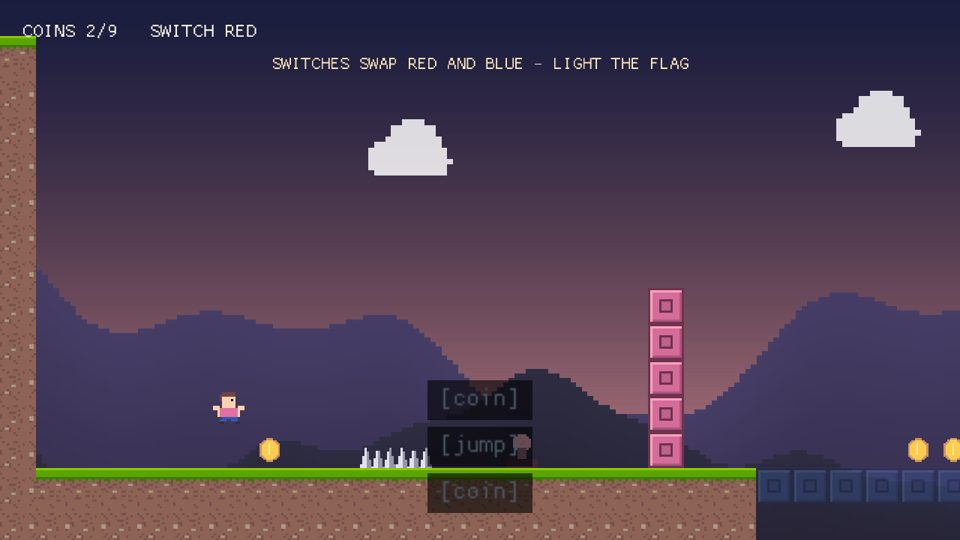
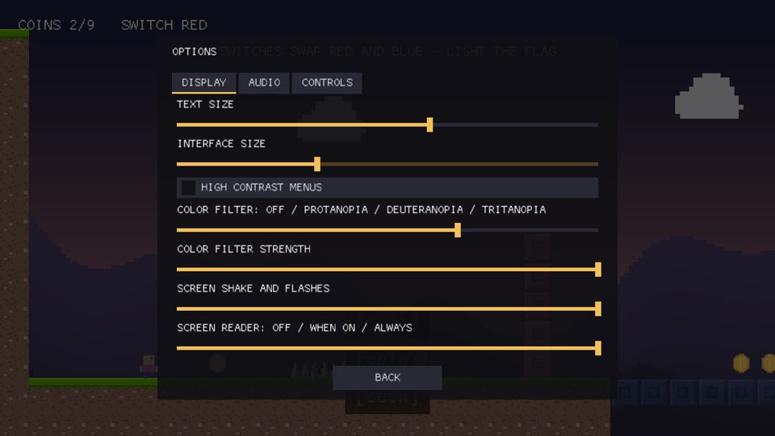
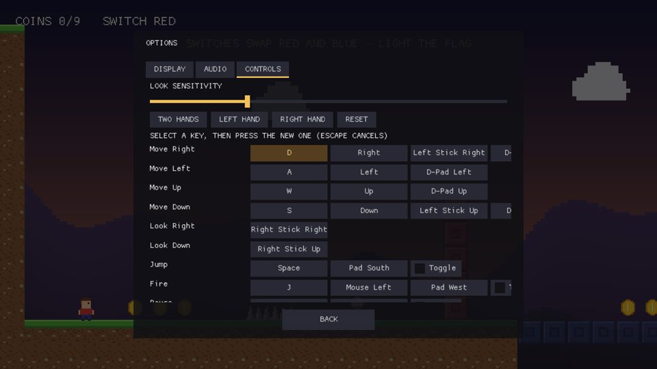
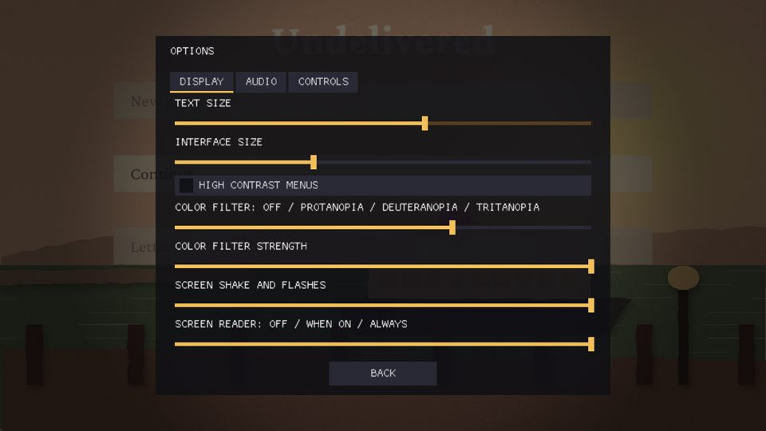

# M-ACCESS — Accessibility (milestone record)

**Status:** done on the desktop (engine gap track, ROADMAP "Engine gap tracks"; Linear SBA-95…99). Open: the
screen reader on a phone and on each desktop OS (step 4, the demo).
**Why:** N15 kept accessibility beyond rebinding out of v1.0; MCE now ships an SDK, store builds and agent-made
games, and stores and players expect these options.
**Measured on:** the Linux CI container (Mesa llvmpipe GL 4.5 and lavapipe Vulkan, Xvfb).

Step order: step 1 (subtitles, SBA-95) waited on M-CINEMA's timeline (SBA-76), so steps 2 and 3 went first.

## Step 1 — Subtitles and captions (SBA-95)

| Item | Where | Evidence |
|---|---|---|
| Caption lines in the sim: `ShowCaption` events, `SoundCaption` tags on an `SfxTrigger` (each play) or an `AudioSource` (a loop while it plays), at most 8 lines, kept in the `Captions` resource; `kit::caption_lines` adds the playing timelines' subtitle lines | `mce/kit/captions.h`, installed by `kit::install_stock` | `test_kit` "ShowCaption lines show for their seconds ...", "a SoundCaption captions its SfxTrigger's plays and its looping AudioSource", "captions leave the state hash alone"; `test_kit` timeline "every track kind plays against the tick" reads Mira's line through `caption_lines` |
| The subtitle view: a box per line centred at the bottom of the safe area, the speaker's name in its own color, sounds bracketed, wrapping at 80 % of the width, the newest three | `ui::SubtitleView`, `ui::subtitle_style()` (`mce/ui/subtitles.h`) | `test_ui` "subtitles show speech by default, sounds when captions are on ...", "subtitle size, background and safe area", "subtitle_style reads the access convars" |
| The player draws it under the scene's UI screens | `PlayerApp::update_subtitles`, `record_overlay` | — |
| The NPC dialogue box follows the subtitle settings | `novel::DialogueBox::update`: the name tag follows `access.subtitle_speaker`, the box opacity scales with `access.subtitle_background` (outlined text below 0.5) | defaults leave the box as styled (the novel goldens hold) |
| Options | `access.subtitles`, `access.captions`, `access.subtitle_speaker`, `access.subtitle_size`, `access.subtitle_background` (Saved), on the template's options screen (Audio tab) | user guide 10.7 |

Limits: the full-screen novel stage (`novel::install`) draws its own text box and does not read the subtitle
settings yet; the dialogue box keeps its text size (its rows are the rectangles the sim hit-tests). Sound
captions come from tags, not from the clip asset: an `.sfx` has no caption field.


## Step 2 — Visual options (SBA-96)

Every option is a `Saved` console variable read each frame by the extractors and the player; none is written into a
component, so players with different settings share the state hash (`test_kit` "reduced motion scales the view's
shake, never the camera's state").

| Convar | Range | Effect |
|---|---|---|
| `access.colorblind` | 0 none, 1 protanopia, 2 deuteranopia, 3 tritanopia | color-vision correction, last in the 2D post pass and in the 3D tonemap pass (after the LUT grade, before FXAA's luma) |
| `access.colorblind_strength` | 0..1 | how much of the correction to apply |
| `access.text_scale` | 0.5..3 | UI text size on top of `ui_scale`; widgets sized by their text grow with it |
| `access.high_contrast` | bool | every UI document (images aside) drawn with `ui::high_contrast_theme()`'s colors; bare labels get a black outline |
| `access.motion_scale` | 0..1 | camera shake (`CameraShake2D`, `render::ScreenShake` via `scale_shake`), the 2D chromatic aberration, 3D motion blur and the platformer sample's flash; 0 turns them off |

| Item | Where | Evidence |
|---|---|---|
| Daltonization over the Machado 2009 severity-1 simulation, CPU reference | `render/accessibility.h`, `accessibility.cpp` | `test_render` "color-vision correction keeps greys and moves the colors a viewer confuses" |
| The same math in GLSL, shared by both passes | `render/src/shaders_cvd.h`; `kPostFS` (`PostU.enable.w`, `grade.y`), `kTonemapFS` (`u_cluster.z/w`) | `test_render_gl` "FR-R2D-100: 2D post ..." and "M-ACCESS: the tonemap pass applies the color-vision correction after the grade", on GL and SDL_GPU (lavapipe), within 3–4 levels of the CPU reference |
| Settings folded into the post chains | `apply_accessibility(Post2D&)`, `apply_accessibility(PostFx&)`, called by `SpriteExtract::post_2d` and `Kit3DExtract` | `test_render` "the access.* convars, clamped, and the post chains they change" |
| Text scale and high contrast in `mce_ui` | `UpdateContext::text_scale` / `high_contrast`, `Document::measure` / `submit`, `ui::high_contrast_theme()`, `ui::high_contrast_style()`; set by the player for every document and by the editor's UI Document preview | `test_ui` "text scale grows the text ...", "the high-contrast theme keeps text at 7:1 or more ..." |

Limits: the correction filters the game frame, not the UI drawn over it (the UI has the high-contrast theme), and
on a 3D frame the 2D sprites drawn over it are not corrected. Games that write shake or flashes into their own
components scale them by reading `render::accessibility_settings()` in their render code; the engine scales only
the effects it owns. Undertow (`CameraRig`, `ScreenFlash`, written in its simulation) does not yet.

## Step 3 — Options and remap screen (SBA-97)

| Item | Where | Evidence |
|---|---|---|
| Action labels in the cooked input map (chunk v2: one length-prefixed name per action; v1 still read; id-only maps keep v1 bytes) | `InputMapSet::labels` / `label()`, `InputMapBuilder::action(StringView)`, the `.mcinput` cook (importer v2) | `test_input` "the cooked map keeps action labels (v2) and still reads v1 chunks" |
| Binding names for the UI ("W", "Mouse Right", "Pad South", "Left Stick Up") | `mce/input/binding_names.h` | `test_input` "binding names read the way a player says them" |
| Look sensitivity, hold-to-toggle, one-hand keyboard presets, a bindings generation | `InputSystem::set_look_sensitivity`, `set_toggle`, `apply_hand_preset(Hand)`, `bindings_generation` | `test_input` "look sensitivity scales Look only ...", "one-hand presets move the keyboard to one side ..." |
| The remap list: rows per action (per direction for axis actions), capture on confirm, Toggle switches, preset and reset buttons | `ui::OptionsPanel` (widgets found by name: `remap_list`, `preset_*`, `reset_bindings`), driven by the player's `UiScreens` | `test_ui` "the options panel lists the remappable actions and rebinds by capture", "the Toggle switch sets hold-to-toggle ..." |
| Saved convars persist | `console::load_settings` / `save_settings` (SBA-60's settings.cfg) plus `console::saved_generation` so a change is written when it settles | `test_core` "a Saved convar change moves the settings generation", "saved convars round-trip through the settings file" |
| Settings and bindings files | the player: `settings.cfg` and `<app>.bindings` in the save folder, loaded after the input map, written once a change settles for 30 frames and on quit; `-settings 0`, and capture runs skip them | user guide 11.4 |
| The stock screen | `templates/project/assets/ui/options.mcui` (Display, Audio and Controls tabs), on the template's main scene behind `UiFlow` show_on Pause / hide_on Back | the template probe cooks it |

Limits: the one-hand presets move keyboard bindings only (mouse, gamepad and touch stay); the gamepad is
rebound per binding. Look sensitivity applies to the action named `Look`.

## Step 4 — Screen reader bridge (SBA-98)

| Item | Where | Evidence |
|---|---|---|
| The UI tree for readers: roles (button, switch, slider, tab, list, text field, text, image; panels and stacks are groups), names (own text, else the label just before; all-caps read in sentence case), values ("40%" on a 0..1 slider, the number otherwise, on/off, a tab's "selected"), rects, focus and enabled; hidden subtrees left out | `ui::build_access_tree`, `ui::access_node`, `ui::access_line` (`mce/ui/access.h`) | `test_ui` "the access tree gives each widget a role, a name and a value" |
| Focus announcements: a focus move speaks the item, a focused value change speaks the value, a new document speaks its focus | `ui::AccessAnnouncer` | `test_ui` "the announcer speaks focus moves, then a focused value's changes" |
| The platform bridge: `announce`, `running`, a sink for tests and logs | `platform::screen_reader` (`mce/platform/screen_reader.h`) | `test_platform` "screen reader announcements reach the sink ..." |
| Android TalkBack: `MceActivity.mceScreenReaderOn` (touch exploration on) and `mceAnnounce` (`View.announceForAccessibility` on the UI thread), stamped by `android_app.py`, looked up over JNI | `cmake/mobile/android_app.py` `ACCESS_METHODS`, `screen_reader.cpp` | `android_bridges` checks the stamped methods and the JNI names and signatures |
| iOS VoiceOver (`UIAccessibility.post(.announcement)`, `isVoiceOverRunning`), macOS VoiceOver (`NSAccessibilityAnnouncementRequestedNotification`, `isVoiceOverEnabled`), Windows (a minimal UI Automation provider hosted by the game's HWND, `UiaRaiseNotificationEvent`; `SPI_GETSCREENREADER`) | `screen_reader_uikit.swift`, `screen_reader_apple.mm`, `screen_reader_win32.cpp`, behind `MCE_SCREEN_READER_NATIVE` (OFF) | not compiled or run here: they need the Mac, a phone and a Windows machine |
| The player speaks the focus of the topmost modal screen (or the open console) | `access.screen_reader` (0 never, 1 while a reader is on, 2 always) read by `platform::screen_reader::wanted()`, which asks the OS at most once a second; `PlayerApp::speak_focus`, `UiScreens::focus_document` | user guide 12.5 |

Device verification is open: TalkBack on an Android device or emulator, VoiceOver on iOS and macOS, and
Narrator or NVDA on Windows, each with `MCE_SCREEN_READER_NATIVE=ON` where it applies. Until then the iOS, macOS
and Windows bridges stay off by default (the StoreKit precedent). Limits: announcements only, no explorable tree
(touch exploration, a reader's own list of the screen's items); the HUD is not read (it never takes focus);
the editor's play-in-editor does not announce.

## Step 5 — `project_check` rules, the guide, the novel stage (SBA-99)

| Item | Where | Evidence |
|---|---|---|
| `.mcui` text: a `text_size` under 16 px at UI scale 1, and text below 4.5:1 against the nearest opaque panel behind it (colors as authored; a themed document's unstated colors are not judged) | `UiTextCheck` in `tools_check.cpp`, the `accessibility` section | `test_mcp_check` "M-ACCESS gate: project_check flags a seeded UI contrast failure, small UI text, a timeline with no subtitles and uncaptioned sounds" |
| Subtitle coverage: a `.mctimeline` with an audio track and no subtitle track (warning); a scene `SfxTrigger`, or an `AudioSource` off the Music bus, with no `SoundCaption` (info) | same | same test |
| The novel stage speaks: a page once shown (speaker first), the selected row with its place ("Wave back, 1 of 2", "dimmed" when locked), letters and panels, each once | `novel_speak` in `kit_novel/src/stage.cpp`, `NovelState::spoken` (a resource: not hashed) | `test_novel` "screen reader (M-ACCESS): the stage says the title row, each finished page with its speaker, and the choice" |
| One switch for every speaker: `access.screen_reader` moved into `mce_platform` with `screen_reader::wanted()` | `screen_reader.h` / `.cpp` | the player and the stage share it |
| `-access_log <file>`: every announcement to a text file (a desktop with no reader, captures) | `PlayerApp` | the demo below |
| The stock options screen in Kindle and Undelivered (`assets/ui/options.mcui` and an `Options` entity: `UiFlow` Pause / Back, `UiScreen`); Kindle's sounds pushed with a caption (`play(f, clip, "coin")`) | `projects/Kindle`, `projects/Undelivered` | `kindle_level` and `undelivered_run` pass: both runs still hash the same |
| User guide chapter | `docs/user-guide/24-accessibility.md` (README row; 12.5 and 16 updated) | — |

## Demo

Run in this container under the offscreen driver with Mesa's software GL. `samples/03_platformer` (Ember Step) has
its own host with no `mce_ui` menus and no subtitle view; it takes `access.motion_scale` only. The Ember Step half of
the demo therefore runs on Kindle (`projects/Kindle`, UC-D), which is Ember Step's mechanics and art on the stock
player.

The Kindle input file (`-input`, 11.5) for the first shots; the remap shot opens the options the same way, then
`115 Move=0,1`, `130 Confirm`, `145 Move=0,-1`, `160 Move=0,-1`:

```
20-90 Move=1,0
40-44 Jump
100 Pause
```

| Shot | Command (from the project's build folder) | What it shows |
|---|---|---|
|  | `kindle -input kindle.input -access.captions 1 -access.colorblind 2 -access.text_scale 1.5 -capture_ticks 46` | "[coin]" and "[jump]" captions over the level, the deuteranopia correction on the red and blue blocks |
|  | same run, Pause at tick 100 | the Display tab: text size, color filter (deuteranopia), motion, screen reader |
|  | Pause, up to the Controls tab, Confirm, down twice | the remap list: each action's keyboard, mouse and gamepad buttons, Toggle switches, the one-hand presets |
|  | `undelivered -access.text_scale 1.5 -access.colorblind 2 -capture_ticks 120`, input `60 Pause` | the same screen over the novel's title |

The screen reader on the desktop, with `-access.screen_reader 2 -access_log heard.txt` (no reader runs in the
container, so the log stands in for the speech):

- Undelivered's title: `New game, 1 of 2`.
- A bot run (`-novel.autoplay 1 -novel.instant 1`, 3000 ticks): 2,986 lines, among them every page with its speaker
  (`Kaptan Hasan: Nermin's grandchild. You've grown into her nose.`) and 337 choice rows
  (`I didn't forget. I was at university., 1 of 3`).
- Kindle's options screen, Pause then up, Confirm, down, down: `Text size, slider, 1.25`, `Controls, tab`, `selected`,
  `Left hand, button`, `Move Right, D, button`.

`project_check` on the two projects after the change: no `.mcui` finding (the stock options screen passes). The
existing scene rule warns about Kindle's HUD banner (4.2:1) and Undelivered's letter lines and HUD. The letter lines
sit on a light card sprite the check does not pair with them, so that warning is a false positive; the guide says so.

Open: VoiceOver and TalkBack reading Undelivered's menus on a phone, and Narrator or VoiceOver on a desktop OS. This
needs the user's Mac and a phone (`MCE_SCREEN_READER_NATIVE=ON` for iOS, macOS and Windows).

Found and fixed during the demo:

- Menu presses were lost when the game drew fewer frames than it ran ticks (software GL here, any slow device): the
  UI screens saw only the newest tick's snapshot, so a Confirm or a tap of the stick on an earlier tick never reached
  them. The player now carries the edges and taps of the ticks no frame saw (`PlayerApp::carry_ui_edges`); the
  remap demo above gives the same log on every run.
- A remap button was read as its key alone ("D, button"). A control in a row led by a label now says the label
  first ("Move Right, D, button"; `test_ui` "a control in a labelled row says the row's label first").
- Slider values were read with two significant digits ("1.2" for 1.25); they now keep three.

Limits found and left: the remap rows clip a fourth binding at the right edge of the Controls page; the options
screen's title shares the top band with Kindle's HUD banner.

## Gates

| Gate | Result |
|---|---|
| Every option is a saved setting and never touches the sim hash | all `access.*` convars are `Saved` (settings.cfg, SBA-97). Hash evidence: `test_kit` "captions leave the state hash alone", "reduced motion scales the view's shake, never the camera's state"; the stage's speech state is in the `NovelState` resource; `kindle_level` and `undelivered_run` hash the same with the options screen added and captions pushed |
| `project_check` flags a seeded contrast failure | `test_mcp_check` M-ACCESS gate: a seeded `.mcui` reads "UI text contrast against the panel behind it is 1.8:1" |
| `local_ci.sh` green on every step | `--task` per step; `--batch` at the end of the milestone |

