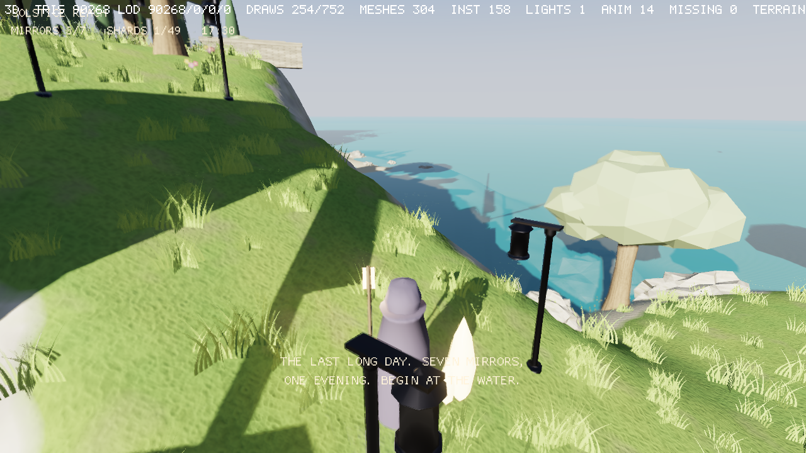

# M-TERRAIN — Heightmap terrain (milestone record)

**Status:** done (steps 1–6 and the demo, 2026-10-15; Metal untested). Plan: ROADMAP §M-TERRAIN; Linear SBA-89 … SBA-94.
**Why:** SolsticeReach's island is a script-generated mesh in 16 chunks; there is no terrain an editor or an
agent can shape. Each step is opt-in: a scene without a `Terrain3D` draws exactly as before.

## Steps

| # | Step | Linear | State |
|---|---|---|---|
| 1 | `Terrain3D` + `.mcterrain`, CDLOD-style LOD, normals, skirts | SBA-89 | done: GL and SDL GPU (gated), tier budgets below; Metal untested |
| 2 | Splat layers (8), triplanar, height blend | SBA-90 | done: GL and SDL GPU (gated), tier knobs below; Metal untested |
| 3 | Jolt height-field collision, holes | SBA-91 | done: collision matches the drawn surface; holes in both |
| 4 | Editor brushes with undo, cook round-trip | SBA-92 | done: eight brushes, stroke undo, the source round-trips |
| 5 | Foliage and grass painting | SBA-93 | done: density per layer, painted with the layer brush |
| 6 | MCP sculpt/paint, import, generator, navmesh bake; demo | SBA-94 | done: four MCP tools, PNG/raw import, fBm + erosion-lite, terrains in the navmesh; SolsticeReach's island is a painted `Terrain3D` |

## Step 1 — terrain asset, LOD and drawing

**Asset.** `CHNK_TERRAIN` (`asset::Terrain`, `TERRAIN_VERSION` 1, `mce/asset/formats.h`): a 96-byte
`TerrainHeader` (resolution 2^n+1 in 33…4097, chunk quads per node 8…256, size in metres, height range)
and `resolution²` u16 samples, z rows of x columns, centred on the entity. `TerrainView::read` validates
the payload; `height_at` is bilinear and clamped. The source is a native JSON `.mcterrain` (importer
`terrain`): `resolution`, `chunk` (default 32), `size`, `height_range`, then either `heights` (base64 of
little-endian u16) or `fill` (a constant height). Bad documents are cook errors naming the file. MCP
`asset_schema` / `asset_create` know the kind (template: 129 samples over 128 m).

**LOD (`mce/render/terrain.h`).** `TerrainLod` builds a quadtree of grid nodes: each node is `chunk × chunk`
quads at stride 2^level, root first. A node's geometric error is the largest height difference between the
full-resolution surface and the node's triangles (same diagonal split as the mesh), raised to at least each
child's. `select()` walks from the root and splits while `error · k > pixel_error · distance`
(`k = proj[1][1] · viewport_h / 2`), culling nodes outside the frustum unless they are within
`shadow_reach` (so shadow casters behind the camera stay). `build_mesh()` writes a node as a cooked mesh
payload: central-difference normals, UVs at `uv_tile` metres per repeat (or once over the terrain), and
skirts on edges inside the terrain, deep enough to cover a neighbour two levels coarser.

**Drawing.** `Terrain3D` (kit3d, 80 bytes, reflected): terrain, material, tint, pixel_error (0: the quality
tier's `terrain_pixel_error`, Low 4 / Medium 2 / High 1), uv_tile, cast_shadows, enabled. `Kit3DExtract`
keeps one LOD tree per terrain, builds and uploads a node's mesh the first time it is selected
(`MeshStore::allocate_key`, keys from 0x80000000), and evicts nodes unused for 300 extracts; the tree is
rebuilt when the asset generation or uv_tile changes. Stats: `terrain_nodes`, `terrain_triangles`,
`terrain_uploads`, `terrain_resident`; the player's stats line shows `TERRAIN nodes/resident`.
`MeshStore::get` became O(1) (a newest-per-key map) since terrains add many keys.

**Budgets (gate).** 513 samples over 512 m with 3 m bumps every 20 m (a worst case), camera 2 m above a corner looking across it, 1280×720, 60 m shadow reach
(`tests/render/test_terrain.cpp`):

| Tier | pixel error | Budget nodes / triangles | Measured |
|---|---|---|---|
| Low | 4 | ≤ 64 / ≤ 150 K | 52 / 118 K |
| Medium | 2 | ≤ 96 / ≤ 220 K | 83 / 189 K |
| High | 1 | ≤ 144 / ≤ 330 K | 124 / 284 K |

**Tests.** `test_cook` (cook, defaults, nine bad documents, payload validation), `test_render` (tree, errors,
selection coverage, culling and shadow reach, transform invariance, mesh and skirt validity, budgets),
`test_kit` (upload, reuse, rebuild, release, const store), `test_render_gl` / `test_render_sdlgpu`
(mixed-level nodes with T-junctions show no crack from a close oblique view; checked sensitive: 55 crack
pixels with skirts removed), and `terrain_player_gl` / `terrain_player_sdlgpu` (a cooked project drawn
by the stock `mce_player`, 0 GL errors, ≥ 10 K triangles).

## Step 2 — splat layers

**Asset.** `TerrainHeader` gained `layer_count`, `splat_resolution` and the offsets of a `TerrainLayer`
table (a `.mcmat` GUID, tile metres, height strength, triplanar flag) and the weights: two RGBA8 planes
(layers 0–3, 4–7) of `splat_resolution²`, the layout a 2-layer texture array uploads as is. The
`.mcterrain` source adds `layers`, `splat_resolution` (default `min(resolution, 1025)`) and `splat`
(u8 weights per layer per sample); without `splat`, each layer's `auto` rule (height and slope bands with
soft edges) paints it at cook, unclaimed ground going to layer 0. Layer materials are cook dependencies.

**Drawing.** `TerrainShading` (scene3d.h) on a `MeshInstance` switches its draws to `kTerrainFS`: the
forward shader with `MCE_TERRAIN`, whose surface comes from `terrain_surface()` instead of the material.
The layers' maps of one kind are layers of one texture array bound in the material slots (albedo 6, normal 7,
ORM 8), the weights in the emissive slot 13, the per-layer parameters in a `TerrainU` block on bank 2.
Layers tile in the terrain's own xz metres; triplanar layers add the x and z projections where the ground
is steep (whiteout-blended normal maps, no tangents); height blend lets the layer whose albedo brightness
rises highest win at a seam. The layer loop uses explicit gradients and skips layers under 1/500 weight.
`Kit3DExtract::set_texture_store` lets the extract pack each kind with `render::compose_layer_array`
(textures must share format, size and mips; a mismatch is left out with a warning) and upload the weights.

**Tiers.** Low blends by weight alone, Medium adds height blend, High adds triplanar
(`QualitySettings::terrain_height_blend`, `terrain_triplanar`).

**Tests.** `test_cook` (layers, weights, auto rules, ten bad documents), `test_render` (array packing,
mismatches), `test_render_gl` / `test_render_sdlgpu` (two layers split by their weights with and without
height blend, a base color multiplying its layer, a checker on a 3 m cliff: 0 light/dark flips down the
wall projected from above, 9 with triplanar), and the stock-player terrain project (grass on flats, rock on
slopes by `auto` rules).

## Step 3 — collision and holes

**Holes.** `TerrainFlags::kHoles` in the header flags and a bit per height sample (`(resolution² + 7) / 8`
bytes at `holes_offset`, the old reserved field); `TerrainView::hole(x, z)`. The `.mcterrain` source takes
`holes` (base64 of the mask, size-checked); an all-zero mask cooks to no holes. The heights under a hole
stay as authored, so a hole can be closed again without losing the ground.

**One surface.** `TerrainView::surface_at` (and `TerrainLod::surface_at`) is the height of the triangles
both the mesh and Jolt use: each quad split along its (x0, z0)–(x1, z1) diagonal, the split Jolt's
`HeightFieldShape` makes. A triangle with a hole corner is dropped by both: Jolt drops it for a
`cNoCollisionValue` corner (`physics::kHeightFieldHole`), `build_mesh()` drops the grid triangle and any skirt
quad on a hole sample. A node holding a hole always splits to level 0, so a hole's outline never coarsens;
`node_triangles()` counts what the cut mesh keeps.

**Physics.** `Shape3D::height_field(heights, samples, origin, spacing)` (`ShapeType3D::HeightField`,
static or kinematic only, like meshes) builds a `JPH::HeightFieldShape` (Jolt quantizes heights to 16 bits
per block). `TerrainCollider3D` (kit3d, 8 bytes: friction, layer) on a `Terrain3D` entity builds one at
Startup, and for terrains spawned later through `kit3d_bodies`; the entity's scale stretches the samples
and its rotation turns the body. Removing the component removes the body.

**Tests.** `test_cook` (a hole mask, an empty mask, a wrong-sized one; `surface_at` against the two
triangles), `test_physics3d` (rays hit a height field's planes and pass through its hole; malformed and
dynamic shapes refused), `test_render` (a holed node selected at level 0 on a flat terrain, its mesh
missing exactly the 48 triangles around a 4 × 4 hole block, no grid corner on a hole), and `test_kit`
(a moved, turned, 1.5× stretched terrain: over 100 rays straight down land within 2 cm of `surface_at`,
the ray through the hole hits nothing, a terrain spawned later gets a body and loses it with the component).

## Step 4 — editor brushes

**Core (`mce/editor/terrain_editor.h`, headless).** `TerrainDocument` loads a terrain from its source
text and its cooked payload, so heights, weights and holes are exactly what the cook made (the `auto`
rules already applied), and keeps every other source key as written. `apply(brush, centre, scale)` runs
one dab: Raise / Lower (metres), Smooth (toward the 3×3 mean), Flatten (toward a target height), Noise
(value noise fixed per position and seed), Paint (raises one layer, scales the others down, every sample
still summing to 255), Hole / Fill. The falloff is flat to `hardness × radius`, then a smoothstep to 0.
Heights clamp to `height_range`. `serialize()` writes explicit `heights`, `splat` once painted and
`holes` when any is set, dropping `fill`.

**Editor.** `TerrainEditor` binds to the selected entity's `Terrain3D`, groups dabs into strokes, saves
and hot-reloads through `EditorSession::write_asset` (mid-stroke via `flush()`, about every 0.2 s from the
viewport, and at the end), and keeps whole-terrain snapshots for stroke undo and redo (64 MB cap).
`raycast()` marches the bilinear surface under the entity's transform; `pixel_ray()` (orbit_camera.h)
gives the viewport's ray. The Terrain panel picks the brush; the orbit view's sculpt tool draws the
brush rim draped on the ground and applies dabs scaled by the frame time (Ctrl inverts, Alt orbits).

**Tests.** `test_editor`: each op on a document (falloff, clamping, smoothing a spike, flatten, noise
determinism, paint sums, hole and fill counts, a brush off the terrain), and a project round trip:
a terrain with an `auto` rule bound under a moved, stretched entity; rays straight down and slanted
land on the surface; a raise stroke (with a mid-stroke flush), a paint stroke and a hole stroke each
re-bake the live mount; the saved source keeps its name and layers and drops `fill`; a fresh bind
reads back the same document; three undos restore the original and three redos the edits; the project
cooks clean. `pixel_ray` is checked against `project_segment` at four pixels.

## Step 5 — foliage on the terrain

**Placement.** `render::scatter_on_terrain` lays a jittered grid over the terrain with cells of
`1/sqrt(density)` metres (coarsened when the grid would exceed four times `max_count` cells). Each
cell draws its own random numbers from a hash of the seed and the cell, so repainting one spot leaves
every other copy where it was. A candidate survives with probability equal to the bilinear weight of
its splat layer (a terrain with no layers counts as all layer 0, and layer 8 means everywhere), is
dropped in hole quads and where the slope from `surface_at` differences is steeper than
`max_slope_deg`, then stands on `surface_at` with a random yaw and a uniform scale, under the
terrain's transform.

**Component.** `TerrainFoliage3D` (128 bytes): `mesh`, `material`, `tint`, `layer`, `density`,
`max_count`, `seed`, `scale_min`/`scale_max`, `max_slope_deg`, wind amplitude, frequency and
direction, `cull_distance`, `cast_shadows`, `random_yaw`, `enabled`. It uses the `Terrain3D` on its
own entity or its `ChildOf` parent. The kit extract caches the instance list keyed on the pose, the
terrain asset and its generation (so a re-bake from the brushes re-scatters) and the scatter inputs;
batches are drawn as instanced foliage with ids tagged `0x80000000` so they never clash with
`Foliage3D`.

**Tests.** Render: counts within 6 % of density × painted area, a quarter of the copies in the
half-weight strip, none on unpainted ground or in holes, every copy on `surface_at`, the same seed
gives the same copies, a transformed terrain moves them, the slope limit clears a steep ramp, zero
density gives none. Kit: a child entity scatters 32×32 copies at the fill height, moving the terrain
re-scatters, disabling drops the batch.

## Step 6 — MCP tools, import, generator, navmesh; the demo

**MCP.** `terrain_sculpt` (raise, lower, smooth, flatten, noise) and `terrain_paint` (a layer, holes, filling
them) run the Terrain panel's brushes (`editor::TerrainDocument`) at `[x, z]` points or along them as a
stroke, `terrain_import` reads a heightmap, `terrain_generate` grows a landscape (`mcp/src/tools_terrain.cpp`).
Each reads the `.mcterrain`, cooks it in memory for the data the brushes edit, applies the change and writes
it back through the asset tools' cook-checked write. Sculpt returns the height under each point, so an agent
measures as it shapes (strength 0 only measures); paint returns each layer's share and the hole count.

**Import.** `TerrainDocument::import_heightmap`: a PNG (8- or 16-bit grey through `cook::decode_png_grey16`;
colour gives luminance) or raw 8/16-bit samples (square, or `raw_width`), resampled bilinearly to the
resolution, the image's top row along -z, black and white mapped to `range` (default `height_range`).

**Generator.** `TerrainDocument::generate`: fBm value noise (feature size, octaves, lacunarity, gain, a
ridged blend) normalized into `[low, high]` of the height range, an island falloff, then erosion-lite:
thermal passes move half the excess over the talus step down to steeper neighbours (mass kept), and rain
droplets with inertia pick up silt where they speed up and leave it where they slow, climb or stop (mass
kept to 2 %). The same seed gives the same terrain. A terrain whose layers follow `auto` rules re-applies
them to the new shape.

**Navmesh.** `gather_nav_geometry` adds each `TerrainCollider3D` terrain in the surface's layer mask: the
collider's triangles (each quad split on its (x0, z0)-(x1, z1) diagonal, holes left out) under the entity's
transform.

**Demo.** SolsticeReach's island is one `Terrain3D` (`tools/gen_terrain.py`): 257 samples over the 200 m the
16 mesh chunks covered, the heights from `tools/island.py` (the formula `module/terrain.h` builds the
collider from), painted sand, grass, dry grass and rock with the rules the chunks used, rock triplanar, four
`.mcmat` layers over the project's textures. Its grass is a `TerrainFoliage3D` child on the grass layer
(0.8 per m², replacing four grass `Scatter` boxes). `tools/author_island_mcp.py` re-authored the scene
through `solstice_reach_mcp` (419 entities, cook clean, 300 headless ticks with no warnings); the 16 chunk
meshes are gone. The agent's valley is the MCP test below: generate an island, flatten a valley floor
along a stroke, raise a hill, paint the valley, cut and fill a hole, import a heightmap, cook.

**Tests.** Editor: PNG and raw import (orientation, ranges, clamping, bad files), the generator's range,
seed determinism, island edges, thermal flattening with mass kept, droplets moving a quarter of the samples
with mass kept. MCP: the session above, every refusal leaving the file unchanged. Kit: a navmesh baked from a
holed terrain under a moved entity covers the ground, finds nothing in the hole and paths around it.
SolsticeReach: the drawn terrain samples the collider's field to 2 mm, the grass is the island's child on
layer 1; the bot's run, determinism and the GPU walk pass.

## Gates

- Draws inside the tier budgets (step 1), collision matches the drawn surface within 2 cm (step 3).
- Edits are undoable in the editor and round-trip through the cook (step 4); MCP edits are cook-checked.
- `local_ci.sh` green on every step.
- Metal and real-GPU budgets wait on the Mac session, as for M-VISUAL.
