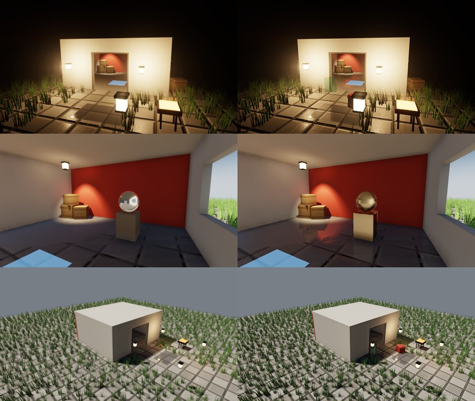

# M-VISUAL2 — Rendering gaps left after M-VISUAL (milestone record)

**Status:** done in the cloud (steps 1–5 and the demo, 2026-10-16); real-GPU budgets and Metal pixels wait on the Mac/device session. Plan: ROADMAP §M-VISUAL2; Linear SBA-101 … SBA-105.
**Why:** the engine comparison (`assessments/motor-kiyaslama-eksikler.md`, item 10) lists what the 3D frame
still lacks next to Godot, Unity and Unreal after M-VISUAL. Every step is opt-in, keeps GL as the reference
backend with SDL GPU gated alongside, and leaves today's frame unchanged when off. Real-GPU and mobile budgets
and Metal pixels wait on the Mac/device session, as for M-VISUAL.

## Steps

| # | Step | Linear | State |
|---|---|---|---|
| 1 | Screen-space reflections | SBA-101 | done: GL and SDL GPU (gated + goldens), Low tier drops it; Metal untested |
| 2 | Spatial upscaler and contrast-adaptive sharpening | SBA-102 | done: GL and SDL GPU (gated + golden), saved player convars; Metal untested |
| 3 | Contact shadows | SBA-103 | done for the sun: GL and SDL GPU (gated + golden), Low tier drops it; local lights keep their shadow maps (see below); Metal untested |
| 4 | Material extensions: clear coat, sheen, anisotropy, transmission | SBA-104 | done: `.mcmat` keys and glTF KHR factors, GL and SDL GPU (gated + goldens); textures of the extensions not imported; Metal untested |
| 5 | Kit/MCP reach, `samples/06_showcase`, docs and goldens | SBA-105 | done: every knob on `Environment3D` / `.mcmat` and over MCP; the showcase's on/off sheet below |

## Step 1 — screen-space reflections

**What.** `ScreenSpaceReflections` on `Scene3D` (`set_reflections`), `Environment3D.ssr` and its knobs in the
3D kit, `Forward3DDesc::ssr` and `-r.ssr 0` as off switches, `QualitySettings::ssr` (off on Low). M-VISUAL step
8 had left SSR out as optional.

**How.** SSR reuses the half-resolution view normal + depth prepass SSAO already draws (`record_prepass`: it
runs once a frame when either effect is on, so a scene with both draws its opaques into it once). A
full-screen pass (`kSsrFS`, `mce.3d.ssr`, RGBA16F at half size) marches each pixel's mirror ray in screen space,
with uv and 1/z interpolated so the steps are perspective-correct, jittered per pixel by a 4×4 Bayer pattern.
A sample is a hit when it lies behind the depth buffer by less than `thickness` plus the step's own depth
travel, at a surface facing the ray; four bisections refine it. Requiring a facing surface keeps a ray from
stopping on its own start: on a grazing floor the half-size depth texels around the origin are in front of
the ray, and without the test half the floor's rays ended there (a checkerboard of misses in the first
build). The hit's view position is reprojected with last frame's jittered view-projection and last
frame's resolved HDR color is read there. Forward3D keeps that matrix and a valid flag; a resize, a new
Forward3D or the first frame reflect nothing, so SSR shows from the second frame. The confidence (alpha) fades
toward the screen's edges, the ray's end and rays turning toward the camera, and is 0 for misses and the sky.

The main pass (`kMeshFS`, sampler slot `bank::kSsr` = 3, the last free fragment slot of 16) reads the trace
at its screen position and blends it over the specular ambient (sky, IBL, probes) by
`confidence × clamp((max_roughness − roughness) / roughness_fade)`, through the same split-sum BRDF. Captures
(probes, the GI volume) bind a stand-in and never read it. A material at or above `max_roughness`, a miss, or
SSR off draws exactly the pixels it drew before.

**Gates.** `render3d_gl` (GL and `MCE_RHI=sdlgpu` on lavapipe): the probe room's mirror floor shows the red
wall from the second frame, the first SSR frame and the frame with it off are byte-identical, a roughness-0.8
floor is byte-identical with SSR on, and SSAO + SSR share one prepass. Goldens `ssr_room` on `linux-gl` and
`linux-sdlgpu`; every earlier golden is unchanged. `kit3d`: the Environment3D fields reach the scene and the
Low tier drops SSR.

**Known limits.** Moving objects reflect where they were last frame (reprojection uses the camera only); the
prepass has no normal maps, so the ray follows the geometric normal while the blend uses the mapped
roughness; rough reflections fade to the probes rather than blur. Budget on llvmpipe is not meaningful; the
real-GPU number joins the Mac/device session.

## Step 2 — spatial upsample and sharpening

**What.** `PostFx::upscaler` (`Upscaler::Bilinear`, today's path, or `Spatial`) and `PostFx::sharpen` (0..1);
`Environment3D.upscaler` (1 = spatial, the kit's default) and `Environment3D.sharpen`; the saved player
convars `r.upscaler` (`scene`, `bilinear`, `spatial`) and `r.sharpen` (-1 = the scene's). The temporal
upscaler stays `PostFx::taa` with `render_scale < 1` (M-VISUAL 5); with TAA on, the spatial upsample has
nothing to do and only the sharpen runs.

**How.** Both run on the display-space frame after the tonemap and FXAA, which then stay at the frame's own
size in `fin_src_` (RGBA8) instead of writing the output. The upsample (`kUpscaleFS`) reads the 4×4 source
texels around each output pixel and weights them with the polynomial Lanczos-2 approximation over offsets
rotated into the local edge's frame (the luma gradient of the four nearest texels, bilinearly weighted),
squeezed across the edge and stretched along it by how clean the edge is, then clamps to the four nearest
texels so the negative lobes cannot ring. The sharpen (`kSharpenFS`) is AMD CAS's filter: the pixel minus a
share of its four neighbors, largest where the local contrast is low, falling to none where it would clip.
With both on, the upsample writes `fin_up_` at the output size and the sharpen reads it. Both count in the
post stage's timing.

**Gates.** `render3d_gl` (GL and SDL GPU): a Bilinear frame and a Spatial frame at full size are
byte-identical to today's; at half scale the spatial frame's mean difference to the full-resolution 4× MSAA
frame is 0.83 against bilinear's 1.03 (llvmpipe and lavapipe alike); sharpen 0.8 raises the full-size frame's
edge energy by 47 % at a mean difference of 0.3 levels; `r.upscaler` and `r.sharpen` override the scene's
choice both ways. Golden `spatial_sharpen` on both backends; every earlier golden is unchanged.

## Step 3 — contact shadows

**What.** `ContactShadows` on `Scene3D` (`set_contact_shadows`: `enabled`, `length` 0.35 m, `thickness`
0.1 m, `steps` 12, `intensity` 1) and the sun's own switch `DirectionalLight::contact_shadows` (on);
`Environment3D.contact_shadows` with `contact_length`, `contact_thickness` and `contact_intensity`;
`r.contact_shadows 0` drops the pass for every scene; the Low quality tier drops it.

**How.** A half-size full-screen pass (`kContactFS`) after SSR reads the shared normal + depth prepass (the
prepass now runs when SSAO, SSR or contact shadows want it). Each pixel facing the sun marches `length`
meters toward it from a texel off its surface, jittered by a 4×4 Bayer pattern; a sample that passes behind
the depth buffer by more than half a texel's footprint and less than `thickness` plus a texel's occludes,
faded toward the screen's edges and the ray's far end. The result goes to `ao_b_` (free once the SSAO blur
is done): r copies the SSAO visibility (1 without SSAO), g holds the sun's. The main pass binds it in the
SSAO's slot (`PassU::ao.y` flags it), so no sampler slot was needed, and multiplies the sun's shadow term
by g. It has its own GPU timestamp stage (`Forward3DGpuTimes::contact`).

**Not done: local lights.** The plan named shadowed point and spot lights too. Every fragment sampler slot
is taken, so per-light contact rays would need a depth read in the clustered light loop (a full-resolution
depth copy in place of a slot, or packing two inputs into one). That waits for a slot freed by step 4's
material work or a bindless path; local lights keep their atlas shadows meanwhile.

**Gates.** `render3d_gl` (GL and SDL GPU): with the cascades off, a low sun's contact shadow darkens the
ground at the box's foot while ground past the ray's reach, open ground and the box's top stay within 2
levels; off, or a sun with `contact_shadows` false, is byte-identical to the frame without it; with SSAO on
the target's r is byte-identical to the SSAO's own visibility and one prepass serves both;
`r.contact_shadows 0` creates no pipeline. Golden `contact_foot` on both backends; every earlier golden is
unchanged.

## Step 4 — material extensions

**What.** `asset::MaterialExt` (64 bytes): `clearcoat`, `clearcoat_roughness`, `sheen_color`,
`sheen_roughness`, `anisotropy`, `anisotropy_rotation`, `transmission`, `ior`. A `.mcmat` with any of them
set appends it after its `MaterialChunk` (minor `MATERIAL_MINOR_EXT`); a mesh whose glTF materials use
`KHR_materials_clearcoat`, `_sheen`, `_anisotropy`, `_transmission` or `_ior` carries a per-submesh table
(`MeshFlags::Materials`, minor `MESH_MINOR_MATERIALS`; `MeshSubmesh::reserved2[0]` points at the submesh's
entry). Only the factors are imported; the extensions' textures are warned about. Old payloads read as all
zero, and an all-zero material draws byte-identically to today's.

**How.** `ObjectU` gains `coat`, `sheen` and `ext`. With any lobe on, `shade()` takes `direct_ext`:
anisotropic GGX (Filament's stretched roughness, the tangent frame from screen derivatives rotated by
`anisotropy_rotation`), a Charlie sheen with the Neubelt visibility, and a clear coat on the geometric
normal (GGX, F0 0.04) whose Fresnel takes its share from the base. The ambient bends anisotropic
reflections toward the stretch (Filament's bent normal), adds the sheen under the irradiance with an
approximate albedo, and mirrors the sky in the coat. `ior` sets the dielectric F0.

Transmission: draws with `transmission > 0` sort after the opaques with the blended ones. When a frame has
one, the main pass ends after the sky, the opaque frame is copied (an MSAA resolve, or `kFrameCopyFS` on a
single-sample target) to `trans_src_`, and the pass resumes with its color and depth loaded. Each
transmissive draw binds the copy in the SSAO slot (`o_ext.w` tells the shader, which then skips SSAO and
contact shadows for it), replaces its diffuse by the copy seen through it, shifted by the view normal and
`1 − 1/ior` and tinted by the base color, weighted by `1 − F`. `Forward3DStats::transmissive` counts them.

**Not done.** Extension textures; sheen energy compensation; the coat ignores the probes and SSR;
transmission is thin-walled (no volume, thickness or attenuation), does not blur with roughness, sees
neither other transmissive draws nor particles, casts an opaque shadow, and does not refract inside
instanced batches.

**Gates.** `test_cook_project` (the `.mcmat` keys, ranges, a plain material reads zero) and `test_cook_gltf`
(the KHR factors reach the submesh, the texture warning, a plain mesh has no table). `render3d_gl` (GL and
SDL GPU): an all-zero table draws byte-identically to no table; clear coat and sheen each brighten the box
under a white sky, anisotropy changes a metal box; ior 2.4 brightens a dielectric; a transmissive box shows
the ground behind it with 4× MSAA and without, open ground unchanged, `transmissive` counts it. Goldens
`material_lobes` and `material_glass` on both backends; every earlier golden is unchanged.

## Step 5 — reach and the demo

**Reach.** Every knob of steps 1–4 is data:

| effect | kit (`Environment3D` unless noted) | MCP | player convar |
|---|---|---|---|
| screen-space reflections | `ssr`, `ssr_max_distance`, `ssr_thickness`, `ssr_max_roughness`, `ssr_roughness_fade`, `ssr_intensity`, `ssr_steps`, `ssr_edge_fade` | `component_set` on the resource | `r.ssr` |
| spatial upsample, sharpening | `upscaler`, `sharpen` | `component_set` | `r.upscaler`, `r.sharpen` (saved) |
| contact shadows | `contact_shadows`, `contact_length`, `contact_thickness`, `contact_intensity`, `contact_steps` | `component_set` | `r.contact_shadows` |
| material extensions | `.mcmat` `clearcoat`, `clearcoat_roughness`, `sheen_color`, `sheen_roughness`, `anisotropy`, `anisotropy_rotation`, `transmission`, `ior` (a `MeshRef`'s `material`); glTF `KHR_materials_*` factors | `asset_schema` lists the keys; `asset_create` / `asset_write` | — |

This step added `ssr_steps`, `ssr_edge_fade` and `contact_steps` (the only render knobs the kit did not reach)
and the eight material keys to the MCP Material schema.

**Demo.** `samples/06_showcase` turns the effects on in its Low, Medium and High profiles. Reflections reach
12 m and show in the polished floor and the puddle. Contact shadows are on, and the final frame is
sharpened at 0.3. A green glass slab stands beside the path, a lacquered crate sits on its edge, and the
statue is brushed metal. The Low tier drops SSR and contact shadows. The new profile `highbase` is High
without any of them. `06_showcase -sheet sheet.ppm -sheet.profiles highbase,high` renders the on/off sheet
below (rows: dusk, interior, noon; columns: highbase, high):

**Changes from the first column.** Inside, the floor mirrors the red wall and the crates (SSR). The crates
and the statue sit in their contact shadows. The statue's highlights stretch along its brushed metal. At
dusk, the glass slab shows the pavilion wall behind it tinted green, and the lacquered crate carries a sharp sky
reflection over its matte red.

**Budget (480×270 cells, 24 frames per shot, means over the settled half, debug build, Mesa llvmpipe;
relative only):**

| stage (ms) | highbase | high |
|---|---|---|
| SSR | 0 | 1.8 |
| contact shadows | 0 | 1.8 |
| main pass | 163.4 | 159.4 |
| last pass (FXAA slot: the sharpen) | 0 | 1.9 |
| 3D frame total | 501.0 | 423.4 |

On llvmpipe the run-to-run noise of the big stages (shadows, SSAO, GI, TAA) is larger than everything
M-VISUAL2 adds: SSR and contact shadows cost about 2 ms each at this size, and the sharpen about 2 ms. The
transmissive draw's frame copy is part of the main pass. The real-GPU budget is the Mac/device session's
to measure with the same run (`-sheet.w 1920 -sheet.h 1080`).

**Gates.** The goldens and pixel tests of steps 1–4 on GL and SDL GPU. `test_kit3d` checks that the new kit
knobs reach the scene. `test_mcp_content` checks that the Material schema lists the extension keys.
`sample_06_showcase_gpu` runs 60 frames of the High profile with no GL errors. The headless hash run
(`sample_06_showcase_300`) prints a new hash, because the High scene gained the new props. No test pins
that hash.

